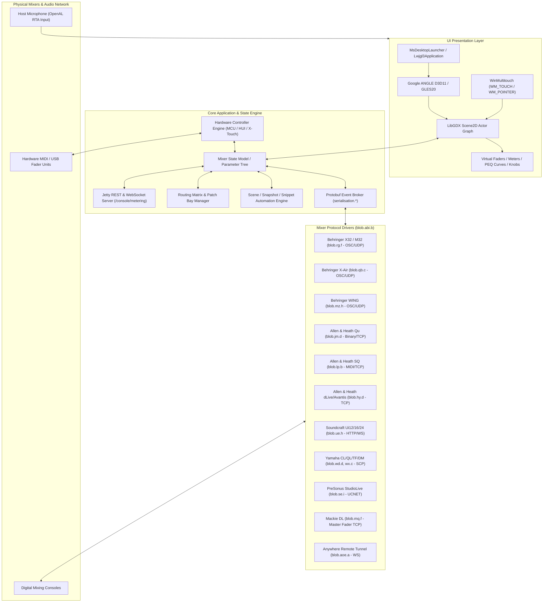

# REA Phase 3 — Application Architecture Mapping
**Target:** Mixing Station PC Windows 3.2.2 Build 789  
**Analysis Date:** 2026-11-09  
**Status:** VERIFIED  

---

## 1. System Architecture Overview

Mixing Station is architected as an **abstracted universal mixer control platform** with hardware-decoupled control surfaces, multi-threaded protocol adapters, low-latency multi-touch input, and remote IPC/API endpoints.

---

## 2. Classification of Subsystems (Phase 3.4)

### 2.1 UI Framework
- **Primary Framework:** LibGDX Scene2D 2D game engine adapted for vector UI rendering.
- **Rendering Pipeline:** LWJGL 3 (`org.lwjgl.opengl`, `org.lwjgl.opengles`) rendering through Google ANGLE (`libEGL.dll`, `libGLESv2.dll`) to DirectX 11 on Windows.
- **Font Rasterization:** FreeType native vector font engine (`gdx-freetype64.dll`).
- **UI Architecture:** Retained-mode scene graph (`com.badlogic.gdx.scenes.scene2d.Stage`, `Actor`, `Table`, `Widget`).
- **Evidence:** `com.badlogic.gdx.backends.lwjgl3.angle.ANGLELoader`, `org.devcore.mixingstation.gdx.desktop.MsDesktopLauncher`.
- **Confidence:** VERIFIED.

### 2.2 Main Application Lifecycle
- **Initialization:** `MsDesktopLauncher.main()` verifies x86-64 CPU, sets DPI scale via `org.devcore.mixingstation.gdx.desktop.g`, parses CLI switches, instantiates `org.devcore.mixingstation.gdx.desktop.c`, and launches LibGDX `Lwjgl3Application`.
- **Termination:** `Exit Mixing Station?` prompt handler in `c.class`, disposes JNI native handles (`WinMultitouch.dispose()`), shuts down Jetty server, flushes settings.
- **Confidence:** VERIFIED.

### 2.3 Mixer Connection Management
- **Central Abstraction:** `blob.abi.b` (Abstract Console Client).
- **Watchdog & Heartbeat:** Periodically emits ping/refresh packets (e.g. `/xremote` every 9 seconds on X32; `metertype:unicast` on Yamaha DM; HTTP keepalive on Soundcraft Ui).
- **Auto-Reconnect:** Detects socket drop, emits `"Connection lost"`, `"Heartbeat timed out"`, and engages exponential retry loop.
- **Confidence:** VERIFIED.

### 2.4 Network Protocols
- **UDP Broadcast / Multicast Discovery:**
  - Behringer OSC discovery on UDP 10023 / 10024.
  - Yamaha SCP multicast discovery on `239.192.0.164:53450` (`_ypax-tf`, `_ypax-dm`).
  - PreSonus broadcast discovery on UDP 2889.
- **TCP Stream Protocols:**
  - Yamaha SCP control stream (`scpmode encoding utf8`, `scpmode keepalive 10000`).
  - Allen & Heath Qu/SQ/dLive TCP protocol.
  - PreSonus StudioLive TCP UCNET protocol.
- **HTTP & WebSocket:**
  - Soundcraft Ui12/16/24R connects over port 80/443 with JSON/text WebSocket frames.
  - Mixing Station Remote Mix ("Anywhere") connects via OAuth2 (`/oauth2/token`) and secure WebSocket tunnels.
- **Confidence:** VERIFIED.

### 2.5 Bluetooth Communication
- **Architecture:** BLE discovery and communication strings exist in `blob.afy`, `blob.agb`, `blob.acq` for Bluetooth MIDI and wireless stage controller units.
- **Host Stack:** Operates through standard OS Bluetooth/MIDI endpoints (WinRT BLE / CoreBluetooth on Mac).
- **Confidence:** PROBABLE.

### 2.6 MIDI Communication
- **Host Interface:** Java Sound API (`javax.sound.midi.MidiSystem`, `MidiDevice`, `Transmitter`, `Receiver`) on Windows/Linux; native CoreMIDI (`org.devcore.coremidi.macos`) on macOS.
- **Supported Control Surfaces:**
  - Mackie Control Universal (MCU) & MCU Expanders (`blob.abc.g`).
  - Behringer X-Touch & X-Touch Extender (`x-touch`, `x-touch-ext`).
  - PreSonus Faderport Classic.
  - Waves FIT (LV1).
  - Mackie HUI protocol.
  - Roto-Control / Roto-Control Plus.
  - Generic MIDI CC/NRPN learn mappings (`midiMap.json`, `midiMap.mmp`).
- **Confidence:** VERIFIED.

### 2.7 USB Integration
- **Roles:**
  - USB MIDI controllers mapped via MIDI subsystem.
  - Console USB Player / Recorder state inspection (`USB Player`, `WLive`, `card`, `usb_stick` in `blob.aja.b`).
- **Confidence:** VERIFIED.

### 2.8 Audio Processing
- **Decoupled Architecture:** Mixing Station is an **out-of-process control surface**. The audio processing (summing, filtering, conversion) runs on the physical mixing console hardware DSP, NOT on the host PC.
- **Local Host Audio:** Restricted to:
  - Host microphone capture via OpenAL Soft (`alcCaptureOpenDevice`, `alcCaptureSamples`) for Real-Time Analyzer (RTA).
  - Local diagnostic alert tones/beeps.
- **Confidence:** VERIFIED.

### 2.9 DSP Modeling
- The host PC models DSP mathematically for **graphical curve representation**:
  - PEQ filter magnitude response curves computed from frequency, gain, and Q.
  - Compressor transfer curves ($V_{in}$ vs $V_{out}$) plotted with threshold, ratio, and knee parameters.
  - Gate hysteresis and expansion transfer curves.
- **Confidence:** VERIFIED.

### 2.10 EQ (Equalizer)
- **Implementations:** 123 dedicated classes in `blob.*`.
- **Types:**
  - 4-band / 6-band Parametric EQ (PEQ) with Bell, Low Shelf, High Shelf, Low Pass, High Pass, Notch (`blob.aau.c`, `blob.acq.e`).
  - 31-band Graphic EQ (GEQ) with 1/3 octave sliders (`blob.acs.a$a`, `blob.adg.b$a`).
- **Touch Interaction:** Multi-touch pinch-to-Q, drag frequency/gain (`peqPinchSens`, `peqPinchRatios`).
- **Confidence:** VERIFIED.

### 2.11 Compressor & Dynamics
- **Implementations:** 71 classes in `blob.da.*`, `blob.ec.*`, `blob.fe.*`, `blob.fo.*`.
- **Controls:** Threshold, Ratio (1:1 to $\infty:1$), Attack, Hold, Release, Soft/Hard Knee, Auto/Manual, Sidechain Source Selection (`SC Select Compressor`, `Compressor side chain source`).
- **Vintage Emulations:** PreSonus Fat Channel emulations (`Brit`, `Classic`, `160`, `Everest C100A`, `FC-670`, `RC-500`, `Tube CB`, `VT1`).
- **Confidence:** VERIFIED.

### 2.12 FX (Effects Processors)
- **Implementations:** 198 classes in `blob.ab.*`, `blob.pb.*`, `blob.of.*`, `blob.agy.*`.
- **Types Supported:**
  - Reverbs: Plate Reverb Designer (`blob.ab.af`), Hall, Room, Vintage Room, Ambience.
  - Delays: Stereo Delay, Tap Delay, Midas Delay (`blob.of.ab`), Modulation Delay.
  - Modulation: Chorus, Flanger, Rotary Speaker (`blob.aaf.l`), Phase Shifter.
  - Dynamic FX: De-Esser (`blob.ahf.a`), Precision Limiter, Pitch Shifter (`blob.aaf.d`).
- **Confidence:** VERIFIED.

### 2.13 Metering
- **Implementations:** 30 classes in `blob.abv.*`, `blob.acq.*`, `blob.afw.*`, `blob.afz.*`.
- **Engine:**
  - Console meter subscription packets (`/meters` on X32; `RequestMeter` on Yamaha DM; `VU2` on Soundcraft Ui).
  - High-efficiency unpackers for RMS, Peak, Gate Gain Reduction, and Dynamics Gain Reduction (`grMeter`, `showGRDynMeter`, `showGRGateMeter`).
  - Meterbridge visualization (`Meterbridge Faders`, `Meter Count`, `Meter style`).
- **Confidence:** VERIFIED.

### 2.14 Channel Management
- **Hierarchy:** Input Channels, Aux Inputs, FX Returns, Mix Busses, Subgroups, Matrix Outputs, Main Stereo/Mono/Center, DCA / VCA Groups, Mute Groups.
- **Operations:** Channel naming, color tagging (`#chCol/`), icon selection, phantom power (+48V), polarity invert, delay, stereo linking, channel move/copy/paste (`CHMOVE__`, `CHPASTE_`).
- **Confidence:** VERIFIED.

### 2.15 Routing Matrix
- **Implementations:** 43 classes in `blob.ael.*`, `blob.ajf.*`, `blob.akj.*`.
- **Features:**
  - Grid-based visual patch bay (`User Routing`, `outRouting`).
  - Batch routing operations with user confirmation (`Confirm batch routing`, `Confirm routing` in `blob.ael.b$a`).
  - Physical I/O patching (Local XLR, Stagebox AES50, Dante, USB Card, W-Live, Aux In/Out).
- **Confidence:** VERIFIED.

### 2.16 Scene Management
- **Implementations:** 48 classes in `blob.ade.*`, `blob.adl.*`, `blob.ajs.*`, `blob.akm.*`.
- **Capabilities:**
  - Full console Show / Scene / Snapshot storage (`.cnfg`, `.ms`, JSON).
  - Granular Snippet recall filters (safes / recall scope).
  - Cue list sequencing with trigger delays.
  - Offline scene editing and conversion between mixer models (`Offline Scenes`).
- **Confidence:** VERIFIED.

### 2.17 Configuration and Persistence
- **Storage Locations:** Local AppData / user settings directory (`userAppSettings`, `globalSettings.dson`, `layouts.json`, `midiMap.json`).
- **Serialization Format:** Fast DSON (binary/compact serialization) and JSON via Jackson.
- **Confidence:** VERIFIED.
