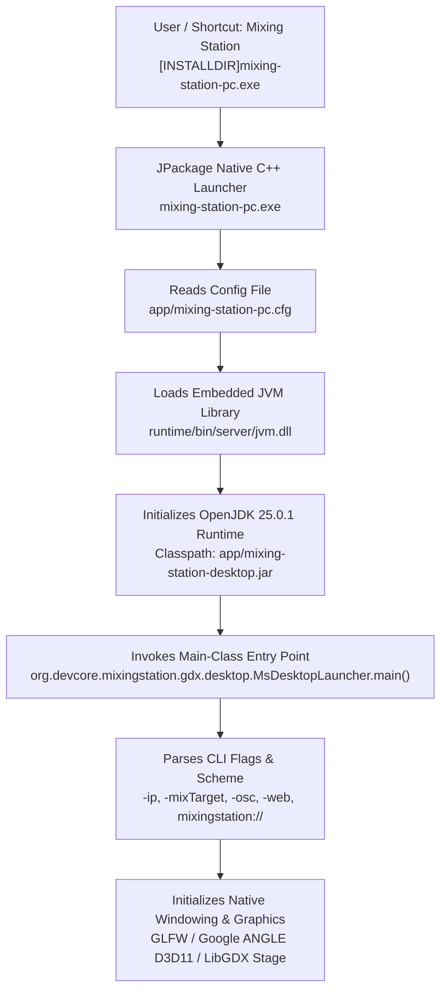

# REA Phase 3 — Application Entry Point Analysis
**Target:** Mixing Station PC Windows 3.2.2 Build 789  
**Analysis Date:** 2026-11-09  
**Status:** VERIFIED  

---

## 1. Executive Summary

The application entry point chain has been verified across four independent layers of evidence:
1. **Windows Installer Shortcut Table:** Directs execution to `[INSTALLDIR]mixing-station-pc.exe`.
2. **JPackage Launcher Configuration:** `mixing-station-pc.cfg` configures the JVM launch parameters and points directly to the fat JAR.
3. **JAR Manifest Metadata:** `META-INF/MANIFEST.MF` defines `Main-Class: org.devcore.mixingstation.gdx.desktop.MsDesktopLauncher`.
4. **Bytecode Constant Pool & Method Analysis:** `MsDesktopLauncher.main([Ljava/lang/String;)V` handles CLI options, verifies 64-bit architecture, initializes logging, and boots the LibGDX desktop application.

---

## 2. Launch Chain Architecture



---

## 3. Layer 1 — MSI Package & Shortcut Verification

From the parsed Windows Installer compound database (`installer.msi`):

### 3.1 Shortcut Table Record
```sql
SELECT Shortcut, Directory_, Name, Component_, Target, Arguments FROM Shortcut
```
- **Shortcut Name:** `Mixing Station` (`ApplicationStartMenuShortcut`)
- **Directory:** `ApplicationProgramsFolder` (`ProgramMenuFolder\mixing-station-pc`)
- **Target:** `[INSTALLDIR]mixing-station-pc.exe`
- **Arguments:** None (standard desktop launch)
- **Component:** `ApplicationShortcut`

### 3.2 Directory Table Mapping
- `TARGETDIR` -> Root
- `LocalAppDataFolder` -> `C:\Users\<User>\AppData\Local`
- `INSTALLDIR` -> `[LocalAppDataFolder]\mixing-station-pc`
- `dir40f84b56068d341da01a768174eb5e59` -> `[INSTALLDIR]\app`
- `dire87a7d2cab5f35e0bf0a9181e38d0c09` -> `[INSTALLDIR]\runtime`

---

## 4. Layer 2 — JPackage Launcher Configuration

**File:** `mixing-station-pc\app\mixing-station-pc.cfg`  
**Size:** 289 bytes  
**SHA-256:** `5449bbf8c4522fb00b322193620a92a0fc3514a5b8d604d9b1ecfec9e1fb8f52`  
**Confidence:** VERIFIED  

### Configuration Content:
```ini
[Application]
app.classpath=$APPDIR\mixing-station-desktop.jar
app.mainclass=org.devcore.mixingstation.gdx.desktop.MsDesktopLauncher

[JavaOptions]
java-options=-Djpackage.app-version=3.2.2
java-options=--enable-native-access=ALL-UNNAMED
java-options=-XX:-OmitStackTraceInFastThrow
```

### Analysis of JVM Launch Flags:
- `app.classpath=$APPDIR\mixing-station-desktop.jar`: Resolves to the installed fat JAR containing all 13,549 classes and 21 embedded native libraries.
- `app.mainclass=org.devcore.mixingstation.gdx.desktop.MsDesktopLauncher`: Declares the JVM entry point class.
- `-Djpackage.app-version=3.2.2`: Passes the exact semver string into Java system properties.
- `--enable-native-access=ALL-UNNAMED`: Permits Java 25 Foreign Function & Memory (FFM) and JNI native access without security warning popups.
- `-XX:-OmitStackTraceInFastThrow`: Prevents the HotSpot C2 compiler from collapsing recurring exception stack traces, ensuring diagnostic fidelity in error logs.

---

## 5. Layer 3 — Application Manifest Metadata

**File:** `mixing-station-desktop.jar!META-INF/MANIFEST.MF`  
**Confidence:** VERIFIED  

```manifest
Manifest-Version: 1.0
Implementation-Title: Mixing Station
Implementation-Version: 3.2.2
Implementation-VersionCode: 789
Implementation-Vendor: Mixing Station GmbH
Main-Class: org.devcore.mixingstation.gdx.desktop.MsDesktopLauncher
```

---

## 6. Layer 4 — Runtime Environment & Modules

**File:** `mixing-station-pc\runtime\release`  
**Confidence:** VERIFIED  

```properties
JAVA_VERSION="25.0.1"
MODULES="java.base java.datatransfer java.xml java.prefs java.desktop java.logging java.management java.security.sasl java.naming java.net.http jdk.crypto.ec jdk.unsupported"
```

The runtime is a stripped, custom JRE built with `jlink`:
- **Module Count:** 12 modules linked into `runtime/lib/modules` (26,156,140 bytes).
- **Excluded Modules:** Compilers (`jdk.compiler`), debugging headers, and non-essential tooling are omitted to reduce attack surface and memory footprint.
- **Critical Inclusions:**
  - `java.desktop`: AWT, fontmanager, color management (lcms), sound (jsound).
  - `java.net.http`: Modern asynchronous HTTP/2 client for web services and remote APIs.
  - `jdk.unsupported`: `sun.misc.Unsafe` access required by Netty/LWJGL memory buffers.

---

## 7. Layer 5 — Entry Class Bytecode Analysis (`MsDesktopLauncher`)

**Class:** `org.devcore.mixingstation.gdx.desktop.MsDesktopLauncher`  
**Superclass:** `org.devcore.mixingstation.gdx.desktop.a`  
**Source Location:** Bytecode method `public static void main(String[] args)`  
**Confidence:** VERIFIED  

### 7.1 Command-Line Arguments & Flags

Bytecode inspection reveals that `MsDesktopLauncher` implements an argument parser supporting both standard execution and automation/headless modes:

| Argument Flag | Associated Help / Meaning | Bytecode Target Action |
|---|---|---|
| `-appSeries` | *"App variant which should be selected on startup"* | Selects default console family (e.g. X32, WING, SQ, Ui) |
| `-ip` | *"Console IP / Hostname where the app should connect to on startup"* | Triggers immediate background connection to specified IP |
| `-mixTarget` | *"Mix access restriction for the startup connection (comma separated)"* | Restricts channel/bus access rights (e.g., monitor mix mode) |
| `-osc` | *"Port for the OSC server"* | Binds local OSC listener on custom UDP port |
| `-web` | *"Port for the web server"* | Sets HTTP/WebSocket external control server port |
| `-settings` | *"Settings folder"* | Overrides default AppData settings directory |
| `-format` | *"png or jpg"* | Screenshot format selector |
| `-output` | *"Output directory where the screenshots should be written to"* | Target destination path for screenshot capture |
| `-scale` | *"dpi scale"* | Manual override for desktop DPI scaling factor |
| `-expFw` | Experimental firmware flag | Enables support for beta mixer firmware builds |
| `mixingstation://` | *"Scheme launch argument using mixingstation://"* | Deep-linking protocol handler (dispatched to `org.devcore.mixingstation.gdx.desktop.f`) |
| `screenshot` | Headless screenshot command | Captures UI view to disk and exits |
| `asyncGlfw` / `glfw_async` | GLFW asynchronous event loop flag | Toggles asynchronous polling mode for window messages |

### 7.2 Architecture & Environment Validation
`MsDesktopLauncher` executes immediate pre-flight checks:
1. **CPU Architecture:** Queries `System.getProperty("os.arch")`. If running on a 32-bit JVM or OS, aborts with `"Only 64-bit OS/Java supported"`.
2. **SLF4J Initialization:** Sets `slf4j.suppressInitError` to true to prevent unconfigured appender warnings.
3. **Application Lifecycle Handlers:**
   - Instantiates `org.devcore.mixingstation.gdx.desktop.f` to handle IPC and custom URI scheme triggers.
   - Instantiates `org.devcore.mixingstation.gdx.desktop.g` for high-DPI scaling factor computation.
   - Bootstraps the primary Scene2D application controller `org.devcore.mixingstation.gdx.desktop.c`.
