# REA Phase 3 — Audio & DSP Modeling Analysis
**Target:** Mixing Station PC Windows 3.2.2 Build 789  
**Analysis Date:** 2026-11-09  
**Status:** VERIFIED  

---

## 1. Architectural Audio Decoupling

A critical architectural distinction verified during Phase 3 analysis:

> [!IMPORTANT]
> **Mixing Station does NOT process live console audio on the host PC.**
> - The live audio mixing, summing, A/D-D/A conversion, and DSP (biquad filtering, dynamics processing, convolution, reverberation) occur entirely on the **physical mixing console's DSP hardware** (Analog Devices SHARC DSPs, Xilinx/Altera FPGAs, or custom ASICs).
> - Mixing Station's DSP modules are **mathematical modeling and visualization engines** that compute transfer function curves, display real-time metering, model filter interaction, and capture local microphone audio for acoustic analysis (RTA).

---

## 2. Local Audio Engine (OpenAL Soft)

**Native Library:** `windows/x64/org/lwjgl/openal/OpenAL.dll` (1,338,368 bytes, SHA-256 `0630aa42...`)  
**Java Bindings:** `blob/aua/a.class`, `blob/aua/c.class`, `blob/aua/f.class`, `blob/aua/g.class`  
**Confidence:** VERIFIED  

### 2.1 Audio Capture Implementation
Mixing Station uses OpenAL Soft's `ALC_EXT_CAPTURE` extension for microphone input:
- `alcCaptureOpenDevice(deviceName, sampleRate, format, bufferSize)`
- `alcCaptureStart(device)`
- `alcCaptureSamples(device, buffer, numSamples)`
- `alcCaptureStop(device)`
- `alcCaptureCloseDevice(device)`

### 2.2 RTA (Real-Time Analyzer) Subsystem
- **Classes:** `blob.afe.d`, `blob.afe.f`, `blob.afw.d`, `blob.aua.*`
- **Function:** Captures audio from the PC's built-in sound card or USB measurement microphone, executes a Fast Fourier Transform (FFT), and renders a real-time spectral display overlaid directly onto the Parametric EQ curve display.
- **Evidence:** Strings extracted from `blob/afe/d.class`:
  ```text
  RTA: %s
  peak-color
  background-color
  dB
  rta
  ```

---

## 3. Parametric & Graphic EQ Modeling Engine

**Class Count:** 123 classes  
**Key Classes:** `blob.aau.c`, `blob.aaw.a`, `blob.abs.c`, `blob.acq.e`, `blob.acq.g`, `blob.acs.a`, `blob.adg.b`  
**Confidence:** VERIFIED  

### 3.1 Biquad Filter Mathematics
Mixing Station calculates visual filter magnitude response curves using standard biquad transfer functions:

$$H(z) = \frac{b_0 + b_1 z^{-1} + b_2 z^{-2}}{a_0 + a_1 z^{-1} + a_2 z^{-2}}$$

The UI evaluates $|H(e^{j\omega})|$ across 20 Hz – 20 kHz to draw the continuous composite curve reflecting all active bands:

| Filter Type | Parameters | Graphic Rendering Behavior |
|---|---|---|
| **Bell / Peaking** | Frequency ($f_0$), Gain ($G$ in dB), Quality ($Q$) | Symmetric boost/cut curve centered at $f_0$ |
| **Low Shelf** | Frequency, Gain, Slope | Flat low-frequency shelf transitioning to unity at $f_0$ |
| **High Shelf** | Frequency, Gain, Slope | Flat high-frequency shelf transitioning from unity at $f_0$ |
| **High Pass (Low Cut)** | Cutoff Frequency, Slope (6, 12, 18, 24 dB/oct) | Attenuates frequencies below cutoff |
| **Low Pass (High Cut)** | Cutoff Frequency, Slope (6, 12, 18, 24 dB/oct) | Attenuates frequencies above cutoff |
| **Notch** | Frequency, $Q$ | Infinite/steep attenuation notch for feedback suppression |
| **GEQ (Graphic EQ)** | 31 standard 1/3-octave ISO frequencies (20 Hz to 20 kHz) | Vertical fader array with interpolated composite curve |

### 3.2 Touch Interactions
- **Pinch-to-Q:** Multi-touch pinch gesture dynamically expands/narrows filter $Q$ (`peqPinchSens`, `peqPinchRatios`).
- **Drag Frequency/Gain:** Simultaneous 2D drag updates $X$ (frequency) and $Y$ (gain in dB).

---

## 4. Dynamics Modeling Engine (Compressor, Limiter & Gate)

**Class Count:** 71 classes  
**Key Classes:** `blob.da.a`, `blob.dy.a`, `blob.ec.f`, `blob.fe.e`, `blob.fo.a`, `blob.afx.c`, `blob.afz.c`  
**Confidence:** VERIFIED  

### 4.1 Compressor Transfer Function
The transfer diagram (`Compressor Diagram` in `blob/afz/c.class`) renders the relationship between input level ($L_{in}$) and output level ($L_{out}$):

$$L_{out} = \begin{cases} L_{in} & L_{in} < T - \frac{W}{2} \\ L_{in} + \frac{(\frac{1}{R} - 1)(L_{in} - T + \frac{W}{2})^2}{2W} & T - \frac{W}{2} \le L_{in} \le T + \frac{W}{2} \\ T + \frac{L_{in} - T}{R} & L_{in} > T + \frac{W}{2} \end{cases}$$

Where:
- $T$ = Threshold (dB)
- $R$ = Ratio ($1:1$ to $\infty:1$)
- $W$ = Knee width (dB) (`knee`, `softKnee`, `cKnee`)

### 4.2 Parameter Set & Sidechain
- **Temporal Controls:** `attack`, `cAttack`, `release`, `cRelease`, `hold`, `gateHld`.
- **Sidechain Filter:** Low cut / High cut filters on detector path (`SCF Gate`, `SC Select Compressor`, `Compressor side chain source`).
- **PreSonus Vintage Models (`blob.se.j`):**
  - Tube Compressor: `Tube CB`, `Tube EQ`, `thetubep1b` (Teletronix LA-2A style optical).
  - Class A / VCA: `160` (dbx 160 style), `Classic` / `classiccomp`, `Brit` / `britcomp` (Neve 2254 / SSL style).
  - Variable-Mu: `FC-670` (Fairchild 670 emulation).
  - Tube Preamp: `Everest C100A`, `RC-500`, `VT1`.

---

## 5. Channel Strip Signal Path

Mixing Station models the standard digital mixing console channel strip architecture:

```mermaid
flowchart LR
    In["Physical Input / Preamp"] --> HPF["HPF / LPF"]
    HPF --> Gate["Noise Gate / Expander"]
    Gate --> Insert["Insert FX / GEQ"]
    Insert --> PEQ["4/6-Band PEQ"]
    PEQ --> Comp["Compressor / De-Esser"]
    Comp --> Fader["Channel Fader (Level)"]
    Fader --> Pan["Pan / Balance"]
    Pan --> Mute["Mute Switch"]
    Mute --> Out["Mix Busses / Main Stereo"]
```



Tap points (Pick-off points) can be configured for every Aux/Monitor send:
- Pre-Preamp
- Pre-EQ (post-gate)
- Post-EQ (pre-compressor)
- Pre-Fader (post-compressor)
- Post-Fader
- Subgroup

---

## 6. FX Processing Architecture

**Class Count:** 198 classes  
**Key Classes:** `blob.ab.af`, `blob.aaf.l`, `blob.of.ab`, `blob.ahf.a`, `blob.agy.*`  
**Confidence:** VERIFIED  

1. **Reverberation:**
   - Plate Reverb Designer (`blob/ab/af.class`): Decay time, pre-delay, diffusion, high-frequency damping, bass multiplier.
   - Hall / Room / Ambience algorithms.
2. **Delay & Modulation:**
   - Midas Delay (`blob/of/ab.class`): Stereo delay with independent $L/R$ time, feedback, BPM tap sync (`globalBPM`, `useGlobalTapTempo`).
   - Chorus, Flanger, Phase Shifter (`blob.agy.a`).
   - Rotary Speaker Emulation (`blob.aaf.l`): Dual horn/rotor speed switching (slow/fast), acceleration, drive.
3. **Dynamics & Correction:**
   - De-Esser (`blob.ahf.a`): Dynamic frequency-selective sibilance compression (female/male voice presets).
   - Pitch Corrector / Shifter (`blob.aaf.d`).
