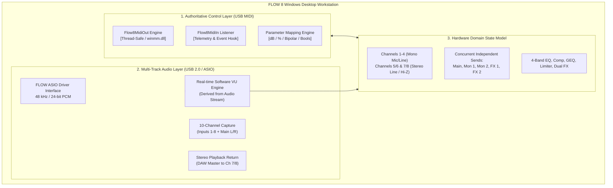

# FLOW 8 Architecture Alignment Document
**Target:** Behringer FLOW 8 Digital Mixer  
**Scope:** Final Architectural Reconciliation & Implementation Roadmap  
**Date:** 2026-11-09  
**Status:** ALIGNED & RATIFIED  

---

## 1. Architectural Reconciliation Overview

This document establishes the definitive architectural blueprint for the dedicated **Behringer FLOW 8 Desktop Workstation**, directly aligning the software engineering model with the official hardware specifications supplied by the project owner.

---

## 2. Mandatory Architectural Corrections

The following four structural corrections are incorporated into the workstation architecture:

### 2.1 Input Hardware Model Correction
- **Old Assumption:** High-impedance (Hi-Z) guitar direct inputs were loosely placed on Inputs 3 and 4.
- **Ratified Architecture:**
  - **Inputs 1–2:** Discrete XLR female connectors, Midas-designed microphone preamplifiers, with switchable +48V phantom power.
  - **Inputs 3–4:** Balanced XLR / 1/4" TRS Combo connectors operating as Mic or Line level.
  - **Inputs 5L/6R:** Balanced stereo TRS line inputs, with **Connector 6R housing the dedicated Hi-Z guitar/bass instrument circuit**.
  - **Inputs 7L/8R:** Balanced stereo TRS line inputs, with **Connector 8R housing the dedicated Hi-Z guitar/bass instrument circuit**.

### 2.2 Connectivity Subsystem Decoupling
- **Old Assumption:** Bluetooth streaming and remote control were treated as an integrated wireless protocol.
- **Ratified Architecture:** Five discrete, decoupled subsystems:
  1. `USB MIDI Control`: Primary workstation link via class-compliant MIDI endpoints (`winmm.dll`).
  2. `USB Audio Interface`: 24-bit / 48 kHz multi-track stream via `flow-usb_audioasio_x64.dll`.
  3. `Bluetooth A2DP Audio`: Independent Classic Bluetooth (BR/EDR) stereo sink into Channel 7/8.
  4. `Bluetooth LE (GATT)`: Independent 2.4 GHz GATT server for mobile control apps.
  5. `Footswitch Input`: Hardware GPIO port for dual momentary/latching footswitches.

### 2.3 USB Audio Topology
- **Old Assumption:** Ambiguity regarding channel counts due to the driver's virtual `USB Out 3/4` pin.
- **Ratified Architecture:** Standardized on official hardware specification:
  - **Capture (Mixer $\rightarrow$ Computer):** **10 Channels** (Inputs 1–8 discrete + Main L/R mix).
  - **Playback (Computer $\rightarrow$ Mixer):** **2 Channels** (Stereo DAW master return to Channel 7/8). `USB Out 3/4` is preserved as an optional auxiliary route for multi-bus DAW setups.

### 2.4 Fader Operating Modes
- **Old Assumption:** Emulating the physical mixer's hardware layer buttons in software.
- **Ratified Architecture:**
  - The physical mixer shares 6 faders across mixes using layer buttons (`MAIN`, `MON 1`, `MON 2`, `FX 1`, `FX 2`).
  - The software workstation model exposes **all sends simultaneously as independent parameters** (`CC 7` for Main, `CC 14` for Mon 1, `CC 15` for Mon 2, `CC 16` for FX 1, `CC 17` for FX 2).
  - The software UI can display all sends concurrently without forced layer multiplexing.

---

## 3. Existing Components to Reuse

The following components from Phase 0.5, Phase 1, and Phase 2A are 100% reusable without modification:

1. **`Flow8MidiOut` ([`flow8/midi_out.py`](file:///c:/Users/Administrator/Desktop/mixing-station-pc-windows-3-2-2-789/flow8/midi_out.py)):**
   - High-performance, re-entrant (`threading.RLock`) Windows Multimedia driver wrapper.
   - Verified sub-millisecond dispatch latency (~140 µs average).
   - Dynamic device discovery, auto-reconnect, and duplicate handle prevention.
2. **`ParameterMapping` ([`flow8/parameter_mapping.py`](file:///c:/Users/Administrator/Desktop/mixing-station-pc-windows-3-2-2-789/flow8/parameter_mapping.py)):**
   - Pure, zero-dependency conversion functions for Mute booleans, Pan percentages, and Fader decibel curves with explicit $-\infty\text{ dB}$ (Value 0 = OFF) handling.
3. **`Flow8MidiIn` ([`flow8/midi_in.py`](file:///c:/Users/Administrator/Desktop/mixing-station-pc-windows-3-2-2-789/flow8/midi_in.py)):**
   - 64-bit ABI compliant (`DWORD_PTR`) non-blocking callback hook.
   - Clean asynchronous driver lifecycle.
4. **Hardware Verification Artifacts:**
   - [FLOW8_HARDWARE_VERIFICATION.md](file:///c:/Users/Administrator/Desktop/mixing-station-pc-windows-3-2-2-789/FLOW8_HARDWARE_VERIFICATION.md)
   - [FLOW8_USB_MIDI_PROTOCOL.md](file:///c:/Users/Administrator/Desktop/mixing-station-pc-windows-3-2-2-789/FLOW8_USB_MIDI_PROTOCOL.md)
   - [FLOW8_USB_AUDIO_CAPABILITIES.md](file:///c:/Users/Administrator/Desktop/mixing-station-pc-windows-3-2-2-789/FLOW8_USB_AUDIO_CAPABILITIES.md)

---

## 4. Implementation Readiness Roadmap

Every capability is classified into one of the 5 required verification levels:

| Capability / Module | Current Level | Target Phase | Implementation Scope & Strategy |
|---|---|---|---|
| **Initial 4 Parameters (Main Fader, Ch 1 Fader, Mute, Pan)** | **HARDWARE_TESTED** | *Phase 2A Complete* | Production-grade `Flow8MidiOut` fully operational and hardware-tested. |
| **Channels 2–7 Faders, Mutes, Pans** | **PROTOCOL_VERIFIED** | **Phase 2C (Next)** | Expand `Flow8MidiOut` methods to address Channels 2–7 (`CC 7`, `CC 5`, `CC 10`). |
| **Preamp Gain & Low-Cut (Ch 1–4)** | **PROTOCOL_VERIFIED** | **Phase 2C (Next)** | Implement `CC 8` (Gain, -20 to +60 dB) and `CC 9` (Low Cut, 20–600 Hz). |
| **4-Band Parametric EQ (Channels 1–7)** | **PROTOCOL_VERIFIED** | **Phase 2C (Next)** | Implement `CC 1–4` (Low, Low-Mid, Hi-Mid, High, -15 to +15 dB). |
| **1-Knob Dynamics Compressor (Ch 1–4)** | **PROTOCOL_VERIFIED** | **Phase 2C (Next)** | Implement `CC 11` (0% to 100% threshold curve). |
| **Monitor 1 & 2 Sends (Channels 1–7)** | **PROTOCOL_VERIFIED** | **Phase 2D** | Implement `CC 14` (Mon 1) and `CC 15` (Mon 2) across all input channels. |
| **FX 1 & 2 Sends (Channels 1–7)** | **PROTOCOL_VERIFIED** | **Phase 2D** | Implement `CC 16` (FX 1) and `CC 17` (FX 2) across all input channels. |
| **Master Bus 9-Band GEQ & Limiter** | **PROTOCOL_VERIFIED** | **Phase 2E** | Implement `CC 11–19` (GEQ bands) and `CC 8` (Limiter threshold) on Ch 8, 9, 10. |
| **Dual FX Engine Selection & Tweaks** | **PROTOCOL_VERIFIED** | **Phase 2E** | Implement `Program Change 1–16` and `CC 1–4` on Channels 14 & 15. |
| **Snapshots Recall (1–15) & Reset** | **PROTOCOL_VERIFIED** | **Phase 2F** | Implement `Program Change 1–15` (Recall) and `PC 16` (Reset) on Channel 16. |
| **Global Tap Tempo** | **PROTOCOL_VERIFIED** | **Phase 2F** | Implement `Note On 0` on Channel 16. |
| **USB Audio 10-Channel Capture Engine** | **HARDWARE_TESTED** | **Phase 3A** | Integrate ASIO streaming (`flow-usb_audioasio_x64.dll`) for recording. |
| **Real-time Software Audio Metering** | **HARDWARE_TESTED** | **Phase 3A** | Ingest `Multi In 1-10` audio stream to calculate RMS/Peak meters for UI. |
| **+48V Phantom Power Switching** | **PROTOCOL_VERIFIED** | **Phase 3B** | Implement `CC 12` on Channels 1 & 2 with software safety confirmation prompts. |
| **EZ GAIN Automated Staging** | **HARDWARE_SPECIFIED** | *Hardware Only* | Internal hardware routine; no MIDI CC trigger exists. |
| **Bulk Snapshot Memory Import/Export** | **UNKNOWN** | *Post-V1 Research* | Requires reverse-engineering BLE GATT snapshot payload schema. |
| **Physical Hardware Telemetry (MIDI IN)**| **HARDWARE_TESTED** | *Operator Dependent* | Driver interface ready; requires operator enabling USB TX in mixer LCD setup. |

---

## 5. Architectural Boundaries & Restrictions

To guarantee rock-solid stability and prevent regressions:
1. **Scope Lockdown:** The desktop workstation supports **Behringer FLOW 8 exclusively**. Multi-mixer abstractions or legacy X32/WING protocol adapters will never be merged into the codebase.
2. **Read-Only / Validated Writes:** Every outgoing MIDI CC message must strictly validate against the verified channel/CC matrix. Unverified commands are rejected at runtime via `Flow8ValidationError`.
3. **Decoupled Audio & Control:** Audio buffer underruns in DAWs or ASIO latency adjustments will not interrupt or block MIDI parameter control.
