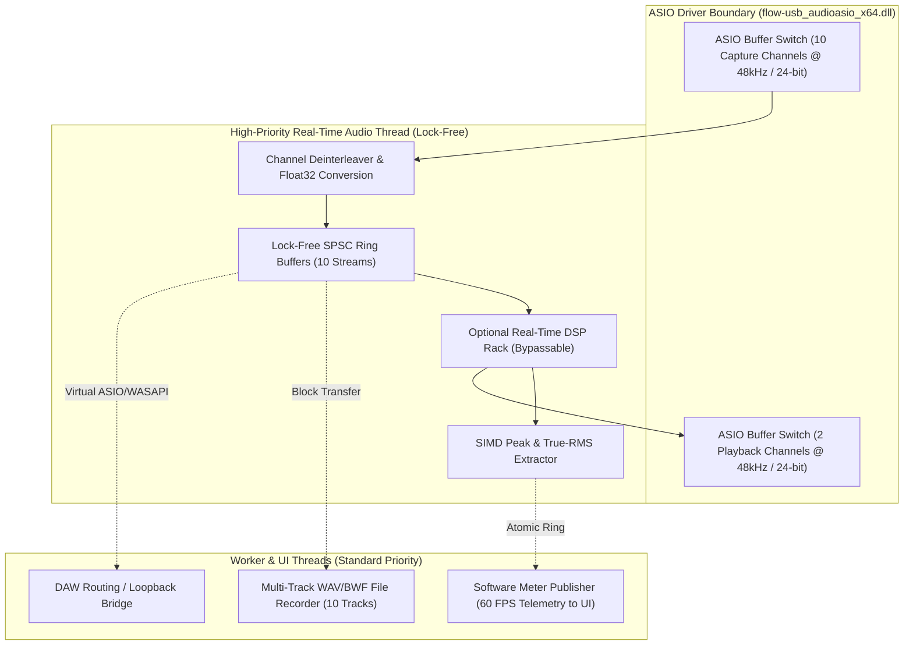

# FLOW 8 Audio Engine Architecture Specification
**Target Hardware:** Behringer FLOW 8 Digital Mixer  
**Audio Driver:** Thesycon `flow-usb_audioasio_x64.dll` (CLSID: `{894D150C-9770-4CD8-B1F1-21128150A199}`)  
**Scope:** Phase B — Real-Time Multi-Track Audio Engine Architecture  
**Date:** 2026-11-09  
**Status:** SPECIFICATION COMPLETE  

---

## 1. Executive Audio Engine Architecture

The FLOW 8 Audio Engine is a real-time, low-latency audio processing and routing pipeline built upon the native **Behringer FLOW ASIO Driver**. It operates strictly decoupled from the USB MIDI control engine.



---

## 2. Audio Subsystem Interfaces

### 2.1 ASIO Capture Interface (`IAsioCapture`)
```cpp
struct IAsioCapture {
    virtual bool initialize(uint32_t sampleRateHz, uint32_t bufferSizeSamples) = 0;
    virtual void setChannelMask(uint16_t activeChannelsBitmask) = 0;
    virtual void registerAudioCallback(void (*callback)(const float* const* channelBuffers, uint32_t numSamples, void* userData)) = 0;
    virtual bool start() = 0;
    virtual void stop() = 0;
    virtual void release() = 0;
};
```
- **Channel Allocation:** Fixed at 10 input channels:
  - `Ch 0`: Mic 1
  - `Ch 1`: Mic 2
  - `Ch 2`: Mic/Line 3
  - `Ch 3`: Mic/Line 4
  - `Ch 4`: Line 5 (L)
  - `Ch 5`: Line 6 (R / Hi-Z)
  - `Ch 6`: Line 7 (L)
  - `Ch 7`: Line 8 (R / Hi-Z)
  - `Ch 8`: Main Out (L)
  - `Ch 9`: Main Out (R)

### 2.2 ASIO Playback Interface (`IAsioPlayback`)
```cpp
struct IAsioPlayback {
    virtual bool initialize(uint32_t sampleRateHz, uint32_t bufferSizeSamples) = 0;
    virtual void writePlayback(const float* const* outputBuffers, uint32_t numSamples) = 0;
    virtual void setMute(bool muted) = 0;
    virtual void setMasterGain(float linearGain) = 0;
};
```
- **Channel Allocation:** 2 standard playback channels routed to `USB Out 1/2` (Ch 7/8 strip on mixer). Optional secondary route to `USB Out 3/4`.

### 2.3 Software Metering Engine (`IMeteringEngine`)
Because hardware VU metering is not transmitted over USB MIDI CC, the audio engine computes precision software levels directly from the capture stream:
- **Peak Level:** Fast attack instant sample peak detection:
  $$P_{\text{peak}} = 20 \log_{10} \left( \max_{i} |s_i| \right)$$
- **True RMS Level:** 300 ms sliding window root-mean-square:
  $$P_{\text{RMS}} = 20 \log_{10} \left( \sqrt{ \frac{1}{N} \sum_{i=1}^N s_i^2 } \right)$$
- **Telemetry Frame Rate:** Published to UI and Gateway at 60 Hz via lock-free atomic double-buffering.

### 2.4 Multi-Track Recording Engine (`IRecorderEngine`)
- **Format:** Multi-track Broadcast Wave Format (BWF / RF64) 24-bit PCM.
- **Writers:** Background thread reading from lock-free SPSC ring buffers.
- **Disk Latency Tolerance:** 4-second memory buffer absorbs disk I/O stalls without audio dropouts.

---

## 3. Real-Time Thread Safety & Buffer Ownership

1. **Zero Allocations on Audio Thread:**
   - No `malloc`, `free`, `new`, `delete`, or garbage collection triggers in the `bufferSwitch` callback.
   - All buffers are pre-allocated during engine initialization.
2. **Lock-Free Concurrency:**
   - Audio thread never takes mutexes (`std::mutex`, `CRITICAL_SECTION`).
   - Inter-thread communication with worker threads uses Single-Producer Single-Consumer (SPSC) lock-free ring buffers with release-acquire atomic memory ordering.
3. **Buffer Ownership:**
   - The ASIO driver owns the DMA buffers passed to `bufferSwitch`.
   - The audio callback copies/deinterleaves incoming 24-bit int samples to pre-allocated `float32` scratch arrays immediately upon invocation.

---

## 4. Latency Budgets & Buffer Sizes

| Preferred ASIO Buffer Size | Theoretical Buffer Duration ($T_{\text{buf}} = N / f_s$) | Estimated Round-Trip Latency (Input $\rightarrow$ Output) | Jitter Tolerance | Target CPU Profile |
|---|---|---|---|---|
| **64 samples** | 1.33 ms | ~3.8 ms | Low | High-performance DAW Workstation |
| **128 samples (Default)** | **2.67 ms** | **~6.5 ms** | **Balanced** | **Standard Studio / Live Stream** |
| **256 samples** | 5.33 ms | ~11.8 ms | High | High DSP Load / Mobile Gateway |
| **512 samples** | 10.67 ms | ~22.5 ms | Ultra-High | Multi-track Live Recording Only |

> [!NOTE]
> Theoretical buffer duration represents the mathematical duration of $N$ audio frames at 48 kHz ($N / 48000$). The estimated round-trip latency figures are engineering calculations incorporating input DMA buffer period, hardware converter delays (ADC + DAC pipeline ~1.0–1.5 ms), USB audio framing (USB 2.0 micro-frame interval 125 µs), and output DMA buffer period under the dedicated Behringer FLOW ASIO driver.

---

## 5. DSP Bypass Requirements

- **Zero-Latency Pass-Through:** For pure multi-track recording or direct DAW mixing, all internal DSP plugins must support a bit-perfect zero-overhead **HARD BYPASS** mode.
- In Hard Bypass, incoming ASIO buffers bypass float conversion and are forwarded directly to disk and DAW loopback without arithmetic modification.
