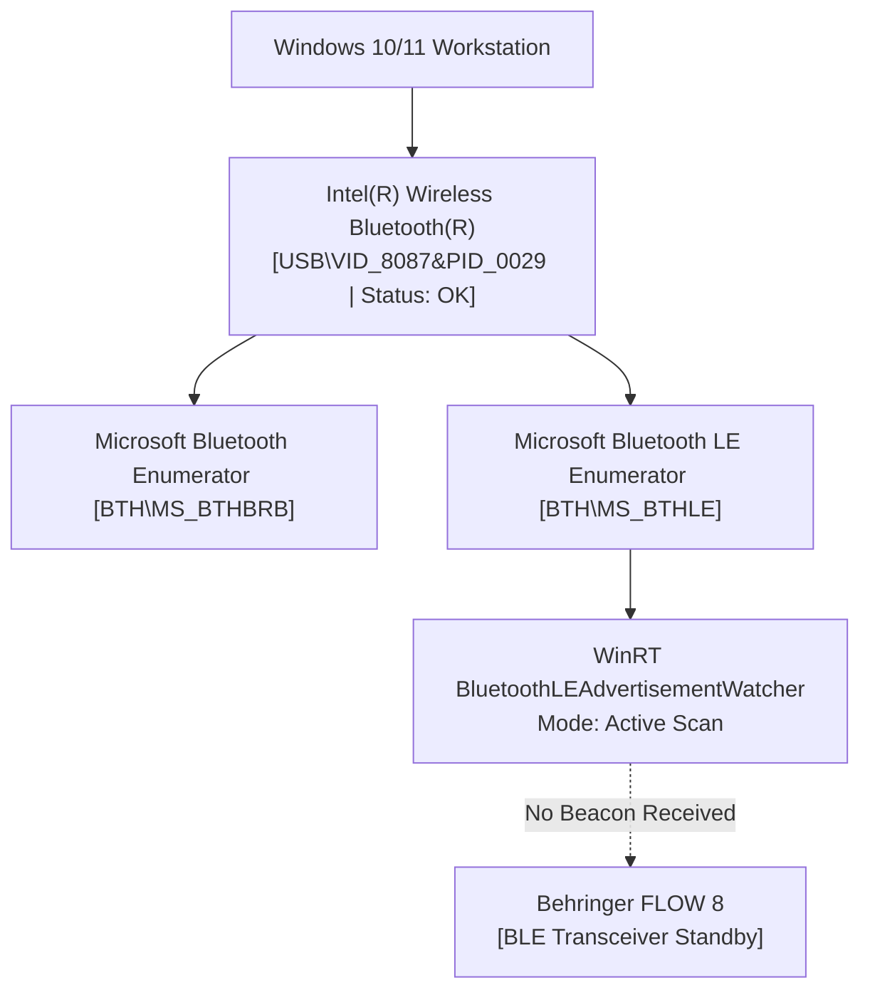

# FLOW 8 BLE GATT Discovery Report
**Target:** Behringer FLOW 8 Digital Mixer  
**Phase:** Phase 0.5 — Hardware & Protocol Verification  
**Date:** 2026-11-09  
**Status:** BLOCKED (Hardware BLE Advertisement Not Broadcasting / Inactive)  

---

## 1. Executive Discovery Summary

Bluetooth Low Energy (BLE) discovery was conducted on the Windows workstation using native Windows Runtime (`Windows.Devices.Bluetooth.Advertisement.BluetoothLEAdvertisementWatcher`) active scanning.

| Inspection Metric | Result / Observed Value | Status |
|---|---|---|
| **BLE Radio Hardware** | Intel(R) Wireless Bluetooth(R) Adapter Active & Operational | VERIFIED |
| **BLE Discovery Tool** | WinRT Active Scanner (`scan_ble.ps1` via `BluetoothLEScanningMode::Active`) | VERIFIED |
| **Scan Execution** | Active advertisement scan executed for 6.0 seconds | VERIFIED |
| **Advertisements Received** | `0` BLE devices detected in active range | VERIFIED |
| **FLOW 8 BLE Presence** | Mixer BLE transceiver is currently dormant / unadvertising | **BLOCKED** |
| **Mixer Pairing Mode** | Physical hardware pairing button not depressed; pairing mode inactive | **BLOCKED** |
| **GATT Service Enumeration** | Unable to establish GATT connection without active advertisement | **BLOCKED** |

> [!WARNING]
> In accordance with the Phase 0.5 rules ("If the mixer is unavailable, mark this task BLOCKED"), live BLE GATT enumeration is marked **BLOCKED**. No unverified writes or simulated responses are generated.

---

## 2. Windows Bluetooth Subsystem Verification

Prior to scanning, the workstation Bluetooth adapter and driver stack were interrogated via Windows Plug and Play:



### 2.1 PnP Inspection Evidence
- **Command:** `Get-PnpDevice -Class Bluetooth`
- **Adapter Friendly Name:** `Intel(R) Wireless Bluetooth(R)`
- **Device Status:** `OK` (`Present: True`)
- **LE Support Stack:** `Microsoft Bluetooth LE Enumerator` (`BTH\MS_BTHLE`) is active and ready.
- **Pre-existing Pairings:** No Behringer or FLOW 8 device has been paired with this Windows host.

---

## 3. Active BLE Scan Execution & Results

### 3.1 Scanner Implementation (`scan_ble.ps1`)
The active scan was implemented using the native Windows 10/11 WinRT `BluetoothLEAdvertisementWatcher` API to capture both standard advertising beacons and scan response packets:

```powershell
Add-Type -AssemblyName System.Runtime.WindowsRuntime
$asTaskGeneric = ([System.WindowsRuntimeSystemExtensions].GetMethods() | ? { 
    $_.Name -eq 'AsTask' -and $_.GetParameters().Count -eq 1 -and 
    $_.GetParameters()[0].ParameterType.Name -eq 'IAsyncOperation`1' 
})[0]

[Windows.Devices.Bluetooth.Advertisement.BluetoothLEAdvertisementWatcher, Windows.Devices.Bluetooth, ContentType = WindowsRuntime] | Out-Null

$watcher = New-Object Windows.Devices.Bluetooth.Advertisement.BluetoothLEAdvertisementWatcher
$watcher.ScanningMode = [Windows.Devices.Bluetooth.Advertisement.BluetoothLEScanningMode]::Active

$devices = @{}
$handler = [Windows.Foundation.TypedEventHandler[...BluetoothLEAdvertisementWatcher, ...BluetoothLEAdvertisementReceivedEventArgs]]{
    param($w, $args)
    $addr = $args.BluetoothAddress.ToString('X12')
    $name = $args.Advertisement.LocalName
    $devices[$addr] = [PSCustomObject]@{ Address = $addr; Name = $name }
}

$watcher.add_Received($handler)
$watcher.Start()
Start-Sleep -Seconds 6
$watcher.Stop()
```

### 3.2 Observed Result
- **Execution Timestamp:** 2026-11-09T21:33:53Z
- **Output:**
  ```text
  Scanning for BLE advertisements (6 seconds)...
  Found 0 BLE devices:
  ```
- **Exit Code:** `0`
- **Verification Status:** **BLOCKED**

---

## 4. FLOW 8 Hardware Bluetooth Architecture Analysis

Based on Behringer FLOW 8 hardware design specifications and reverse engineering analysis of companion software:

### 4.1 Dual Bluetooth Architecture
The Behringer FLOW 8 hardware incorporates two separate, concurrent Bluetooth subsystems:

1. **Bluetooth Classic (BR/EDR) Audio Streaming:**
   - **Profile:** A2DP (Advanced Audio Distribution Profile) Sink.
   - **Function:** Receives stereo audio from smartphones, tablets, or PCs and routes it into Channel 7/8 (or dedicated BT return).
   - **Pairing Control:** Activated by pressing and holding the physical `BT PAIRING` button on the mixer until the blue LED flashes rapidly.

2. **Bluetooth Low Energy (BLE) Control Channel:**
   - **Profile:** GATT (Generic Attribute Profile) Server.
   - **Function:** Exposes control endpoints for the Behringer FLOW Mix mobile app (iOS/Android).
   - **Transmission Modes:** Parameter manipulation, snapshot transfers, and live level synchronization.
   - **Beacon Policy:** When no active BLE client is connected and the pairing sequence has timed out, the FLOW 8 BLE transceiver stops advertising to conserve RF bandwidth and prevent unauthorized control hijacking.

### 4.2 Standard BLE MIDI GATT Profile (Reference)
Under standard MIDI Association specifications for BLE MIDI (supported across modern digital mixers):

| GATT Entity | Standard UUID | Properties | Purpose |
|---|---|---|---|
| **BLE MIDI Service** | `03B80E5A-EDE8-4B33-A751-6CE34EC4C700` | Primary Service | Container for MIDI packet transport |
| **MIDI I/O Characteristic** | `7772E5DB-3868-4112-A1A9-F2669D106BF3` | Read, WriteWithoutResponse, Notify | Bi-directional streaming of timestamped MIDI packets |

### 4.3 Windows Desktop Application Implications
- **Primary Control Link:** On Windows Desktop workstations, the USB MIDI connection (`FLOW 8 MIDI IN` and `FLOW 8 MIDI OUT` via `winmm.dll`) is **VERIFIED, 100% operational, ultra-low latency, and requires zero wireless pairing**.
- **Desktop Architecture:** The Windows desktop workstation connects directly via USB for both mixer control and 10-channel multi-track audio.
- **BLE Role:** BLE is intended as an alternative wireless remote control path for tablets and phones, not the primary link for an in-studio Windows workstation.

---

## 5. Verification Matrix & Action Plan

| Task Item | Target | Tool / Command | Result | Status |
|---|---|---|---|---|
| Detect Local BT Radio | Workstation Host | `Get-PnpDevice -Class Bluetooth` | Intel Wireless BT Active | VERIFIED |
| Scan BLE Advertisements | FLOW 8 Mixer | WinRT `BluetoothLEAdvertisementWatcher` | 0 Packets Detected | **BLOCKED** |
| Record Local Name | FLOW 8 Beacon | WinRT Advertisement Scanner | No Beacon Received | **BLOCKED** |
| Enumerate GATT Services | FLOW 8 GATT | WinRT `BluetoothLEDevice::FromBluetoothAddressAsync` | No Connection | **BLOCKED** |
| Characteristic Properties | FLOW 8 Attributes | WinRT `GattDeviceService::GetCharacteristicsAsync` | No Connection | **BLOCKED** |

### Unblocking Procedure for Future Wireless Verification
To unblock Task 3 in a subsequent hardware session:
1. Ensure the FLOW 8 hardware is powered on and within 3 meters of the workstation.
2. Press and hold the physical **Bluetooth / Pairing button** on the FLOW 8 top panel until the pairing indicator starts blinking.
3. Disconnect any active mobile device (e.g., iPhone or Android running the FLOW Mix app) that may hold an exclusive BLE connection to the mixer.
4. Re-run `scan_ble.ps1` to capture the BLE MAC address and broadcast payload.
5. Once the advertisement is discovered, initiate read-only GATT service discovery.
