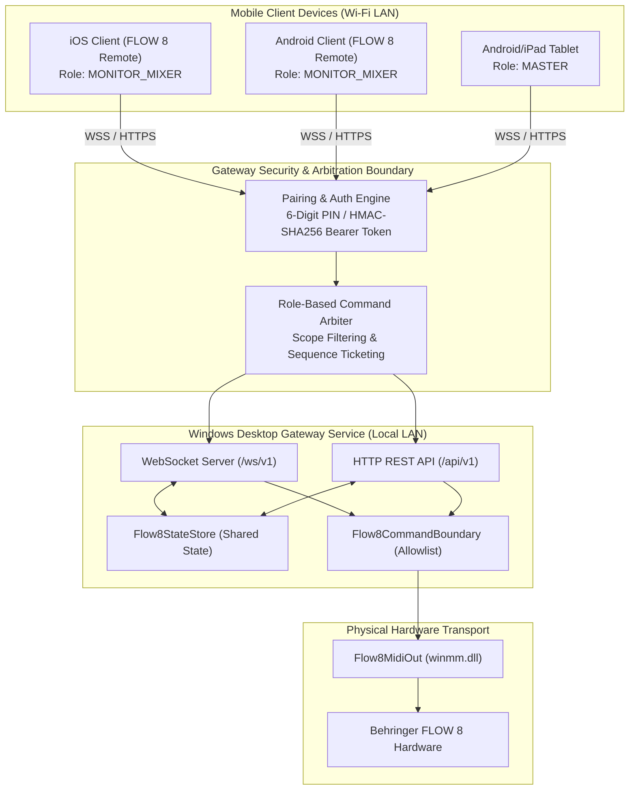
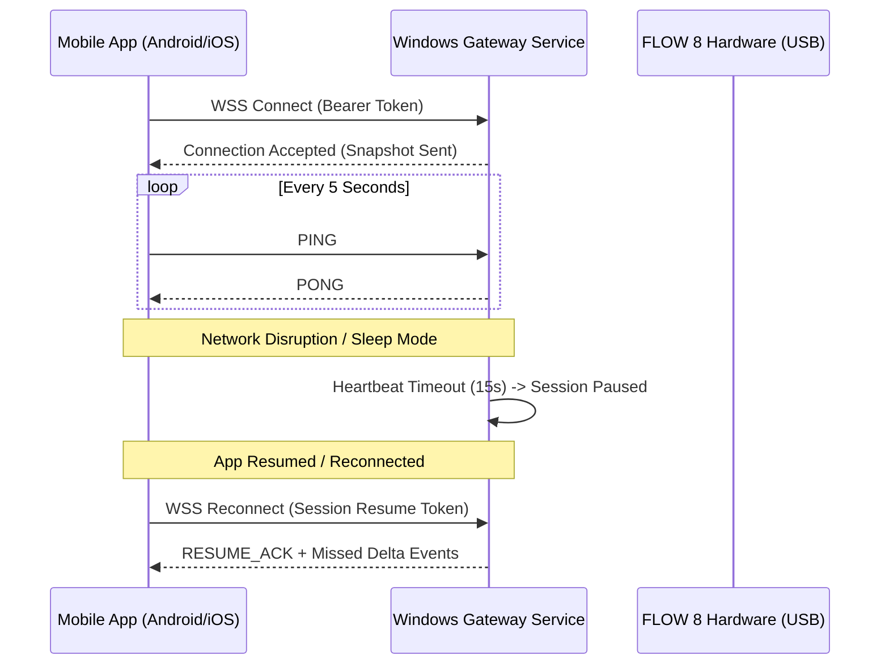

# FLOW 8 Application Gateway API Specification
**Target Platform:** Windows Desktop Gateway for Android / iOS Clients  
**Target Hardware:** Behringer FLOW 8 Digital Mixer  
**Scope:** Phase B — Gateway Architecture Design  
**Date:** 2026-11-09  
**Status:** SPECIFICATION COMPLETE  

---

## 1. Gateway Architectural Overview

The FLOW 8 Desktop Workstation acts as an authenticated local host gateway on Windows, bridging mobile client devices (Android / iOS) to the physical FLOW 8 hardware connected over USB.



---

## 2. Authentication, Pairing, & Session Security

To prevent unauthorized LAN access or hijacked mixer parameters during live performances, the gateway strictly forbids unauthenticated endpoints.

### 2.1 Device Pairing Ceremony (Zero-Trust LAN Protocol)
1. **PIN Generation:** The Windows Desktop UI generates a cryptographically random 6-digit numeric PIN with a 120-second expiration.
2. **Pairing Request:** The mobile client scans an mDNS advertisement (`_flow8-gateway._tcp.local`) and transmits a pairing payload:
   ```json
   POST /api/v1/pair
   {
     "device_id": "c8a1b2c3-4d5e-6f7a-8b9c-0d1e2f3a4b5c",
     "device_name": "Singer iPhone 15",
     "client_platform": "iOS",
     "pin": "749201",
     "requested_role": "MONITOR_MIXER"
   }
   ```
3. **Session Token Issuance & Rate Limiting:**
   - **Rate Limiting:** To mitigate brute-force PIN guessing, the gateway enforces a strict rate limit of maximum **5 failed attempts per client IP within 120 seconds**. If exceeded, the gateway triggers a **5-minute lockout** (HTTP `429 Too Many Requests` with a `Retry-After: 300` header) for that IP address.
   - Upon valid PIN submission within the 120-second validity window, the desktop issues an HMAC-SHA256 signed session token valid for 24 hours:
   ```json
   {
     "status": "PAIRED",
     "token": "f8tok_9e2a4b8c...hmac_sig",
     "session_id": "sess_01J8F...",
     "assigned_role": "MONITOR_MIXER",
     "allowed_channels": [1, 2, 5],
     "allowed_buses": ["MON1"],
     "expires_at": 1794285600
   }
   ```
4. **Subsequent Calls:** All HTTP requests and WebSocket connections must carry the header:
   `Authorization: Bearer f8tok_...`

---

## 3. Role-Based Access Control (RBAC) & Command Arbitration

The gateway implements role-based command filtering to support multi-user stage workflows:

| Session Role | Permissions & Scope | Typical Device |
|---|---|---|
| `MASTER` | Unrestricted control over all channels, main fader, gains, EQs, mutes, FX, and snapshots. | Sound Engineer Tablet / Secondary PC |
| `MONITOR_MIXER` | **Strictly restricted** to auxiliary send levels for assigned monitor bus (e.g. `MON 1` or `MON 2`). Main fader, preamp gain, +48V phantom, and other monitor mixes are rejected. | Musician / Performer Smartphone |
| `AUDITOR` | Read-only state subscription. Zero command dispatch permitted. | Production Display / Logging Rig |

### 3.1 Command Arbitration Policy
- **Last-Write-Wins with Sequence Ticketing:** Every command payload carries an incrementing client sequence number (`seq_no`). The gateway rejects out-of-order stale commands.
- **Master Preemption:** Commands from `MASTER` override conflicting commands from `MONITOR_MIXER`.
- **Hardware Feedback Preemption:** Direct physical mixer movement (when detected) takes precedence over all connected wireless clients.

---

## 4. HTTP Command API Specification

Base URL: `https://<windows-host-ip>:8443/api/v1`

### 4.1 Endpoints Summary
| Method | Endpoint | Description | Role Required |
|---|---|---|---|
| `GET` | `/health` | Gateway health, FLOW 8 USB link status, active sessions count. | Public |
| `POST` | `/pair` | Submit pairing PIN to obtain session token. | Public |
| `GET` | `/state` | Full snapshot of all parameter states and verification levels. | `AUDITOR` or higher |
| `POST` | `/command` | Dispatch a single parameter command. | `MONITOR_MIXER` or higher |
| `GET` | `/topology` | Hardware input connectors, logical channels, and bus layout. | `AUDITOR` or higher |

### 4.2 Parameter Command Payload (`POST /api/v1/command`)
```json
{
  "seq_no": 1042,
  "param_id": "ch1.fader",
  "value": 15,
  "unit": "raw",
  "client_timestamp": 1794200000.123
}
```
**Response (200 OK):**
```json
{
  "status": "EXECUTED",
  "param_id": "ch1.fader",
  "sync_status": "PENDING_DISPATCH",
  "raw_midi_sent": 15,
  "latency_us": 142.5
}
```

---

## 5. WebSocket Event Contract Specification

Endpoint: `wss://<windows-host-ip>:8443/ws/v1`  
Protocols: `flow8-v1`

### 5.1 Client $\rightarrow$ Server Messages

#### 1. Subscribe to State Changes
```json
{
  "action": "SUBSCRIBE",
  "filter": {
    "channels": [1, 8],
    "buses": ["MAIN", "MON1"]
  }
}
```

#### 2. Real-Time Parameter Tweak (Low-Latency Fader Drag)
```json
{
  "action": "SET_PARAMETER",
  "seq_no": 1043,
  "param_id": "main.fader",
  "value": 100,
  "unit": "raw"
}
```

#### 3. Client Heartbeat Ping
```json
{
  "action": "PING",
  "timestamp": 1794200005.000
}
```

### 5.2 Server $\rightarrow$ Client Messages

#### 1. Initial State Snapshot
```json
{
  "event": "STATE_SNAPSHOT",
  "timestamp": 1794200000.000,
  "parameters": {
    "main.fader": {
      "commanded_value": 0,
      "observed_value": null,
      "sync_status": "PENDING_DISPATCH",
      "verification_level": "HARDWARE_TESTED"
    },
    "ch1.fader": {
      "commanded_value": 0,
      "observed_value": null,
      "sync_status": "PENDING_DISPATCH",
      "verification_level": "HARDWARE_TESTED"
    }
  }
}
```

#### 2. Delta State Broadcast (Dispatched on Any Parameter Change)
```json
{
  "event": "PARAMETER_CHANGED",
  "param_id": "ch1.fader",
  "commanded_value": 15,
  "observed_value": null,
  "sync_status": "PENDING_DISPATCH",
  "source": "REMOTE_GATEWAY",
  "timestamp": 1794200000.125
}
```

---

## 6. Disconnect & Reconnect Lifecycle



1. **Heartbeat Interval:** 5.0 seconds. Timeout threshold: 15.0 seconds.
2. **Session Freezing:** If a mobile client drops, its session locks are held for 60 seconds before being pruned.
3. **Hardware Isolation:** A mobile disconnect never impacts physical USB MIDI or USB Audio operation between the Windows workstation and the FLOW 8.
