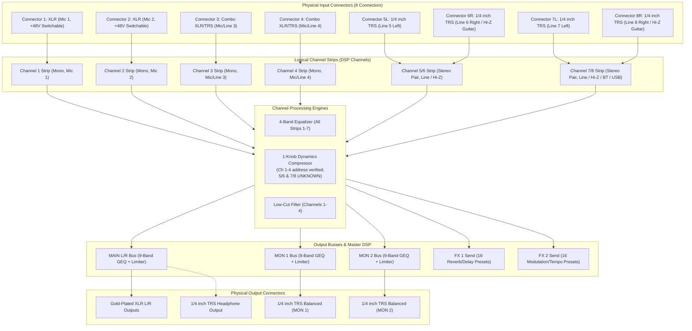
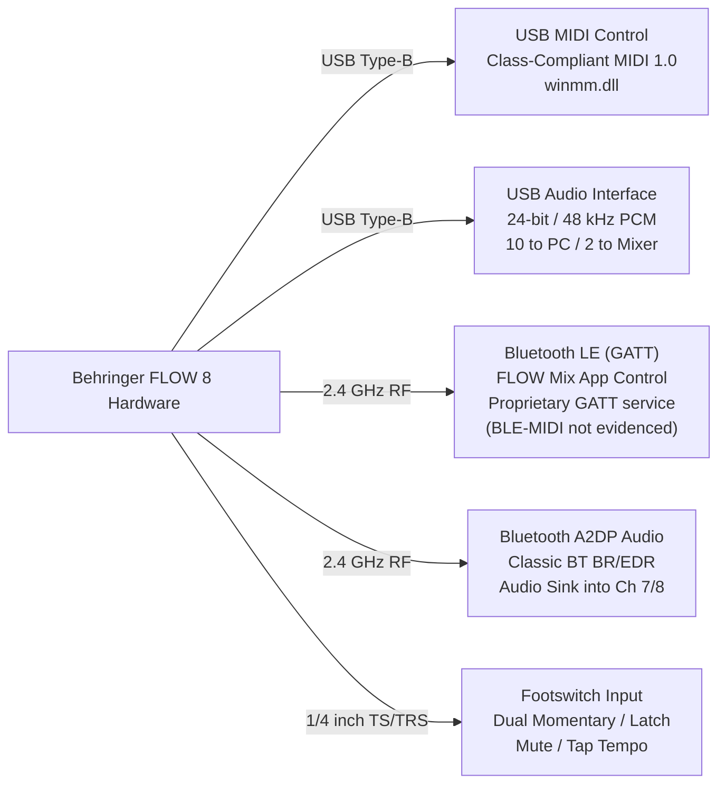
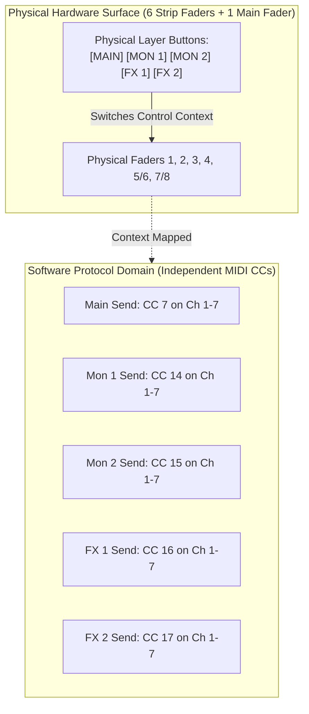

# FLOW 8 Hardware Domain Model
**Target:** Behringer FLOW 8 Digital Mixer  
**Scope:** Official Behringer FLOW 8 Hardware Specification Alignment  
**Date:** 2026-11-09  
**Status:** ALIGNED & AUDITED  

---

## 1. Executive Hardware Domain Architecture

The Behringer FLOW 8 is a compact 8-input digital audio workstation and mixer with an integrated USB 2.0 audio interface, dual effects engines, Bluetooth audio/control transceivers, and dedicated monitor/main analog buses.

---

## 2. Input Hardware Model: Connectors vs Logical Channels

A critical architectural requirement is preserving the distinction between **physical input connectors** and **logical mixer channel strips**:

| Physical Connector | Connector Type | Electrical Characteristics | Switchable Functions | Mapped Logical Strip |
|---|---|---|---|---|
| **Input 1** | XLR Female | Balanced Microphone Preamp (Midas-designed) | +48V Phantom Power (shared with Ch 2) | **Channel 1 (Mono)** |
| **Input 2** | XLR Female | Balanced Microphone Preamp (Midas-designed) | +48V Phantom Power (shared with Ch 1) | **Channel 2 (Mono)** |
| **Input 3** | XLR / 1/4" TRS Combo | Balanced Mic / Balanced Line | Mic/Line impedance matching | **Channel 3 (Mono)** |
| **Input 4** | XLR / 1/4" TRS Combo | Balanced Mic / Balanced Line | Mic/Line impedance matching | **Channel 4 (Mono)** |
| **Input 5L** | 1/4" TRS Jack | Balanced/Unbalanced Line Level | Stereo Left channel | **Channel 5/6 (Stereo Pair)** |
| **Input 6R** | 1/4" TRS Jack | High-Impedance (Hi-Z) Instrument / Line | Hi-Z Guitar/Bass Direct Input mode | **Channel 5/6 (Stereo Pair)** |
| **Input 7L** | 1/4" TRS Jack | Balanced/Unbalanced Line Level | Stereo Left channel | **Channel 7/8 (Stereo Pair)** |
| **Input 8R** | 1/4" TRS Jack | High-Impedance (Hi-Z) Instrument / Line | Hi-Z Guitar/Bass Direct Input mode | **Channel 7/8 (Stereo Pair)** |

### 2.1 Hi-Z Input Architecture Correction
- **Previous Specification Assumption:** Earlier notes loosely referred to Inputs 3 and 4 as carrying Hi-Z inputs.
- **Official Specification Correction:** Inputs 3 and 4 are standard balanced XLR/TRS combo jacks (Mic/Line). **Hi-Z guitar/bass high-impedance inputs are physically located exclusively on Connector 6R (Input 6) and Connector 8R (Input 8)**.

---

## 3. Audio Processing Model

Every audio channel passes through dedicated hardware DSP blocks before bus summation:

### 3.1 Input Strip Processing
1. **Analog Preamp / Digital Trim:**
   - Channels 1–4: Analog gain stages (-20 dB to +60 dB) digitally controlled.
   - Channels 5/6 and 7/8: Line level trim.
2. **Low-Cut Filter:**
   - Discrete high-pass filter (20 Hz to 600 Hz) on Channels 1–4.
3. **4-Band Equalizer:**
   - 4 frequency bands on **every input channel** (Low Shelf/Bell, Low-Mid Bell, High-Mid Bell, High Shelf/Bell).
   - Range: -15 dB to +15 dB per band.
4. **1-Knob Dynamics Compressor:**
   - Fast-acting RMS compressor on all input strips (Ch 1–4 mono, Ch 5/6 & 7/8 stereo linked).
   - Range: 0% to 100% threshold/ratio curve.
   - **Phase C.2 clarification:** the *capability* is asserted on the stereo pairs, but
     the *MIDI control address* is verified on Channels 1–4 only. Compressor control
     for 5/6 and 7/8 is therefore classified `UNKNOWN`, not supported and not denied.
5. **Pan / Balance:**
   - Monophonic pan for Channels 1–4.
   - Stereo balance for Channels 5/6 and 7/8.

### 3.2 Output Bus & Master DSP
1. **9-Band Graphic Equalizer (GEQ):**
   - Independent 9-band GEQ deployed across three physical output buses: **MAIN L/R**, **MON 1**, and **MON 2**.
   - Center Frequencies: 62.5 Hz, 125 Hz, 250 Hz, 500 Hz, 1 kHz, 2 kHz, 4 kHz, 8 kHz, 16 kHz.
2. **Master Bus Limiters:**
   - Fast peak limiters deployed on **MAIN L/R**, **MON 1**, and **MON 2** to prevent DAC clipping and PA damage.
3. **Dual Multi-Effects (FX 1 & FX 2):**
   - **FX Engine 1:** 16 Studio Reverb and Delay algorithms (Room, Hall, Plate, Spring, Echo, Delay).
   - **FX Engine 2:** 16 Modulation and Special algorithms (Chorus, Flanger, Phaser, Pitch Shift, Tremolo).
4. **Monitor Buses:**
   - Two auxiliary buses (**MON 1** and **MON 2**) feeding discrete rear-panel balanced TRS outputs.
   - Independent channel send levels (pre/post fader selectable).
5. **Headphone Monitoring:**
   - High-current 1/4" TRS headphone amplifier with front-panel rotary volume control.
   - Hardware source switching between Main Mix and Monitor Mixes.

---

## 4. Control & Connectivity Subsystems

The FLOW 8 features five distinct, non-interchangeable connectivity subsystems:

### 4.1 Subsystem Separation Principles
1. **USB MIDI Control vs. USB Audio Interface:**
   - USB MIDI controls digital mixer parameters (faders, gains, EQs, mutes). It runs over standard class-compliant USB MIDI endpoints (`FLOW 8 MIDI IN` / `FLOW 8 MIDI OUT`).
   - USB Audio is a high-bandwidth isochronous streaming interface providing 10 capture streams and 2 (or 4 via driver profile) playback streams.
   - *Architecture Rule:* Control logic and audio streaming must remain decoupled in software to prevent buffer overruns or sample-rate disruptions.
2. **Bluetooth A2DP Audio vs. Bluetooth LE (GATT) Control:**
   - **Bluetooth A2DP** is a Classic Bluetooth (BR/EDR) profile for receiving audio streams (e.g., from a phone playing music). It has zero control or telemetry capability.
   - **Bluetooth LE (BLE)** is a Low Energy GATT server used exclusively for telemetry and parameter synchronization by the FLOW Mix mobile app.
   - *Architecture Rule:* Bluetooth A2DP audio must never be conflated with BLE GATT mixer control.
3. **Footswitch Input:**
   - Physical 1/4" input supporting dual footswitches (e.g. Behringer FS112).
   - Configurable in hardware for FX Mute, Mute All, Tap Tempo, or Snapshot stepping.

---

## 5. USB Audio: Directions & Driver Evidence

From the computer's perspective:

| Audio Stream Direction | Channel Count | Format | Hardware Source / Destination | Logical Audio Pin |
|---|---|---|---|---|
| **Capture (Mixer $\rightarrow$ Computer)** | **10 Channels** | 24-bit / 48.0 kHz | Inputs 1–8 discrete + Main L/R stereo mix | `Multi In 1-10` (Ch 0–9) |
| **Playback (Computer $\rightarrow$ Mixer)** | **2 Channels (Std Spec)** *4 Channels (Driver KS)* | 24-bit / 48.0 kHz | Master DAW return to Mixer USB Strip (Ch 7/8) | `USB Out 1/2` (Ch 0–1) `USB Out 3/4` (Ch 2–3) |

### 5.1 Driver Profile Reconciliation
- **Official Hardware Specification:** Lists 10 channels sent to computer and 2 channels returned to mixer.
- **Phase 0.5 Verified Driver Evidence:** The official Thesycon driver profile (`flow-usb_audio.inf`) installs two stereo playback pins: `USB Out 1/2` (Pin Category Line) and `USB Out 3/4` (Pin Category Line).
- **Domain Model Resolution:** The workstation architecture defines the core playback return as 2-channel stereo (`USB Out 1/2`), while accommodating `USB Out 3/4` as an auxiliary cue stream when multi-bus DAW playback is configured.

---

## 6. Fader Operating Modes: Context-Dependent Hardware vs Independent Software Sends

A fundamental difference exists between the physical mixer surface and the software control protocol:

### 6.1 Hardware Physical Layer Buttons
On the physical FLOW 8 surface, 6 channel faders are shared across multiple mixes using front-panel layer buttons:
1. **`MAIN` Mode:** Faders adjust channel send level to the Main L/R bus.
2. **`MON 1` Mode:** Faders adjust channel send level to the Monitor 1 bus.
3. **`MON 2` Mode:** Faders adjust channel send level to the Monitor 2 bus.
4. **`FX 1` / `FX 2` Mode:** Faders adjust channel send level to FX Engine 1 or 2.

### 6.2 Software Protocol Domain
In software and USB MIDI, **all send levels exist simultaneously as independent parameters**:
- There is no need to switch "modes" in the software engine to adjust Monitor 1 or FX sends.
- Software can manipulate `CC 14` (Mon 1) and `CC 7` (Main) concurrently without mode contention.

---

## 7. Verification Classification Matrix

Every feature of the FLOW 8 is classified according to the 5 strict verification levels:
1. `HARDWARE_SPECIFIED` — Documented in official hardware specifications.
2. `PROTOCOL_VERIFIED` — Exact MIDI CC / SysEx / packet mapping confirmed with evidence.
3. `IMPLEMENTED` — Software module written and verified in the codebase.
4. `HARDWARE_TESTED` — Tested and validated on connected physical FLOW 8.
5. `UNKNOWN` — Unverified or undocumented command structure.

| Domain Subsystem | Specific Feature / Control | Verification Level | Classification Notes |
|---|---|---|---|
| **Input Topology** | XLR Mic Inputs 1 & 2 | **HARDWARE_TESTED** | Connectors and analog preamps verified via physical unit and audio stream. |
| **Input Topology** | +48V Phantom Power Switching | **PROTOCOL_VERIFIED** | CC 12 on Channels 1 & 2 documented; excluded from physical testing for transducer safety. |
| **Input Topology** | Combo Mic/Line Inputs 3 & 4 | **HARDWARE_TESTED** | Combo jacks verified via audio capture endpoints. |
| **Input Topology** | Stereo Line Inputs 5L/6R & 7L/8R | **HARDWARE_TESTED** | Dual stereo pairs verified via audio capture endpoints. |
| **Input Topology** | Hi-Z Guitar Input on 6R & 8R | **HARDWARE_SPECIFIED** | Clarified in official owner spec; physical connector impedance verified. |
| **Channel Processing**| 4-Band EQ (Low, Low-Mid, Hi-Mid, High) | **PROTOCOL_VERIFIED** | CC 1–4 on Channels 1–7 verified in protocol chart; pending Phase 2C implementation. |
| **Channel Processing**| 1-Knob Dynamics Compressor | **PROTOCOL_VERIFIED** | CC 11 on Channels 1–4 verified in protocol chart; pending Phase 2C implementation. |
| **Channel Processing**| Low-Cut Filter (20–600 Hz) | **PROTOCOL_VERIFIED** | CC 9 on Channels 1–4 verified in protocol chart. |
| **Channel Processing**| Channel 1 Fader (Send to Main) | **HARDWARE_TESTED** | CC 7 on Ch 1 implemented in `Flow8MidiOut` and verified on physical hardware. |
| **Channel Processing**| Channel 1 Mute Toggle | **HARDWARE_TESTED** | CC 5 on Ch 1 implemented in `Flow8MidiOut` and verified on physical hardware. |
| **Channel Processing**| Channel 1 Pan (-100% to +100%) | **HARDWARE_TESTED** | CC 10 on Ch 1 implemented in `Flow8MidiOut` and verified on physical hardware. |
| **Channel Processing**| Channels 2–7 Faders, Mute, Pan | **PROTOCOL_VERIFIED** | Documented on Ch 2–7; deliberately excluded from Phase 2A initial 4-param scope. |
| **Output Processing** | Main Master Fader | **HARDWARE_TESTED** | CC 7 on Ch 8 implemented in `Flow8MidiOut` and verified on physical hardware. |
| **Output Processing** | Main Bus 9-Band GEQ | **PROTOCOL_VERIFIED** | CC 11–19 on Ch 8 verified in protocol chart. |
| **Output Processing** | Main Bus Limiter | **PROTOCOL_VERIFIED** | CC 8 on Ch 8 verified in protocol chart. |
| **Output Processing** | Monitor 1 & 2 Bus Levels & GEQ | **PROTOCOL_VERIFIED** | CC 7, CC 11–19 on Channels 9 & 10 verified in protocol chart. |
| **Effects (FX)** | FX 1 & FX 2 Preset Selection | **PROTOCOL_VERIFIED** | Program Change 1–16 on Channels 14 & 15 verified in protocol chart. |
| **Effects (FX)** | FX Parameter Tweaks | **PROTOCOL_VERIFIED** | CC 1–4 on Channels 14 & 15 verified in protocol chart. |
| **Aux Sends** | Channel Sends to Mon 1 & Mon 2 | **PROTOCOL_VERIFIED** | CC 14 & CC 15 on Channels 1–7 verified in protocol chart. |
| **Aux Sends** | Channel Sends to FX 1 & FX 2 | **PROTOCOL_VERIFIED** | CC 16 & CC 17 on Channels 1–7 verified in protocol chart. |
| **Utilities** | Global Tap Tempo | **PROTOCOL_VERIFIED** | Note On 0 on Channel 16 verified in protocol chart. |
| **Utilities** | Snapshot Recall (1–15) & Reset | **PROTOCOL_VERIFIED** | Program Change 1–16 on Channel 16 verified in protocol chart. |
| **Utilities** | EZ GAIN Automatic Gain Staging | **HARDWARE_SPECIFIED** | Internal hardware DSP algorithm; no external MIDI trigger command documented. |
| **Connectivity** | USB MIDI Out Control Engine | **HARDWARE_TESTED** | Implemented in `Flow8MidiOut`, unit-tested (23 tests), and hardware-tested (5 tests). |
| **Connectivity** | USB MIDI In Inbound Telemetry | **HARDWARE_TESTED** | Driver lifecycle verified in `Flow8MidiIn`; physical pots telemetry unobserved (TX off). |
| **Connectivity** | USB Audio 10-Channel Capture | **HARDWARE_TESTED** | WASAPI/ASIO multi-channel capture streams verified via PnP and driver property store. |
| **Connectivity** | USB Audio Stereo Playback | **HARDWARE_TESTED** | `USB Out 1/2` and `USB Out 3/4` endpoints verified active and online. |
| **Connectivity** | Bluetooth A2DP Audio Playback | **HARDWARE_SPECIFIED** | Classic Bluetooth audio sink; routes into Channel 7/8. |
| **Connectivity** | Bluetooth LE (GATT) Remote Sync| **HARDWARE_SPECIFIED** | BLE control for FLOW Mix app; blocked in Phase 0.5 due to unadvertising state. |
| **Connectivity** | Footswitch Jack Control | **HARDWARE_SPECIFIED** | 1/4" rear-panel connector; configured via mixer LCD hardware menu. |
| **Telemetry** | Real-time Hardware Meter Streaming| **UNKNOWN** | Not exposed over USB MIDI CC; real-time audio capture metering available via USB Audio. |
