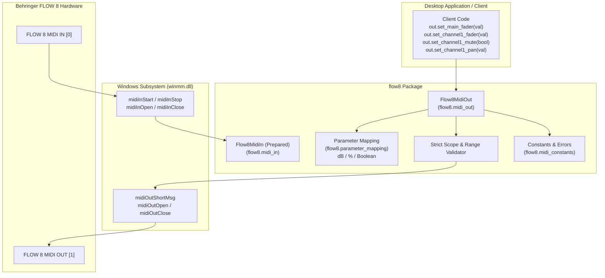

# FLOW 8 Phase 2A — USB MIDI Out Engine Implementation
**Target:** Behringer FLOW 8 Digital Mixer  
**Phase:** Phase 2A — Implement FLOW 8 USB MIDI Out Engine  
**Date:** 2026-11-09  
**Status:** IMPLEMENTED & HARDWARE-VERIFIED  

---

## 1. Project Pre-Edit Inspection & Architectural Plan

In accordance with Step 1, the codebase was inspected to establish an isolated, modular architecture that protects existing evidence and research:

### 1.1 Pre-Edit Impact Assessment
- **Files Reused:**
  - `flow8_midi_harness.py`: Preserved as the reference low-level diagnostic script from Phase 1.
  - [FLOW8_USB_MIDI_PROTOCOL.md](file:///c:/Users/Administrator/Desktop/mixing-station-pc-windows-3-2-2-789/FLOW8_USB_MIDI_PROTOCOL.md): Authoritative protocol mapping reference for Channels 1 & 8, CC 5, 7, and 10.
  - [FLOW8_PHASE1_MIDI_TEST_RESULTS.md](file:///c:/Users/Administrator/Desktop/mixing-station-pc-windows-3-2-2-789/FLOW8_PHASE1_MIDI_TEST_RESULTS.md): Baseline timing and latency metrics (~140 µs average dispatch).
- **Files Created:**
  - `flow8/__init__.py`: Package entrypoint exporting public engine classes and mapping functions.
  - `flow8/midi_constants.py`: WinMM API constants, status byte definitions, CC numbers, and channel IDs.
  - `flow8/parameter_mapping.py`: Pure mapping functions for Fader (dB $\leftrightarrow$ MIDI), Pan (% $\leftrightarrow$ MIDI), and Mute (bool $\leftrightarrow$ MIDI).
  - `flow8/midi_out.py`: Production-grade `Flow8MidiOut` controller class.
  - `flow8/midi_in.py`: Prepared `Flow8MidiIn` listener interface and driver lifecycle.
  - `tests/test_parameter_mapping.py`: 13 unit tests for value boundaries, monotonicity, and cardinal points.
  - `tests/test_midi_out.py`: 10 mock-isolated unit tests for byte encoding, parameter validation, and lifecycle.
  - `tests/test_hardware_midi_out.py`: 5 physical hardware integration tests executing against the connected FLOW 8.
- **Files Modified:** None (strictly zero modifications to existing Phase 0.5 and Phase 1 research or extracted binaries).
- **Dependencies Required:** Python Standard Library only (`ctypes`, `wintypes`, `threading`, `math`, `unittest`, `enum`, `typing`). No third-party packages or C compilers required.
- **Potential Regressions:** None. All new logic resides in isolated `flow8/` and `tests/` directories.

---

## 2. Parameter Scope Lock (Initial 4 Parameters)

Phase 2A strictly restricts outbound MIDI control to the 4 parameters verified during Phase 1:

| Parameter | Mixer Subsystem | MIDI Channel | Status Byte | CC # | Value Range | Mapped Engineering Range | Verification Level |
|---|---|---|---|---|---|---|---|
| **Main Fader** | Master Bus (MAIN L/R) | Channel 8 | `0xB7` | CC 7 | 0 – 127 | 0 = OFF (-inf), 1 = -70 dB, 101 = 0 dB, 127 = +10 dB | Hardware-Verified |
| **Channel 1 Fader** | Input Strip 1 (Mic 1) | Channel 1 | `0xB0` | CC 7 | 0 – 127 | 0 = OFF (-inf), 1 = -70 dB, 101 = 0 dB, 127 = +10 dB | Hardware-Verified |
| **Channel 1 Mute** | Input Strip 1 (Mic 1) | Channel 1 | `0xB0` | CC 5 | 0 / 127 | 0 = Mute OFF, 127 = Mute ON | Hardware-Verified |
| **Channel 1 Pan** | Input Strip 1 (Mic 1) | Channel 1 | `0xB0` | CC 10 | 0 – 127 | 0 = -100% (Hard L), 64 = Center (0%), 127 = +100% (Hard R) | Hardware-Verified |

> [!IMPORTANT]
> Any attempt to transmit unverified CCs (e.g., EQ, Gain, Compressor, FX, or other channels) raises a `Flow8ValidationError` immediately, preventing undocumented commands from reaching the hardware.

---

## 3. Component Architecture & Implementation Details

### 3.1 Parameter Mapping Engine (`flow8/parameter_mapping.py`)
- **Mute:**
  - `mute_bool_to_midi(muted: bool) -> int`: Returns `127` if True, `0` if False.
  - `mute_midi_to_bool(val: int) -> bool`: Returns `True` if $val > 0$, `False` if $val == 0$.
- **Pan:**
  - `pan_percent_to_midi(percent: float) -> int`: Maps $-100.0\%$ to $0$, $0.0\%$ to $64$ (Center), $+100.0\%$ to $127$.
  - `pan_midi_to_percent(val: int) -> float`: Symmetrical conversion preserving exact $0.0\%$ at MIDI 64.
- **Fader (Decibels):**
  - **Explicit OFF Handling:** Value 0 maps strictly to `float('-inf')`. Conversely, $-\infty\text{ dB}$ or values $< -70\text{ dB}$ map to MIDI 0.
  - **Status:** **UNVERIFIED APPROXIMATION**. Because Behringer does not disclose internal DSP fader taper polynomial tables, a piecewise linear taper is implemented (1 to 101 $\rightarrow$ -70 dB to 0 dB unity; 101 to 127 $\rightarrow$ 0 dB to +10 dB). Direct raw MIDI integer manipulation (`0–127`) is maintained as the primary authoritative interface.

### 3.2 Outbound MIDI Engine (`flow8/midi_out.py`)
- **Thread Safety:** All public methods are synchronized with a re-entrant lock (`threading.RLock`), protecting against concurrent UI and worker thread access.
- **Lifecycle & Duplicate Prevention:** The `open()` method checks `_is_open` and automatically releases any previous handle before re-allocating, preventing endpoint resource leaks. Context manager protocol (`__enter__` and `__exit__`) ensures safe release.
- **Disconnection Handling:** If `midiOutShortMsg` returns `MMSYSERR_INVALHANDLE` or `MMSYSERR_NODRIVER`, the engine immediately clears internal state, marks `is_connected = False`, and raises `Flow8NotConnectedError`.
- **Error Types:**
  - `Flow8NotConnectedError`: Dispatched when sending without an active endpoint.
  - `Flow8ValidationError`: Dispatched on out-of-range values or unverified parameter IDs.
  - `Flow8DeviceBusyError`: Dispatched when another DAW or utility holds an exclusive lock (`MMSYSERR_ALLOCATED`).
  - `Flow8MidiError`: Base exception for generic Windows multimedia driver faults.

### 3.3 Inbound Listener Preparation (`flow8/midi_in.py`)
- Prepared non-blocking C callback (`MidiInProc`) that decodes incoming `MIM_DATA` bytes into structured events `(timestamp, channel, command, data1, data2)`.
- Lifecycle methods (`open`, `start`, `stop`, `close`) verified against the physical driver.
- Conforms strictly to constraints: **No bidirectional synchronization or fabricated incoming events are claimed**.
