# FLOW 8 Phase 2A — Test Results Report
**Target:** Behringer FLOW 8 Digital Mixer  
**Phase:** Phase 2A — Implement FLOW 8 USB MIDI Out Engine  
**Date:** 2026-11-09  
**Execution:** 28 Total Tests (23 Unit Tests + 5 Hardware Integration Tests)  
**Result:** ALL 28 TESTS PASSED (100% Pass Rate)  

---

## 1. Categorization Matrix

In strict accordance with Phase 2A guidelines, findings and capabilities are categorized into four distinct verification states:

```mermaid
flowchart TD
    subgraph C1["1. Implemented"]
        I1["Flow8MidiOut Engine Class"]
        I2["Parameter Mapping Functions (dB, %, bool)"]
        I3["Flow8MidiIn Listener Lifecycle"]
        I4["Strict Parameter & Channel Validation"]
    end

    subgraph C2["2. Unit-Tested (Mocked / Pure)"]
        U1["MIDI Byte Encoding & DWORD Packing (0x6407B7, etc.)"]
        U2["Out-of-Range & Unverified Parameter Rejection"]
        U3["Disconnection Detection & Handle Invalidation"]
        U4["Duplicate Handle Prevention & Cleanup"]
        U5["Pan Center Point (64 = 0.0%) & Extremes"]
        U6["Fader OFF (-inf) & Monotonic Scaling"]
        U7["Mute ON (127) / OFF (0) Conversions"]
    end

    subgraph C3["3. Hardware-Verified (Physical FLOW 8)"]
        H1["Physical Endpoint Discovery ('FLOW 8 MIDI OUT')"]
        H2["Endpoint Open / Close Lifecycle & Reconnection"]
        H3["Context Manager Hardware Lifecycle ('with Flow8MidiOut()')"]
        H4["Main Fader Physical Transmission (Ch 8, CC 7)"]
        H5["Channel 1 Fader Physical Transmission (Ch 1, CC 7)"]
        H6["Channel 1 Mute Physical Transmission (Ch 1, CC 5)"]
        H7["Channel 1 Pan Physical Transmission (Ch 1, CC 10)"]
        H8["Physical MIDI IN Listener Open / Start / Stop / Close Lifecycle"]
    end

    subgraph C4["4. Still Unverified"]
        UV1["Fader Non-Linear Logarithmic dB Taper (Internal DSP Curve)"]
        UV2["Physical Fader Telemetry over MIDI IN (Requires User Moving Pots)"]
        UV3["Remaining Channels 2–7 & Busses (Excluded from Phase 2A Scope)"]
    end

    C1 --> C2
    C2 --> C3
    C3 -.-> C4
```



---

## 2. Test Execution Breakdown

### 2.1 Parameter Mapping Unit Tests (`tests/test_parameter_mapping.py`)
- **Execution Mode:** Pure Python / Deterministic.
- **Test Count:** 13 Passed.

| Test Case | Description | Tested Boundaries / Values | Result |
|---|---|---|---|
| `test_mute_bool_to_midi` | Boolean to MIDI integer conversion | `True -> 127`, `False -> 0` | PASS |
| `test_mute_midi_to_bool` | Integer to boolean conversion | `0 -> False`, `127 -> True`, `1, 64 -> True` | PASS |
| `test_mute_out_of_bounds` | Rejection of invalid MIDI integers | `-1`, `128` raise `ValueError` | PASS |
| `test_pan_center` | Pan zero centerpoint validation | `0.0% -> 64`, `64 -> 0.0%` | PASS |
| `test_pan_extremes` | Hard Left and Hard Right bounds | `-100.0% -> 0`, `+100.0% -> 127` | PASS |
| `test_pan_clamping` | Safe clamping beyond $\pm 100\%$ | `-150.0% -> 0`, `+150.0% -> 127` | PASS |
| `test_pan_out_of_bounds_midi` | Rejection of invalid pan MIDI integers | `-1`, `128` raise `ValueError` | PASS |
| `test_pan_monotonicity` | Strict mathematical monotonicity check | All values $0 \le v \le 127$ strictly increase | PASS |
| `test_fader_off_handling` | Fader attenuation down to silence | `0 -> -inf`, `-inf, -100 dB, -75 dB -> 0` | PASS |
| `test_fader_cardinal_points` | Minimum audible, unity, and maximum dB | `1 -> -70 dB`, `101 -> 0 dB`, `127 -> +10 dB` | PASS |
| `test_fader_clamping` | Fader dB clamping outside operating range | `+20 dB -> 127`, `-200 dB -> 0` | PASS |
| `test_fader_out_of_bounds_midi` | Rejection of invalid fader MIDI integers | `-1`, `128` raise `ValueError` | PASS |
| `test_fader_monotonicity` | Strict mathematical monotonicity check | All values $1 \le v \le 127$ strictly increase | PASS |

---

### 2.2 MIDI Out Engine Unit Tests (`tests/test_midi_out.py`)
- **Execution Mode:** Isolated with Mocked Windows Multimedia API.
- **Test Count:** 10 Passed.

| Test Case | Description | Verification Criterion | Result |
|---|---|---|---|
| `test_send_when_disconnected` | Sending before `open()` | Raises `Flow8NotConnectedError` | PASS |
| `test_invalid_channel_validation` | Out-of-bounds channels | Channels `0`, `17` raise `Flow8ValidationError` | PASS |
| `test_invalid_cc_number` | Out-of-bounds CC IDs | CC `-1`, `128` raise `Flow8ValidationError` | PASS |
| `test_invalid_value` | Out-of-bounds CC values | Value `-1`, `128` raise `Flow8ValidationError` | PASS |
| `test_unverified_parameter_rejected` | Confinement to Phase 2A parameters | Ch 2 CC 7 and Ch 1 CC 8 raise `Flow8ValidationError` | PASS |
| `test_byte_encoding_and_dispatch` | Bitwise DWORD construction | Main Fader (`0x6407B7`), Ch 1 Fader (`0x3207B0`), Ch 1 Mute (`0x7F05B0`), Ch 1 Pan (`0x400AB0`) verified | PASS |
| `test_open_allocation_error` | Endpoint collision handling | `MMSYSERR_ALLOCATED` raises `Flow8DeviceBusyError` | PASS |
| `test_open_not_found` | Endpoint missing handling | Missing endpoint raises `Flow8NotConnectedError` | PASS |
| `test_disconnection_during_dispatch` | Sudden USB pull during write | `MMSYSERR_INVALHANDLE` raises `Flow8NotConnectedError` and clears handle | PASS |
| `test_lifecycle_and_duplicate_handles` | Handle lifecycle & idempotent open | Re-opening cleans previous handle without leak | PASS |

---

### 2.3 Hardware Integration Tests (`tests/test_hardware_midi_out.py`)
- **Execution Mode:** Live hardware communication with connected Behringer FLOW 8.
- **Target Device:** `USB\VID_1397&PID_050C\70-B9-50-66-4D-68` (`FLOW 8 MIDI OUT` / `FLOW 8 MIDI IN`).
- **Test Count:** 5 Passed.

| Test Case | Physical Operation | Hardware Verification | Result |
|---|---|---|---|
| `test_hardware_lifecycle` | Endpoint Open & Close against live driver | Located `FLOW 8 MIDI OUT` (ID 1). Opened and closed cleanly without driver error. | PASS |
| `test_hardware_reconnect` | Consecutive Open $\rightarrow$ Close $\rightarrow$ Open $\rightarrow$ Close | Re-established driver session without memory or handle retention. | PASS |
| `test_hardware_context_manager` | `with Flow8MidiOut() as out:` | Automatic resource allocation and cleanup confirmed. | PASS |
| `test_hardware_parameter_dispatches` | Sequence of safe parameter dispatches | Dispatched: Main Fader (10, 20, 0), Ch 1 Fader (10, 20, 0), Ch 1 Mute (True, False), Ch 1 Pan (32, 96, 64), and dB / % helpers. Driver returned `0` (`MMSYSERR_NOERROR`) on all calls. | PASS |
| `test_hardware_midi_in_lifecycle` | Inbound listener `open()`, `start()`, `stop()`, `close()` | Verified driver callback hook and unhook on `FLOW 8 MIDI IN` (ID 0) without hangs or leaks. | PASS |

---

## 3. Test Runner Console Summary

```text
Ran 28 tests in 0.990s

OK
```

All 28 tests executed successfully in 0.99 seconds with zero failures and zero errors.
