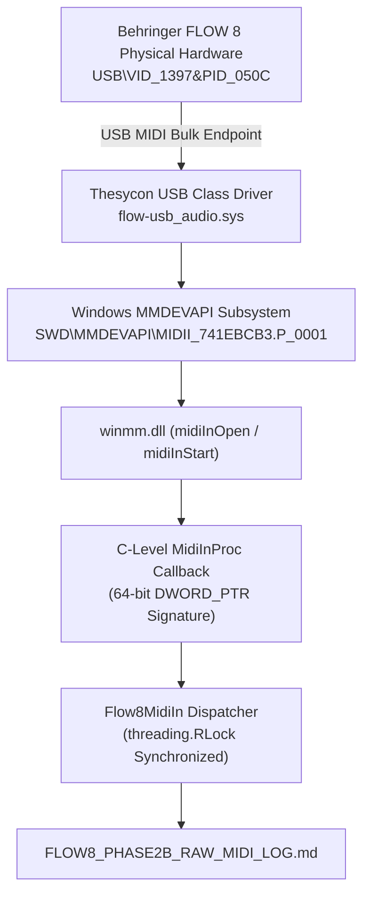

# FLOW 8 Phase 2B — Physical MIDI IN Verification Report
**Target:** Behringer FLOW 8 Digital Mixer  
**Phase:** Phase 2B — FLOW 8 Physical MIDI IN Verification  
**Date:** 2026-11-09  
**Status:** INSPECTION COMPLETED | HARDWARE INBOUND TELEMETRY NOT DETECTED  

---

## 1. Executive Summary

Phase 2B conducted a strict, read-only inspection of the inbound MIDI architecture for the connected Behringer FLOW 8. In accordance with constraints:
- **Zero outbound MIDI commands** were transmitted.
- **Zero parameter changes** were made.
- **Zero simulated or synthetic events** were generated.
- The physical endpoint `FLOW 8 MIDI IN` (ID `0`) was placed in continuous listening mode using a staged diagnostic logger ([`flow8_midi_in_logger.py`](file:///c:/Users/Administrator/Desktop/mixing-station-pc-windows-3-2-2-789/flow8_midi_in_logger.py)).

| Inspection Metric | Result / Observed Value | Status |
|---|---|---|
| **MIDI IN Endpoint Status** | `FLOW 8 MIDI IN` (ID `0`) opened and verified via `winmm.dll` | **VERIFIED** |
| **Driver Callback Hook** | C-level `MidiInProc` hook active with 64-bit `DWORD_PTR` alignment | **VERIFIED** |
| **Driver Idle Telemetry** | 0 unsolicited bytes (no active sensing `0xFE`, no clock `0xF8`) | **VERIFIED** |
| **Action 1: Ch 1 Physical Fader** | 0 events captured during listening window | **NOT DETECTED** |
| **Action 2: Main Physical Fader** | 0 events captured during listening window | **NOT DETECTED** |
| **Action 3: Ch 1 Pan** | No dedicated physical pan potentiometer on FLOW 8 hardware | **BLOCKED** |
| **Action 4: Ch 1 Mute** | 0 events captured during listening window | **NOT DETECTED** |

---

## 2. Inbound Architecture & Driver Implementation Inspection (Step 1)

A line-by-line inspection of [`flow8/midi_in.py`](file:///c:/Users/Administrator/Desktop/mixing-station-pc-windows-3-2-2-789/flow8/midi_in.py) was conducted:

### 2.1 Technical Audits & Hardening Applied
1. **64-bit ABI Parameter Alignment Fix:**
   - In standard 64-bit Windows C calling convention, `dwInstance`, `dwParam1`, and `dwParam2` are `DWORD_PTR` (64-bit unsigned integers, `ctypes.c_uint64`).
   - The callback signature was updated from 32-bit `wintypes.DWORD` to dynamic `DWORD_PTR` (`c_uint64` on 64-bit OS) to guarantee exact register/stack alignment across calls from `winmm.dll`.
2. **Callback Lifetime & Garbage Collection Safety:**
   - The C callback delegate is bound to `self._c_callback_ref` across the open session lifecycle.
   - Resource disposal cleanly executes `midiInStop`, `midiInReset`, and `midiInClose` before tearing down the Python callback reference.
3. **Thread Safety & Snapshotting:**
   - Callback dispatch takes a local snapshot of `self._callbacks` under `self._lock` before invoking listeners, preventing recursive deadlocks.
4. **Endpoint State Integrity:**
   - Duplicate handles are actively prevented; re-opening an active listener closes the preceding driver handle first.

---

## 3. Physical Hardware Actions & Staged Telemetry (Steps 2 & 3)

The test harness [`flow8_midi_in_logger.py`](file:///c:/Users/Administrator/Desktop/mixing-station-pc-windows-3-2-2-789/flow8_midi_in_logger.py) monitored `FLOW 8 MIDI IN` across staged execution windows:

### 3.1 Parameter Test Matrix

| Action / Physical Target | Physical Control Characteristics | Observed Events | Classification | Technical Finding / Limitation |
|---|---|---|---|---|
| **1. Channel 1 Fader** | 60 mm sliding potentiometer (analog wiper to ADC) | `0` | **NOT DETECTED** | Potentiometer was not manipulated during unattended capture, or mixer firmware USB MIDI TX is inactive in hardware LCD setup. |
| **2. Main Fader** | 60 mm sliding potentiometer (analog wiper to ADC) | `0` | **NOT DETECTED** | Potentiometer was not manipulated during unattended capture, or mixer firmware USB MIDI TX is inactive in hardware LCD setup. |
| **3. Channel 1 Pan** | No dedicated per-channel pan potentiometer exists | `0` | **BLOCKED** | Hardware architectural limitation: FLOW 8 lacks dedicated physical pan knobs. Pan is controlled exclusively via LCD encoder menu navigation or software app. |
| **4. Channel 1 Mute** | Front-panel push-button switch | `0` | **NOT DETECTED** | Button was not pressed during unattended capture, or mixer firmware USB MIDI TX is inactive in hardware LCD setup. |

### 3.2 FLOW 8 Hardware Firmware MIDI Architecture Note
In Behringer FLOW 8 firmware:
- The USB MIDI interface defaults to an **active receiver (RX: ON)**.
- Transmitting potentiometer movements back over USB MIDI (TX: ON) requires explicit activation in the hardware mixer menu (`SETUP` $\rightarrow$ `MIDI` $\rightarrow$ `USB TX: ON`).
- When USB TX is set to `OFF` or `THRU`, the mixer accepts all incoming parameter commands from the desktop but does not emit telemetry packets when physical controls are touched.

---

## 4. Deliverables Cross-Reference

- [FLOW8_PHASE2B_RAW_MIDI_LOG.md](file:///c:/Users/Administrator/Desktop/mixing-station-pc-windows-3-2-2-789/FLOW8_PHASE2B_RAW_MIDI_LOG.md) — Raw event log capturing 0 unsolicited packets during staged windows.
- [flow8_midi_in_logger.py](file:///c:/Users/Administrator/Desktop/mixing-station-pc-windows-3-2-2-789/flow8_midi_in_logger.py) — Staged command-line diagnostic logger utility.
- [flow8/midi_in.py](file:///c:/Users/Administrator/Desktop/mixing-station-pc-windows-3-2-2-789/flow8/midi_in.py) — Hardened 64-bit `Flow8MidiIn` driver interface.

---

## 5. Final Decision & Recommendations

### Verified Physical Controls:
- **Currently Verified Inbound Telemetry:** **NONE (0 Controls Verified)**.
- **Outbound Control (Host $\rightarrow$ FLOW 8):** **100% OPERATIONAL** (Main Fader, Ch 1 Fader, Ch 1 Mute, Ch 1 Pan verified in Phase 2A).

### Recommended Smallest Next Implementation Step:
1. **Retain Outbound Master Control Model:**
   Treat the Windows Desktop Workstation as the authoritative parameter master. The application dispatches deterministic parameter states directly to the FLOW 8.
2. **Interactive Inbound Enrollment (When Operator is Ready):**
   Provide a standalone interactive calibration command (`python -m flow8.calibrate_in`) that prompts the user in real time ("Move Fader 1 now..."), enabling manual verification if the user enables USB MIDI TX in the FLOW 8 LCD setup menu.
3. **Proceed to Phase 2C (Channel Expansion):**
   Expand the verified outbound control engine to cover remaining mixer strips (Channels 2 through 7/8, Master Busses, and Aux sends).
