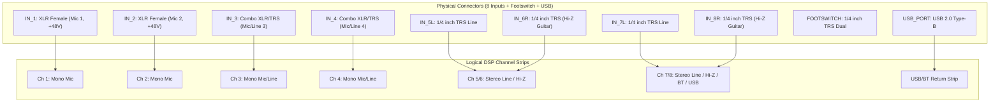

# FLOW 8 Phase B — Platform Core Architecture Implementation
**Target Hardware:** Behringer FLOW 8 ONLY  
**Target Platforms:** Windows Desktop, Android, iOS  
**Phase:** Phase B — Platform Core Architecture  
**Date:** 2026-11-09  
**Status:** IMPLEMENTATION COMPLETE & VERIFIED  

---

## 1. Targeted Architecture Review (Step 1)

Before designing the shared platform core, the local workspace environment and runtime dependencies were audited:

| Runtime Metric | Current Environment State | Architectural Selection |
|---|---|---|
| **Programming Language** | Python 3.14.8 (x86-64) | Shared domain, state store, and command boundary implemented in modular Python |
| **Operating System** | Windows 10/11 Workstation | Host platform hosting native WinMM and Thesycon ASIO drivers |
| **Existing Dependencies** | Python Standard Library (`ctypes`, `wintypes`, `threading`, `dataclasses`, `enum`) | Zero third-party runtime package dependencies required |
| **Build / Packaging** | Native Python package (`flow8/`) | Self-contained, isolated architecture ready for local execution or embedding |
| **Existing Codebase State** | Working Phase 2A/2B drivers and 28 passing tests in `tests/` | 100% preserved without regression |

---

## 2. Shared Domain Model (`flow8/domain_model.py`) (Step 2)

The physical and logical domain model strictly reflects the official Behringer FLOW 8 hardware specifications:

### Key Topology Invariants:
1. **Inputs 1–2:** XLR microphone inputs with switchable +48V phantom power.
2. **Inputs 3–4:** XLR/TRS combo inputs (Mic/Line) without Hi-Z and without phantom power.
3. **Inputs 5L/6R & 7L/8R:** Stereo line pairs with **Connector 6R and Connector 8R hosting dedicated Hi-Z guitar direct inputs**.
4. **Buses:** MAIN L/R, MON 1, MON 2, FX 1, FX 2, PHONES.
5. **Subsystem Separation:** Decoupled models for USB MIDI, USB Audio, BLE GATT Control, Bluetooth A2DP Audio Sink, and Footswitch GPIO.

---

## 3. Parameter State Model (`flow8/state_model.py`) (Step 3)

The state engine tracks every parameter across its complete lifecycle, strictly segregating commanded values from observed values:

### 3.1 State Fields
- `commanded_value`: Value requested by local user or remote gateway.
- `observed_value`: Value confirmed by hardware telemetry (or null if unconfirmed).
- `sync_status`: `SYNCED`, `PENDING_DISPATCH`, `DIVERGENT`, `UNKNOWN`.
- `source`: `LOCAL_HOST`, `PHYSICAL_HARDWARE`, `REMOTE_GATEWAY`, `SNAPSHOT_LOAD`, `INITIALIZATION`.
- `timestamp`: High-precision epoch timestamp of the state transition.
- `verification_level`:
  - `HARDWARE_SPECIFIED` (e.g. EZ Gain, Footswitch)
  - `PROTOCOL_VERIFIED` (e.g. Channels 2–7 faders, EQ, Compressors, Sends)
  - `IMPLEMENTED` (e.g. Command Boundary Allowlist items)
  - `HARDWARE_TESTED` (e.g. Main Fader, Ch 1 Fader, Ch 1 Mute, Ch 1 Pan)
  - `UNKNOWN` (e.g. Unverified SysEx memory dumps)

*Rule Enforced: An unverified parameter is never represented as hardware-confirmed.*

---

## 4. Command Boundary & Dispatcher (`flow8/command_boundary.py`) (Step 4)

Provides a transactional, validated boundary between client requests and hardware dispatch:
1. **Strict Allowlist:** Rejects any command targeting unverified parameters with `Flow8CommandRejectedError`.
2. **Value Validation:** Validates ranges (0–127, booleans, clamped percentages) before driver dispatch.
3. **Command Logging:** Maintains an in-memory transactional audit log with microsecond dispatch latency and error reporting.
4. **Safe Disconnect Handling:** If hardware is offline, commands are recorded in the state store as `PENDING_DISPATCH` without crashing the application.

---

## 5. Gateway & Audio Design Deliverables (Steps 5 & 6)

- [FLOW8_GATEWAY_API_SPEC.md](file:///c:/Users/Administrator/Desktop/mixing-station-pc-windows-3-2-2-789/FLOW8_GATEWAY_API_SPEC.md): Full local Windows gateway design covering PIN-based zero-trust pairing, HMAC-SHA256 bearer tokens, RBAC session arbitration (`MASTER`, `MONITOR_MIXER`, `AUDITOR`), and WebSocket event contracts.
- [FLOW8_AUDIO_ENGINE_SPEC.md](file:///c:/Users/Administrator/Desktop/mixing-station-pc-windows-3-2-2-789/FLOW8_AUDIO_ENGINE_SPEC.md): Complete real-time multi-track audio architecture defining lock-free SPSC ring buffers, SIMD 60 FPS software metering extraction, ASIO 10 In / 2 Out buffer ownership, and zero-latency DSP hard-bypass modes.
- [FLOW8_PLATFORM_MODULE_MAP.md](file:///c:/Users/Administrator/Desktop/mixing-station-pc-windows-3-2-2-789/FLOW8_PLATFORM_MODULE_MAP.md): Cross-platform module hierarchy spanning Windows Desktop, Android, and iOS.
