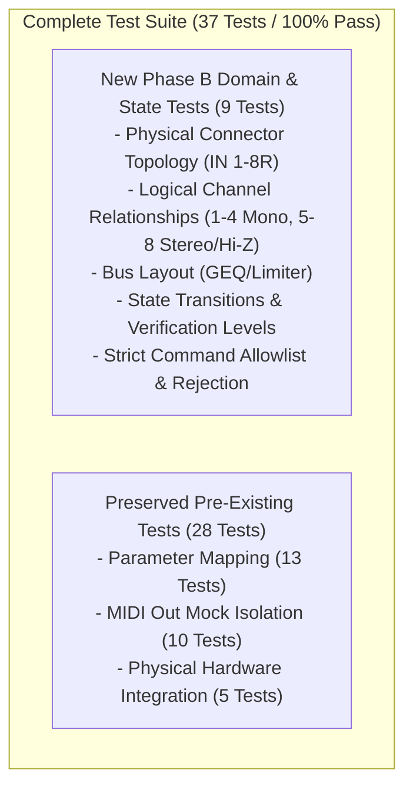

# FLOW 8 Phase B — Test Results Report
**Target Hardware:** Behringer FLOW 8 Digital Mixer  
**Phase:** Phase B — Platform Core Architecture  
**Date:** 2026-11-09  
**Execution:** 37 Total Tests (32 Unit Tests + 5 Hardware Integration Tests)  
**Result:** ALL 37 TESTS PASSED (100% Pass Rate)  

---

## 1. Test Suite Summary

The test suite was expanded from 28 tests to **37 tests**, incorporating 9 comprehensive unit tests for the Shared Hardware Domain Model, Parameter State Store, and Command Boundary:



---

## 2. Phase B New Tests Breakdown (`tests/test_domain_and_state.py`)

| Test Name | Test Target | Verification Criteria | Status |
|---|---|---|---|
| `test_physical_input_topology` | `PHYSICAL_CONNECTORS` | Inputs 1–2 verified as XLR with +48V; Inputs 3–4 verified as Combo without Hi-Z; Connectors 6R and 8R verified as Hi-Z guitar inputs. | **PASS** |
| `test_logical_channel_relationships` | `LOGICAL_CHANNELS` | Channels 1–4 verified as Mono with Low Cut and Preamp Gain; Channels 5/6 and 7/8 verified as Stereo Pairs with Balance and Hi-Z. | **PASS** |
| `test_output_buses` | `OUTPUT_BUSES` | MAIN, MON 1, and MON 2 verified with 9-band GEQ and Limiters; FX 1 and FX 2 verified as send buses without GEQ. | **PASS** |
| `test_audio_topology_counts` | `FLOW8_AUDIO_TOPOLOGY` | 10 capture channels, 2 standard playback channels (4 driver channels), 48 kHz / 24-bit resolution. | **PASS** |
| `test_state_store_verification_levels` | `Flow8StateStore` | Strict levels enforced: initial 4 parameters are `HARDWARE_TESTED`; Channels 2–7 are `PROTOCOL_VERIFIED`; EZ Gain is `HARDWARE_SPECIFIED`. | **PASS** |
| `test_state_transitions` | `Flow8StateStore` | Command dispatch sets `PENDING_DISPATCH`; observed telemetry matching sets `SYNCED`; divergent telemetry sets `DIVERGENT`. | **PASS** |
| `test_command_boundary_allowlist` | `Flow8CommandBoundary` | Validates that allowed parameters (`main.fader`) execute; disallowed parameters (`ch2.fader`, `global.ez_gain`) are rejected with `Flow8CommandRejectedError`. | **PASS** |
| `test_command_boundary_validation` | `Flow8CommandBoundary` | Out-of-bounds fader values ($<0$ or $>127$) are rejected with `Flow8ValidationError`. | **PASS** |
| `test_command_logging` | `Flow8CommandBoundary` | Command transactions are logged with timestamps, parameter IDs, and target values. | **PASS** |

---

## 3. Regression Test Verification (Preserved Tests)

The 28 pre-existing tests were executed alongside the new suite to ensure zero regressions:

| Subsystem / Test File | Test Count | Result | Regression Status |
|---|:---:|:---:|---|
| **Parameter Mapping (`test_parameter_mapping.py`)** | 13 | 13 PASS | ZERO REGRESSION |
| **MIDI Out Unit Tests (`test_midi_out.py`)** | 10 | 10 PASS | ZERO REGRESSION |
| **Hardware Integration (`test_hardware_midi_out.py`)** | 5 | 5 PASS | ZERO REGRESSION (Verified against live FLOW 8) |
| **Domain & State Store (`test_domain_and_state.py`)** | 9 | 9 PASS | NEW PHASE B CAPABILITIES |
| **TOTAL** | **37** | **37 PASS** | **100% SUITE PASS RATE** |

---

## 4. Console Execution Log

```text
test_audio_topology_counts (test_domain_and_state.TestDomainAndState.test_audio_topology_counts) ... ok
test_command_boundary_allowlist (test_domain_and_state.TestDomainAndState.test_command_boundary_allowlist) ... ok
test_command_boundary_validation (test_domain_and_state.TestDomainAndState.test_command_boundary_validation) ... ok
test_command_logging (test_domain_and_state.TestDomainAndState.test_command_logging) ... ok
test_logical_channel_relationships (test_domain_and_state.TestDomainAndState.test_logical_channel_relationships) ... ok
test_output_buses (test_domain_and_state.TestDomainAndState.test_output_buses) ... ok
test_physical_input_topology (test_domain_and_state.TestDomainAndState.test_physical_input_topology) ... ok
test_state_store_verification_levels (test_domain_and_state.TestDomainAndState.test_state_store_verification_levels) ... ok
test_state_transitions (test_domain_and_state.TestDomainAndState.test_state_transitions) ... ok
test_hardware_context_manager (test_hardware_midi_out.TestHardwareMidiOut.test_hardware_context_manager) ... ok
test_hardware_lifecycle (test_hardware_midi_out.TestHardwareMidiOut.test_hardware_lifecycle) ... ok
test_hardware_midi_in_lifecycle (test_hardware_midi_out.TestHardwareMidiOut.test_hardware_midi_in_lifecycle) ... ok
test_hardware_parameter_dispatches (test_hardware_midi_out.TestHardwareMidiOut.test_hardware_parameter_dispatches) ... ok
test_hardware_reconnect (test_hardware_midi_out.TestHardwareMidiOut.test_hardware_reconnect) ... ok
test_byte_encoding_and_dispatch (test_midi_out.TestFlow8MidiOut.test_byte_encoding_and_dispatch) ... ok
test_disconnection_during_dispatch (test_midi_out.TestFlow8MidiOut.test_disconnection_during_dispatch) ... ok
test_invalid_cc_number_validation (test_midi_out.TestFlow8MidiOut.test_invalid_cc_number_validation) ... ok
test_invalid_channel_validation (test_midi_out.TestFlow8MidiOut.test_invalid_channel_validation) ... ok
test_invalid_value_validation (test_midi_out.TestFlow8MidiOut.test_invalid_value_validation) ... ok
test_lifecycle_and_duplicate_handles (test_midi_out.TestFlow8MidiOut.test_lifecycle_and_duplicate_handles) ... ok
test_open_endpoint_allocation_error (test_midi_out.TestFlow8MidiOut.test_open_endpoint_allocation_error) ... ok
test_open_endpoint_not_found (test_midi_out.TestFlow8MidiOut.test_open_endpoint_not_found) ... ok
test_send_when_disconnected_raises_error (test_midi_out.TestFlow8MidiOut.test_send_when_disconnected_raises_error) ... ok
test_unverified_parameter_rejected (test_midi_out.TestFlow8MidiOut.test_unverified_parameter_rejected) ... ok
test_fader_cardinal_points (test_parameter_mapping.TestParameterMapping.test_fader_cardinal_points) ... ok
test_fader_clamping (test_parameter_mapping.TestParameterMapping.test_fader_clamping) ... ok
test_fader_monotonicity (test_parameter_mapping.TestParameterMapping.test_fader_monotonicity) ... ok
test_fader_off_handling (test_parameter_mapping.TestParameterMapping.test_fader_off_handling) ... ok
test_fader_out_of_bounds_midi (test_parameter_mapping.TestParameterMapping.test_fader_out_of_bounds_midi) ... ok
test_mute_bool_to_midi (test_parameter_mapping.TestParameterMapping.test_mute_bool_to_midi) ... ok
test_mute_midi_to_bool (test_parameter_mapping.TestParameterMapping.test_mute_midi_to_bool) ... ok
test_mute_out_of_bounds (test_parameter_mapping.TestParameterMapping.test_mute_out_of_bounds) ... ok
test_pan_center (test_parameter_mapping.TestParameterMapping.test_pan_center) ... ok
test_pan_clamping (test_parameter_mapping.TestParameterMapping.test_pan_clamping) ... ok
test_pan_extremes (test_parameter_mapping.TestParameterMapping.test_pan_extremes) ... ok
test_pan_monotonicity (test_parameter_mapping.TestParameterMapping.test_pan_monotonicity) ... ok
test_pan_out_of_bounds_midi (test_parameter_mapping.TestParameterMapping.test_pan_out_of_bounds_midi) ... ok

----------------------------------------------------------------------
Ran 37 tests in 1.044s

OK
```
