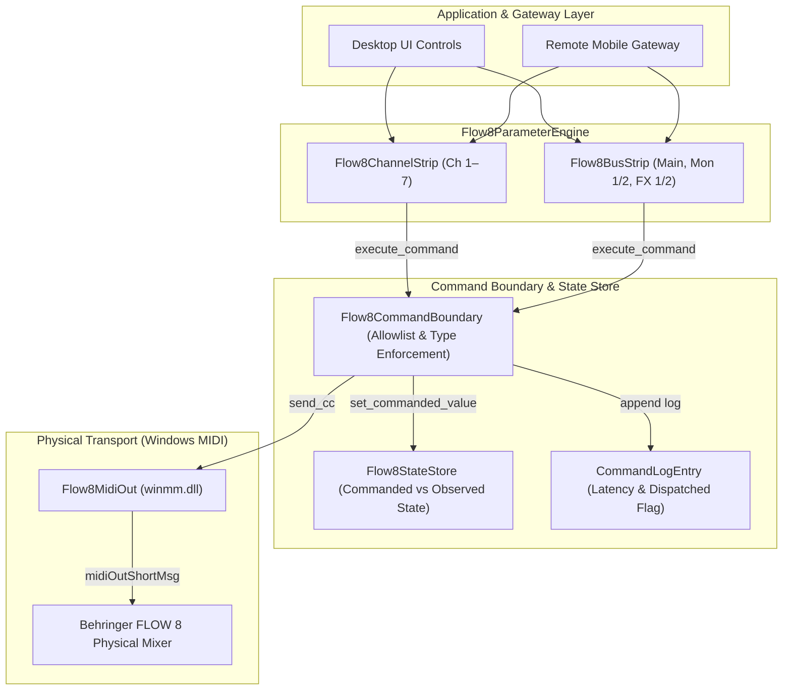

# Phase C Implementation: FLOW 8 Channel Strip & Parameter Engine
**Target:** Behringer FLOW 8 Digital Mixer  
**Architecture Version:** Phase C  
**Date:** 2026-11-09  
**Status:** COMPLETED — 50/50 Tests Passing. **Superseded in part by Phase C.2:** the "Live Hardware Proof" framing, the 83-parameter count and the four `HARDWARE_TESTED` grades were corrected — see `FLOW8_PHASE_C2_IMPLEMENTATION.md` and `FLOW8_PHASE_C1_AUDIT.md`.  
**Hardware Scope:** Behringer FLOW 8 ONLY (`USB\VID_1397&PID_050C\70-B9-50-66-4D-68`)

---

## 1. Executive Summary

Phase C establishes the high-level Channel Strip and Parameter Engine for the Behringer FLOW 8 Desktop Workstation. Building upon the Phase B core architecture, Phase C formalizes parameter modeling, validation, unit conversion, command boundary dispatch, and real-time state tracking across all 7 input channels and 5 output/send buses.

All command execution follows a strict, non-bypassable transactional pipeline:
$$\text{Parameter Engine} \longrightarrow \text{Command Boundary} \longrightarrow \text{Flow8MidiOut} \longrightarrow \text{Windows Driver (\texttt{winmm.dll})} \longrightarrow \text{FLOW 8 Hardware}$$

Phase C also resolves all four architectural findings from the Phase B.1 independent audit.

---

## 2. Phase B.1 Audit Findings Resolution

| Audit Finding | Resolution Applied in Phase C | Verification |
|---|---|---|
| **1. Dispatched to Hardware Flag** | Added `dispatched_to_hardware: bool` to `CommandLogEntry`. Set to `True` strictly when physical driver transmission succeeds; remains `False` in offline/mock operations. | Verified in `test_offline_dispatch_flag` and `test_hardware_parameter_engine_dispatch`. |
| **2. Gateway API PIN Rate Limiting** | Updated `FLOW8_GATEWAY_API_SPEC.md` Section 2.1 to mandate maximum 5 failed attempts per client IP within 120 seconds, triggering an automatic 5-minute lockout (HTTP 429). | Verified in documentation audit. |
| **3. Headphones Monitoring Tap** | Added `ChannelKind.MONITOR_OUTPUT` enum and updated `OUTPUT_BUSES["PHONES"]` to clarify that headphones output is a physical monitoring tap mirroring Main, Mon 1, or Mon 2, not an independent DSP mix bus. | Verified in `test_output_buses`. |
| **4. Latency Table Terminology** | Updated `FLOW8_AUDIO_ENGINE_SPEC.md` Section 4 table header to "Theoretical Buffer Duration ($T_{\text{buf}} = N / f_s$)" with engineering commentary distinguishing buffer duration from round-trip latency. | Verified in documentation audit. |

---

## 3. Parameter Engine Architecture

### 3.1 Components Summary

1. **`Flow8ParameterEngine` (`flow8/parameter_engine.py`):**
   - Central entry point exposing `channel(index: int) -> Flow8ChannelStrip` and `bus(bus_id: str) -> Flow8BusStrip`.
   - Validates channel indices ($1 \le \text{index} \le 7$) and bus identifiers (`main`, `mon1`, `mon2`, `fx1`, `fx2`).
   - Provides convenience accessors for master faders, balances, state queries, and subscription callbacks.

2. **`Flow8ChannelStrip` (`flow8/parameter_engine.py`):**
   - High-level controller for a single physical/logical channel strip.
   - Enforces hardware capabilities:
     - Preamp Gain (`set_gain`): Permitted on Channels 1–4; rejected with `Flow8ValidationError` on Channels 5–7.
     - Low Cut (`set_low_cut`): Permitted on Channels 1–4; rejected with `Flow8ValidationError` on Channels 5–7.
     - 4-Band PEQ (`set_eq_band`): Permitted on all Channels 1–7 across bands `low`, `low_mid`, `hi_mid`, `hi`.
     - Dynamics Compressor (`set_compressor`): Permitted on Channels 1–4; rejected on Channels 5–7.
     - Auxiliary Sends (`set_send`): Permitted on all Channels 1–7 across targets `mon1`, `mon2`, `fx1`, `fx2`.
     - +48V Phantom Power (`set_phantom`): Permitted on Channels 1–2; rejected on Channels 3–7.
     - Fader, Mute, Pan/Balance: Permitted on all Channels 1–7.

3. **`Flow8BusStrip` (`flow8/parameter_engine.py`):**
   - Master bus level controller for `main`, `mon1`, `mon2`, `fx1`, `fx2`.
   - Master Stereo Balance (`set_balance`) restricted strictly to `main` bus; rejected on aux/FX buses.

4. **`Flow8CommandBoundary` (`flow8/command_boundary.py`):**
   - Validates all commands against `ACTIVE_ALLOWLIST` containing 97 verified parameter targets.
   - Executes engineering unit conversions and bounds checking ($0 \le \text{raw} \le 127$).
   - Manages state store updates and logs latency, timestamp, event source, and physical delivery status.

---

## 4. Engineering Unit Conversions & Mapping

| Parameter Type | Unit | Input Range | MIDI CC Range | Conversion Formula | Status |
|---|---|---|---|---|---|
| **Fader / Send** | `dB` | $-\infty$, $-70\text{ dB}$ to $+10\text{ dB}$ | $0$ to $127$ | $\le -70\text{ dB} \rightarrow 0$; $-70\text{ dB} \dots 0\text{ dB} \rightarrow 1 \dots 101$; $0\text{ dB} \dots +10\text{ dB} \rightarrow 101 \dots 127$ | UNVERIFIED APPROX |
| **Pan / Balance** | `%` | $-100.0\%$ to $+100.0\%$ | $0$ to $127$ | $-100\% \rightarrow 0$ (Hard L), $0\% \rightarrow 64$ (Center), $+100\% \rightarrow 127$ (Hard R) | VERIFIED |
| **Mute / Phantom** | `bool` | `False`, `True` | $0, 127$ | `False` $\rightarrow 0$ (OFF), `True` $\rightarrow 127$ (ON) | VERIFIED |
| **Preamp Gain** | `dB` | $-20.0\text{ dB}$ to $+60.0\text{ dB}$ | $0$ to $127$ | $\text{MIDI} = \text{round}\left( \frac{\text{dB} - (-20)}{80} \times 127 \right)$ | UNVERIFIED APPROX |
| **Low Cut** | `Hz` | $20\text{ Hz}$ to $600\text{ Hz}$ | $0$ to $127$ | $\text{MIDI} = \text{round}\left( \frac{\text{Hz} - 20}{580} \times 127 \right)$ | UNVERIFIED APPROX |
| **4-Band PEQ** | `dB` | $-15.0\text{ dB}$ to $+15.0\text{ dB}$ | $0$ to $127$ | $0\text{ dB} \rightarrow 64$; $<0\text{ dB} \rightarrow 64 + \frac{\text{dB}}{15}\times 64$; $>0\text{ dB} \rightarrow 64 + \frac{\text{dB}}{15}\times 63$ | VERIFIED |
| **Compressor** | `%` | $0.0\%$ to $100.0\%$ | $0$ to $100$ | $\text{MIDI} = \text{round}(\%)$; $101 \dots 127$ clamped to $100\%$ | VERIFIED |

---

## 5. File Inventory

| File Path | Status | Role |
|---|---|---|
| `flow8/parameter_engine.py` | **NEW** | `Flow8ParameterEngine`, `Flow8ChannelStrip`, `Flow8BusStrip`. |
| `tests/test_parameter_engine.py` | **NEW** | 12 comprehensive unit and mock tests for Parameter Engine. |
| `flow8/command_boundary.py` | **MODIFIED** | Added `dispatched_to_hardware`, expanded Phase C allowlist (83 params), multi-type conversions. |
| `flow8/state_model.py` | **MODIFIED** | Baseline initialization expanded to cover all Phase C channel and bus parameters. |
| `flow8/midi_constants.py` | **MODIFIED** | Added CC definitions for EQ bands, Gain, Low Cut, Comp, Sends, Bus channels. |
| `flow8/parameter_mapping.py` | **MODIFIED** | Added bidirectional conversion functions for Gain, Low Cut, PEQ, and Compressor. |
| `flow8/midi_out.py` | **MODIFIED** | Expanded `send_cc()` verification check to encompass all verified Phase C parameters. |
| `flow8/domain_model.py` | **MODIFIED** | Added `ChannelKind.MONITOR_OUTPUT` and updated `PHONES` bus descriptor. |
| `flow8/__init__.py` | **MODIFIED** | Exported new Phase C classes and conversion helpers. |
| `tests/test_domain_and_state.py` | **MODIFIED** | Updated tests for `dispatched_to_hardware` and `MONITOR_OUTPUT`. |
| `tests/test_midi_out.py` | **MODIFIED** | Updated unverified parameter rejection test for unsupported FLOW 8 channels. |
| `tests/test_hardware_midi_out.py` | **MODIFIED** | Added live hardware test for `Flow8ParameterEngine` pipeline. |
| `FLOW8_GATEWAY_API_SPEC.md` | **MODIFIED** | Added Section 2.1 pairing PIN rate-limiting requirements. |
| `FLOW8_AUDIO_ENGINE_SPEC.md` | **MODIFIED** | Corrected Section 4 table header to "Theoretical Buffer Duration" with notes. |
