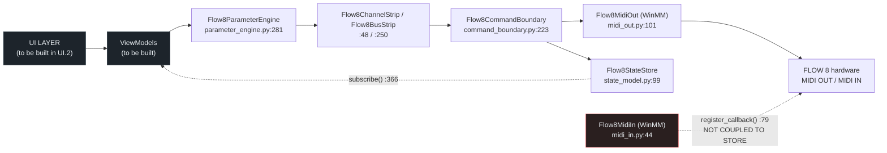
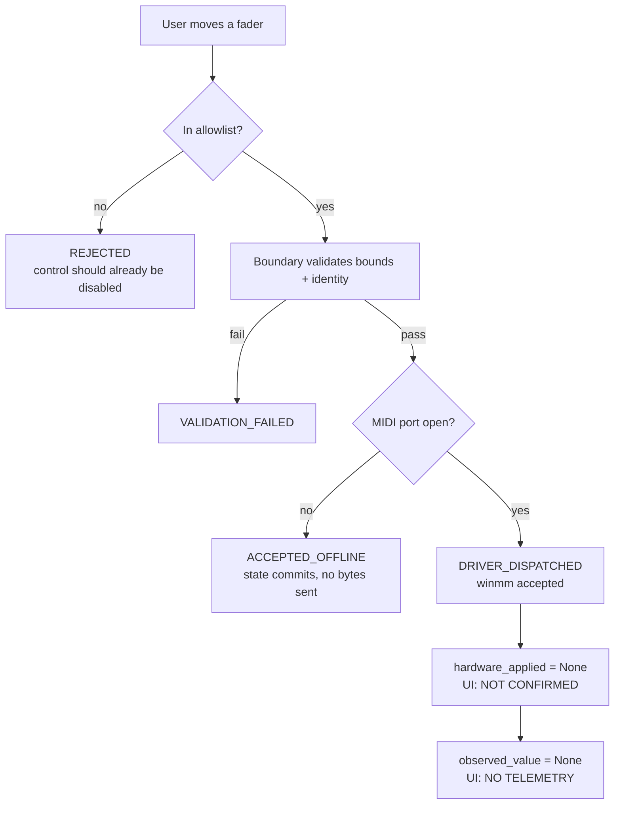
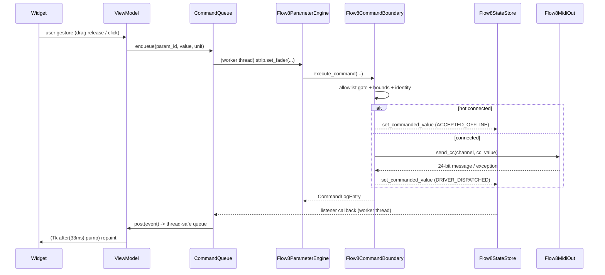

# FLOW 8 — Phase UI.1 Repository Discovery & UI Implementation Plan

**Product:** Behringer FLOW 8 Enhanced Audio Platform
**Phase:** UI.1 — Repository Discovery (READ-ONLY)
**Platform:** Windows Desktop
**Hardware Scope:** FLOW 8 ONLY
**Date:** 2026-11-09
**Repository root:** `C:\Users\Administrator\Desktop\mixing-station-pc-windows-3-2-2-789`

---

## 0. Phase Declaration, Method, and Verdict

### 0.1 Restrictions observed during this phase

| Restriction | Status |
|---|---|
| Read-only inspection | **Honoured** — no source file was modified, moved, renamed, or deleted |
| No source edits | **Honoured** — the only file created is this report |
| No package installation | **Honoured** — `pip install` was never invoked; frameworks were probed with `import` only |
| No application scaffolding | **Honoured** — no `ui/`, `desktop/`, or entry-point module was created |
| No UI implementation | **Honoured** |
| No mock hardware behaviour | **Honoured** — no fake connection, meter, or value path was introduced |
| No automatic MIDI commands | **Honoured** — no MIDI port was opened and no message was transmitted during this phase |
| No fabricated audio meters | **Honoured** — this report documents that no telemetry source exists and specifies meters as unavailable |
| No fake connection states | **Honoured** — connection state is derived only from `is_connected` / `device_info` |
| FLOW 8 ONLY | **Honoured** |

### 0.2 Method

1. Git inspection (`git rev-parse`, `git status`, `git log`).
2. Manifest/discovery sweep for Python, Node/TypeScript, Rust, C#, C++/CMake toolchains.
3. Filesystem topology listing (root directories, `flow8/`, `tests/`, `app/`, `phase2-work/`).
4. Import probe of every plausible Windows GUI toolkit present in the interpreter (no installation).
5. Source-anchored reading of the seven core `flow8/` modules plus the Phase C.2 implementation and safety reports.
6. Live runtime introspection of the real importable API (allowlist size, state-record count, verification-level distribution, strip identity, connection default) with no MIDI port opened and no command executed.
7. Cross-checks for absent capability: state-store coupling in MIDI-In, callers of `set_observed_value`, window construction, USB-audio status API.

### 0.3 Verdict

**DISCOVERY COMPLETE — CONDITIONAL GO for Phase UI.2.**

The command layer is sound and is a safe substrate for a UI: a single 97-parameter allowlist, an import-time validated addressing table, a strict command gateway, and a state store that refuses to claim hardware confirmation. The blocking condition is not the command layer — it is that **the repository contains no application, no UI, no dependency manifest, no version control, and no observation path.** Phase UI.2 must build the application shell from zero, and three UI requirements stated in the brief **cannot be satisfied truthfully today** (§5.6, §11 R-04/R-05/R-06):

- **USB Audio device status** has no status API → must render `NOT INTEGRATED`, not a fabricated state.
- **Audio meters** have no telemetry source → must render `NO TELEMETRY`, never simulated movement.
- **"Input Channels 1–8"** conflicts with the domain model, which defines **7 strips** covering 8 physical inputs → resolution required (decision **D-1**, §7.2).

---

## 1. Git / Repository Status

### 1.1 Finding: this is not a Git repository

| Item requested | Result |
|---|---|
| Working directory | `C:\Users\Administrator\Desktop\mixing-station-pc-windows-3-2-2-789` |
| Git branch | **N/A** — `fatal: not a git repository (or any of the parent directories): .git` |
| Git status | **N/A** — no index, no working tree state |
| Latest commit | **N/A** — no object database, no `HEAD` |
| Uncommitted changes | **N/A** — untracked by definition; nothing can be diffed, stashed, or reverted |
| Existing application structure | Present but **not an application**: a Python library package plus analysis scripts and reference payloads (§3) |

No `.git/` directory exists at the root. Consequently:

- There is **no rollback point** for any UI work.
- There is **no diff-based review** of Phase UI.1–UI.x changes.
- File modification times are the **only** evidence of change history.
- The Phase C.1/C.2 work cannot be attributed to commits; it exists only as current file contents.

The earlier repository-summary metadata supplied at the start of this session reported "Git metadata unavailable" — this report confirms the reason: there is no repository, not a permissions problem.

### 1.2 Root topology (actual)

```
C:\Users\Administrator\Desktop\mixing-station-pc-windows-3-2-2-789\
├── flow8/                 # importable Python library (9 modules, 2,678 lines)
├── tests/                 # unittest suite (8 modules)
├── app/                   # THIRD-PARTY REFERENCE PAYLOAD (Mixing Station), not our code
├── reference/             # EMPTY
├── capture/               # README.md only
├── phase2-work/           # 6 PE/RE analysis documents
├── investigation.cany/    # RE tooling artefact
└── *.py                   # 21 root-level analysis/probe scripts
```

### 1.3 Recommendation (not executed — read-only phase)

Before UI.2 writes a single file, initialize version control and commit the current working tree as a baseline:

```
git init
git add flow8 tests *.md
git commit -m "Baseline: Phase C.2 remediated command layer"
```

This is an **action requiring your approval**; it is recorded as risk **R-01** (§11) and dependency **D-2**.

---

## 2. Actual Technology Stack

### 2.1 Manifest sweep — result: zero manifests

| Manifest probed | Result |
|---|---|
| `package.json` | **ABSENT** |
| `pyproject.toml` | **ABSENT** |
| `requirements*.txt` | **ABSENT** |
| `setup.py`, `setup.cfg`, `Pipfile` | **ABSENT** |
| `Cargo.toml`, `tauri.conf.json` | **ABSENT** |
| `vite.config.*`, `tsconfig.json` | **ABSENT** |
| `*.csproj`, `*.sln` | **ABSENT** |
| `CMakeLists.txt` | **ABSENT** |
| `*.ps1`, `*.bat` build scripts | **ABSENT** |

There is **no declared dependency set of any kind.** The Python package is consumed by directory presence on `sys.path`, not by installation.

### 2.2 Runtime — verified live

| Technology | Status | Evidence |
|---|---|---|
| **Python 3.14.8** | **PRESENT** | `Python 3.14.8 (tags/v3.14.8:8e6e75d, Sep 30 2026) [MSC v.1944 64 bit (AMD64)]` |
| **Tk / tkinter** | **PRESENT** | `import tkinter` succeeds; `TkVersion 9.0`, `TclVersion 9.0` |
| PyQt5 / PyQt6 | **ABSENT** | `ModuleNotFoundError` |
| PySide2 / PySide6 | **ABSENT** | `ModuleNotFoundError` |
| wxPython | **ABSENT** | `ModuleNotFoundError` |
| Kivy | **ABSENT** | `ModuleNotFoundError` |
| Dear PyGui | **ABSENT** | `ModuleNotFoundError` |
| customtkinter | **ABSENT** | `ModuleNotFoundError` |
| NumPy | **ABSENT** | not in `pip list` |
| pytest | **ABSENT** | not in `pip list`; tests are `unittest` |
| mido / python-rtmidi | **ABSENT** | not in `pip list` |

**Consequence:** MIDI is raw `ctypes` → WinMM, hand-written. Confirmed by `flow8/midi_out.py:84` (`MIDIOUTCAPSW` struct) and `flow8/midi_in.py:23` (`MIDIINCAPSW` struct), with WinMM constants defined locally at `flow8/midi_constants.py:9` (`WinMmError`), `:41–49` (`MIM_*` / `MOM_*` / `CALLBACK_FUNCTION`).

### 2.3 UI toolchain — result: none exists

| Probed | Result |
|---|---|
| React / TypeScript / Vite | **ABSENT** — no `package.json`, no `tsconfig.json`, no `vite.config.*` |
| Tauri | **ABSENT** — no `tauri.conf.json`, no `Cargo.toml` |
| Rust | **ABSENT** — no `Cargo.toml`, no `.rs` sources |
| C++ native components | **ABSENT** — no `CMakeLists.txt`, no build system |
| C# / WPF / WinForms | **ABSENT** — no `.csproj`, no `.sln` |
| GUI framework imports in any `.py` | **ZERO matches** for `tkinter|PyQt*|PySide*|wx|kivy|dearpygui|customtkinter` |
| UI source files (`.ui`, `.qml`, `.jsx`, `.tsx`, `.vue`, `.svelte`, `.html`, `.css`) | **ZERO files repo-wide** |
| Any window/app construction (`Tk()`, `QApplication`, `wx.App`) | **ZERO matches** |

### 2.4 Build and test commands (actual)

| Purpose | Command | Verified result |
|---|---|---|
| Full test suite | `python -m unittest discover -s tests -v` | `Ran 104 tests` — `OK (skipped=5)`, exit 0 |
| Non-mutating hardware tier | `FLOW8_HW_TESTS=1 python -m unittest tests.test_hardware_midi_out -v` | `Ran 5 tests` — `OK (skipped=1)` |
| Mutating hardware tier | requires `FLOW8_HW_TESTS=1` **and** `FLOW8_HW_TESTS_MUTATE=1` | not run |
| Application launch | **DOES NOT EXIST** | no entry point, no `main()`, no console script, no `__main__.py` |

### 2.5 The reference product is not this project's stack

`APPLICATION_ARCHITECTURE.md` and `APPLICATION_ENTRY_POINT.md` analyse **Mixing Station 3.2.2 build 789** — a Java 25 application on LibGDX Scene2D, LWJGL3, ANGLE→D3D11, FreeType, Jetty. This is **reverse-engineering evidence about a different product**, corroborated by `app/native_dlls/` containing `lwjgl.dll`, `lwjgl_opengl.dll`, `libGLESv2.dll`, `libEGL.dll`, `gdx64.dll`, `gdx-freetype64.dll`, `jnidispatch.dll`, `OpenAL.dll`.

**This stack must not be adopted, imitated, or treated as a target.** The FLOW 8 project is pure Python. No Java, LibGDX, LWJGL, or Node runtime may be introduced.

### 2.6 Stack conclusion

> **The actual, verified stack is: Python 3.14.8 (CPython, 64-bit) + Python standard library + `ctypes`→WinMM + `unittest`. The only GUI toolkit present on the machine is `tkinter`/Tk 9.0. There is no application framework, no UI layer, no dependency manifest, and no build system.**

---

## 3. Existing UI Components

### 3.1 Finding: there are none

| Component class | Count |
|---|---|
| GUI widgets / windows / views | **0** |
| HTML/CSS/QML/XAML/JSX/TSX files | **0** |
| Frontend build configs | **0** |
| GUI framework imports | **0** |
| Application entry point | **0** |

**The project has no user interface of any kind.** Its only operator surface is a command-line/script surface:

| File | Lines | Nature |
|---|---|---|
| `flow8_midi_harness.py` | 241 | CLI harness exercising the command layer |
| `flow8_midi_in_logger.py` | 96 | MIDI-In message logger |
| `probe_flow8_hw.py` | 62 | Print-only PowerShell `Get-PnpDevice` probe; module-level script, no importable API |
| 21 other root `*.py` | — | Reverse-engineering/analysis scripts (`find_*`, `analyze_*`, `classify_*`, `extract_*`, `reconstruct_layout.py`, `jvm_class_parser.py`, …) |

### 3.2 `app/` is third-party reference material — not project code

```
app/installer.msi, app/setup.msi, app/Data.cab
app/installed/mixing-station-pc/          # the installed Mixing Station app
app/cab_extracted/file<hash>             # opaque MSI cabinet blobs
app/native_dlls/                         # LWJGL/ANGLE/OpenAL/JNI DLLs + native_analysis.json
```

`app/` is an **extracted third-party MSI payload** used to study a competing application. It must **not** be treated as our UI, imported, bundled, or shipped, and it must not appear in any licence or distribution inventory for this product.

`reference/` is **empty**. `capture/` contains only `README.md`.

### 3.3 Implication for UI.2

Every visual element described in §7–§9 will be **built from zero**. There is no existing design system, no reusable widget, and no established look to honour. This is an opportunity (clean architecture) and a risk (**R-02**: no reference implementation to calibrate against; no existing UI test harness).

---

## 4. Core Integration Points

All line references verified against the current working tree. The `flow8/` package is 2,678 lines across 9 files; `flow8/__init__.py:79` declares `__all__` covering the whole public surface.

### 4.1 Layer diagram (as it actually exists)



The red-bound MIDI-In path is the critical architectural gap: **inbound messages are delivered to callbacks but never written into the state store** (§4.6).

### 4.2 `flow8/parameter_engine.py` — the only command surface the UI may call

| Symbol | Line | UI usage |
|---|---|---|
| `Flow8ParameterEngine` | 281 | Root object owned by the app shell |
| `__init__(command_boundary, state_store)` | 288 | Constructed once, injected |
| `boundary` / `state_store` properties | 303 / 307 | Read-only accessors |
| `channel(index)` | 310 | Returns strip 1..7 |
| `bus(bus_id)` | 316 | Returns `main`/`mon1`/`mon2`/`fx1`/`fx2` |
| `channel_for_physical_input(connector_id)` | 342 | **Authoritative strip labelling** — UI must not re-derive |
| `get_state(param_id)` | 362 | Read a `ParameterState` |
| `subscribe` / `unsubscribe` | 366 / 370 | State change feed |

**`Flow8ChannelStrip`** — `:48` (ctor `:54`, `name` `:65`, `kind` `:69`):

| Method | Line | Notes |
|---|---|---|
| `set_fader` | 76 | `raw` or `dB` |
| `set_mute` | 80 | bool |
| `set_pan` | 84 | **Mono strips only** |
| `set_balance` | 92 | **Stereo strips + main only; rejects mono** |
| `set_gain` | 118 | Ch 1–4 only |
| `set_low_cut` | 130 | Ch 1–4 only |
| `set_eq_band` | 146 | `VALID_EQ_BANDS` `:44` = `low`, `low_mid`, `hi_mid`, `hi` |
| `set_compressor` | 170 | Precise guard; verified addressing Ch 1–4 |
| `set_send` | 204 | `VALID_SEND_TARGETS` `:45` = `mon1`, `mon2`, `fx1`, `fx2` |
| `set_phantom` | 228 | Ch 1–2 only |
| `get_parameter` | 244 | Per-strip state read |

**`Flow8BusStrip`** — `:250` (`set_fader` `:265`, `set_balance` `:269`, `get_parameter` `:275`). `VALID_BUS_IDS` `:46` = `main`, `mon1`, `mon2`, `fx1`, `fx2`. Bus convenience helpers at `:324–339`.

### 4.3 `flow8/command_boundary.py` — the sole gateway

| Symbol | Line | Significance for UI |
|---|---|---|
| `Flow8CommandError` | 40 | Base error |
| `Flow8CommandRejectedError` | 44 | Validation/allowlist rejection |
| `DispatchStatus` | 53 | `REJECTED`, `VALIDATION_FAILED`, `ACCEPTED_OFFLINE`, `DRIVER_DISPATCHED`, `DISPATCH_FAILED` |
| `BUS_MIDI_CHANNELS` | 63 | Bus → MIDI channel map |
| `CommandLogEntry` | 73 | Audit record: `command_accepted`, `driver_dispatched`, `hardware_applied` (always `None`), `raw_midi_prepared`, `dispatch_status`, `observed_value`, `verification_level` |
| `_expected_channel_for_param` | 105 | Addressing derivation |
| `_build_phase_c_allowlist` | 121 | **Single source of truth for all addresses** |
| `_validate_allowlist` | 179 | Runs at import; enforces scope, bounds, identity, `(channel, cc)` uniqueness |
| `Flow8CommandBoundary` | 223 | The gateway object |
| `ACTIVE_ALLOWLIST` | 230 | **97 entries** |
| `__init__(midi_out, state_store)` | 235 | Injected |
| `allowlist()` | 242 | Introspection for UI capability gating |
| `command_log` | 246 | Audit trail (dev/diagnostics view) |
| `execute_command(...)` | 256 | **The only dispatch entry point** |
| allowlist gate | 274 | Hard rejection before any byte is built |
| spec lookup | 298 | Per-entry min/max enforcement |

### 4.4 `flow8/state_model.py` — the state and honesty layer

| Symbol | Line | Significance for UI |
|---|---|---|
| `VerificationLevel` | 17 | Members `:34–39`: `HARDWARE_SPECIFIED`, `PROTOCOL_VERIFIED`, `API_ACKNOWLEDGED`, `IMPLEMENTED`, `HARDWARE_TESTED`, `UNKNOWN` |
| `SyncStatus` | 41 | `:42–45`: `SYNCED`, `PENDING_DISPATCH`, `DIVERGENT`, `UNKNOWN` |
| `EventSource` | 47 | `:48–52`: `LOCAL_HOST`, `PHYSICAL_HARDWARE`, `REMOTE_GATEWAY`, `SNAPSHOT_LOAD`, `INITIALIZATION` |
| `ParameterState` | 59 | Fields `:60–76` incl. `commanded_value`, `observed_value`, `sync_status`, `verification_level`, `raw_midi_value`, `min_value`/`max_value`, `unit`, `commanded_raw_midi`, `observed_raw_midi` |
| `to_dict()` | 78 | Serde for view models |
| `Flow8StateStore` | 99 | Central store, thread-safe |
| `_initialize_baseline_parameters` | 111 | **100 records** created |
| `subscribe` / `unsubscribe` | 365 / 371 | Listener registration |
| `set_commanded_value` | 376 | Called by boundary after successful dispatch |
| `set_observed_value` | 424 | **Defined but unused in production** |
| `get_parameter` | 466 | Single read |
| `get_all_parameters` | 470 | Bulk read — console refresh |

### 4.5 `flow8/midi_out.py` — Windows transport (UI must never import this)

| Symbol | Line |
|---|---|
| `Flow8MidiError` / `NotConnected` / `Validation` / `DeviceBusy` | 64 / 68 / 72 / 76 |
| `MIDIOUTCAPSW` (ctypes) | 84 |
| `Flow8MidiOut` | 101 |
| `is_connected` | 116 |
| `device_info` → `(id, name)` | 122 |
| `find_device_id` | 127 |
| `open` / `close` | 138 / 180 |
| context manager | 193 / 197 |
| `send_cc(channel, cc, value) -> int` | 204 — returns the 24-bit message |
| Legacy `set_main_fader` … `set_channel1_pan_percent` | 274–301 |

**Architectural rule:** the UI layer may **not** import `flow8.midi_out` or `flow8.midi_in`. Widgets speak to `Flow8ParameterEngine` only. Enforcement is specified in ticket UI.2-T8.

### 4.6 `flow8/midi_in.py` — verified gap

| Symbol | Line |
|---|---|
| `MIDIINCAPSW` | 23 |
| `Flow8MidiIn` | 44 |
| `is_connected` / `is_listening` / `device_info` | 62 / 68 / 74 |
| `register_callback` / `unregister_callback` | 79 / 85 |
| `find_device_id` | 91 |
| `_internal_c_callback` | 102 |
| `open` / `start` / `stop` / `close` | 126 / 167 / 178 / 185 |

Cross-checks performed:

- `grep` for `state_store|StateStore|set_observed` in `flow8/midi_in.py` → **zero matches**. MIDI-In has **no reference to the state store**.
- `grep -rn "set_observed_value"` repo-wide → the **only** callers are `tests/test_domain_and_state.py:142` and `:147`. **Zero production callers.**
- `probe_flow8_hw.py` is a print-only script using `Get-PnpDevice`; it exposes no importable status API.
- `find_audio.py` mentions `wasapi` only as a **search term** for strings inside `app/installed/mixing-station-pc/app/mixing-station-desktop.jar` (a JAR string scan), not as audio integration.

**Therefore: `observed_value` is `None` for all 100 records, and will remain `None` until an observation path is implemented.** `sync_status` can therefore never legitimately become `SYNCED` through hardware feedback. See §11 R-05.

### 4.7 `flow8/domain_model.py` and `flow8/parameter_mapping.py`

| Symbol | Line |
|---|---|
| `ConnectorType` | domain:15 |
| `ChannelKind` | domain:23 |
| `SubsystemType` | domain:32 |
| `PhysicalConnector` | domain:44 |
| `LogicalChannel` | domain:54 |
| `OutputBus` | domain:73 |
| `PHYSICAL_CONNECTORS` | domain:85 |
| `LOGICAL_CHANNELS` | domain:178 |
| `LOGICAL_CHANNEL_BY_MIDI_CHANNEL` | domain:283 |
| `OUTPUT_BUSES` | domain:302 |
| `UsbAudioTopology` / `FLOW8_AUDIO_TOPOLOGY` | domain:354 / 372 |
| Fader law (`FADER_UNITY_MIDI = 101`, `-70…+10 dB`) | mapping:87–90 |
| Gain range (`-20…+60 dB`) | mapping:143–144 |
| Low cut range (`20…600 Hz`) | mapping:169–170 |
| EQ range (`±15 dB`, centre 64) | mapping:195–197 |

`flow8/midi_constants.py` confirms the documented CC map: `CC_EQ_LOW…CC_EQ_HI` = 1–4 (`:68–71`), `CC_MUTE` = 5 (`:72`), `CC_SOLO` = 6 (`:73`, **defined but absent from the allowlist**), `CC_VOLUME_FADER` = 7 (`:74`), `CC_GAIN` = 8 (`:75`), `CC_LOW_CUT` = 9 (`:76`), `MIDI_CH_MAIN` = 8 (`:61`).

### 4.8 Live capability introspection (verified this phase)

```
allowlist entries        : 97
state records            : 100
verification levels      : PROTOCOL_VERIFIED 93 | API_ACKNOWLEDGED 4 | UNKNOWN 2 | HARDWARE_SPECIFIED 1
in state but NOT allowlist : ch5.compressor, ch6.compressor, global.ez_gain
in allowlist but NOT state : (none)
bus parameters           : fx1.fader, fx2.fader, main.balance, main.fader, mon1.fader, mon2.fader
per-strip counts         : ch1=15, ch2=15, ch3=14, ch4=14, ch5=11, ch6=11, ch7=11  (91) + 6 bus = 97
strip identity           : 1 "Channel 1" (Mono Input), 2 "Channel 2" (Mono Input),
                           3 "Channel 3" (Mono Input), 4 "Channel 4" (Mono Input),
                           5 "Channel 5/6" (Stereo Linked Input),
                           6 "Channel 7/8" (Stereo Linked Input),
                           7 "USB/BT Return" (Stereo Audio Return)
midi_out.is_connected (no open) : False
absent from allowlist    : main.limiter, main.geq_500, ch1.solo, mon1.geq_1k, ch16.snapshot
```

`ch1`/`ch2` carry 15 parameters because they alone have `phantom`; `ch3`/`ch4` have 14; stereo strips `ch5`–`ch7` have 11 (no gain, no low cut, no compressor — EQ, fader, mute, balance, 4 sends).

---

## 5. Hardware Capability Matrix

### 5.1 Evidence vocabulary — six states the UI must never conflate

| UI-evidence state | Meaning | Current repository source | Truthfully displayable today? |
|---|---|---|---|
| **SOFTWARE IMPLEMENTED** | Parameter exists in the allowlist and an engine method commits it to the state store | `command_boundary.py:230`, `state_model.py:376` | **Yes** |
| **DRIVER DISPATCHED** | WinMM accepted the message; `DispatchStatus.DRIVER_DISPATCHED` | `command_boundary.py:53`, `midi_out.py:204` | **Yes** (per command result) |
| **API ACKNOWLEDGED** | WinMM returned success without a device-level error; **no hardware confirmation implied** | `VerificationLevel.API_ACKNOWLEDGED` (`state_model.py:36`) — 4 records | **Yes** |
| **HARDWARE APPLIED** | Device physically applied the change | `CommandLogEntry.hardware_applied` — **always `None`** | **NO — always render "Not confirmed"** |
| **OBSERVED HARDWARE STATE** | Value read back from the device | `observed_value` / `observed_raw_midi` — **zero writers** | **NO — always render "No telemetry"** |
| **UNKNOWN / UNVERIFIED** | Address or behaviour unverified | `VerificationLevel.UNKNOWN` (2 records), `HARDWARE_SPECIFIED` (1, not in allowlist) | **Yes** (as a warning badge) |

**Rule V-1:** no UI element may display the words "applied", "confirmed", "synced", or "verified by hardware" unless the underlying field is non-`None`. Because `hardware_applied` is hard-coded `None`, the UI must render **`HARDWARE: NOT CONFIRMED`** permanently, in every build, until the command layer gains a genuine acknowledgement path.

**Rule V-2:** `SyncStatus.SYNCED` must never be rendered, because it requires hardware observation (§4.6). The sync indicator shows `PENDING` only while a dispatch is in flight, otherwise `UNKNOWN`.

### 5.2 Matrix — controllable surfaces

Address authority for every row: `flow8/command_boundary.py:121` (`_build_phase_c_allowlist()`), validated at import by `:179`.

| # | Surface | Parameter IDs | Qty | Verification | UI state |
|---|---|---|---|---|---|
| 1 | Input faders 1–4 (mono) | `ch1..ch4.fader` | 4 | `PROTOCOL_VERIFIED` | **Enabled** |
| 2 | Input faders 5/6, 7/8 (stereo linked) | `ch5.fader`, `ch6.fader` | 2 | `PROTOCOL_VERIFIED` | **Enabled** |
| 3 | USB/BT return fader | `ch7.fader` | 1 | `PROTOCOL_VERIFIED` | **Enabled** |
| 4 | Mute — all 7 input strips | `ch1..ch7.mute` | 7 | `PROTOCOL_VERIFIED` | **Enabled** |
| 5 | Pan — mono strips | `ch1..ch4.pan` | 4 | `PROTOCOL_VERIFIED` | **Enabled** |
| 6 | Balance — stereo strips + main | `ch5..ch7.pan`, `main.balance` (stored as `parameter_name="balance"`) | 4 | `PROTOCOL_VERIFIED` | **Enabled** — must be labelled *Balance*, and `set_balance` rejects mono (`parameter_engine.py:92`) |
| 7 | Preamp gain | `ch1..ch4.gain` | 4 | `PROTOCOL_VERIFIED` | **Enabled** |
| 8 | Low cut | `ch1..ch4.low_cut` | 4 | `PROTOCOL_VERIFIED` | **Enabled** |
| 9 | 4-band EQ | `ch1..ch7.eq_low/eq_low_mid/eq_hi_mid/eq_hi` | 28 | `PROTOCOL_VERIFIED` | **Enabled** |
| 10 | Compressor | `ch1..ch4.compressor` | 4 | `PROTOCOL_VERIFIED` | **Enabled** |
| 11 | Phantom power | `ch1.phantom`, `ch2.phantom` | 2 | `PROTOCOL_VERIFIED` | **Enabled — with confirmation dialog** (mic power) |
| 12 | Sends ×4 | `ch1..ch7.send_mon1/mon2/fx1/fx2` | 28 | `PROTOCOL_VERIFIED` | **Enabled** |
| 13 | Main fader + balance | `main.fader`, `main.balance` | 2 | `PROTOCOL_VERIFIED` | **Enabled** |
| 14 | Monitor 1 / Monitor 2 faders | `mon1.fader`, `mon2.fader` | 2 | `PROTOCOL_VERIFIED` | **Enabled** |
| 15 | FX 1 / FX 2 return faders | `fx1.fader`, `fx2.fader` | 2 | `PROTOCOL_VERIFIED` | **Enabled** |

### 5.3 Matrix — declared but not controllable

| # | Surface | Evidence | UI treatment |
|---|---|---|---|
| 16 | Compressor on 5/6 | `ch5.compressor`, `ch6.compressor` exist in state only, `VerificationLevel.UNKNOWN`, **absent from allowlist** | **Disabled** — badge `ADDRESS UNVERIFIED`; tooltip: no allowlisted address |
| 17 | Compressor on USB/BT | no `ch7.compressor` record at all | **Not present** — omit the control, do not draw a dead one |
| 18 | Preamp / low cut on 5/6/7 | absent from allowlist for those strips | **Not present** — the stereo strips have no preamp by design |
| 19 | Global EZ-Gain | `global.ez_gain`, `HARDWARE_SPECIFIED`, absent from allowlist | **Not exposed** |

### 5.4 Matrix — unimplemented (must be visibly disabled, never faked)

| Surface | Protocol reference | Status |
|---|---|---|
| Bus limiter (Main/Mon1/Mon2) | `CC8` on MIDI ch 8–10 | **Not implemented** — no allowlist entry |
| Bus 9-band GEQ | `CC11–19` on MIDI ch 8–10 | **Not implemented** |
| Solo | `CC6` (`midi_constants.py:73`) | **Not implemented** — constant defined, no allowlist entry |
| FX engine (type, parameters) | Program Change / `CC1–4` on ch 14–15 | **Not implemented** |
| Scene / snapshot recall & store | Program Change on ch 16 | **Not implemented** — the allowlist is CC-only |
| Tap tempo | — | **Not implemented** |
| BLE MIDI | — | Transport `UNKNOWN` |
| SysEx | — | Transport `UNKNOWN` |

### 5.5 Matrix — absent data sources

| Surface | Why unavailable | UI consequence |
|---|---|---|
| Audio meters / RTA | No audio engine (`flow8/audio_engine.py` **does not exist**), no meter CC in the allowlist, no streaming telemetry path | Meter widgets render a static `NO TELEMETRY` rail. **Zero animation. Zero synthetic movement.** |
| USB Audio device status | No WASAPI/MMDevice code in the importable package; no `flow8/audio_engine.py` | Header indicator renders `USB AUDIO: NOT INTEGRATED` |
| Device name / firmware version | No read path; MIDI-In is not coupled to the store | Render configured port name only, or `—` |
| Observed values / echo | `set_observed_value` has no production callers (§4.6) | Every value readout is `commanded`, explicitly labelled as such |

### 5.6 What the UI may claim, per control



---

## 6. Proposed UI Architecture

### 6.1 Framework decision

**Baseline: `tkinter` / Tk 9.0 + `ttk` + `Canvas`, zero new dependencies.**

Rationale — evidence-based, not preference:

| Consideration | Finding |
|---|---|
| Installed and working | Tk 9.0 present and importable; **every** alternative is absent |
| Installation forbidden | This phase forbids package installation; PySide6/PyQt would require it |
| Sufficient for the required visuals | Custom faders, meters, EQ curves and badges are all Canvas primitives; `ttk` adds native-feeling fields |
| Tk 9 gains | Improved HiDPI/multi-monitor handling over Tk 8.6, relevant for a pro-audio console |
| Main weakness | No native GPU acceleration; large-canvas animation would be poor — **irrelevant here because metering is unavailable (§5.5)** |

**Deferred alternative (decision D-3): Qt (PySide6).** Materially better for a high-DPI console with animated meters, but it **requires installing a dependency**, which is out of scope for this phase and needs your explicit approval. To keep that option cheap, all widgets must sit behind view models (§6.3) so the toolkit is confined to `ui/widgets/` and `ui/app.py`.

**Explicitly rejected:** Tauri/React/Electron (no Node/Rust toolchain exists, would be a full stack replacement); WPF/C# (no .NET project exists); any reuse of the Mixing Station Java/LibGDX payload in `app/`.

### 6.2 Layering (proposed, not created)

```
ui/
├── app.py                 # AppShell: window, lifecycle, wiring, thread pump
├── theme.py               # Design tokens only (§8) — no logic
├── strings.py             # All user-facing text incl. honesty labels (§9.6)
├── viewmodels/
│   ├── session.py         # connection, port identity, USB audio, sync aggregate
│   ├── console.py         # strip list, values, capability gating
│   ├── channel_detail.py  # per-strip editor capability map
│   └── commands.py        # CommandQueue: UI thread -> worker thread
├── widgets/
│   ├── fader.py           # FaderWidget (Canvas)
│   ├── meter.py           # MeterWidget — NO TELEMETRY state only
│   ├── mute_button.py
│   ├── pan_slider.py      # Pan/Balance
│   ├── knob.py            # rotary for EQ/gain/send
│   ├── badge.py           # VerificationBadge
│   ├── indicators.py      # Connection / Sync / AudioStatus
│   ├── strip.py           # ChannelStripView, BusStripView
│   └── nav.py             # NavRail
└── views/
    ├── console.py         # Main Mixer page
    ├── channel.py         # Channel Detail dock
    ├── routing.py         # placeholder (not implemented)
    ├── fx.py              # partial
    ├── scenes.py          # placeholder (not implemented)
    └── recording.py       # placeholder (not implemented)
```

**Import rules (hard):**

| Layer | May import |
|---|---|
| `ui/widgets/*` | `ui/theme.py`, `ui/strings.py`, stdlib only — **no `flow8`** |
| `ui/views/*` | widgets, view models, `flow8.state_model` (types only) |
| `ui/viewmodels/*` | `flow8.parameter_engine`, `flow8.state_model`, `flow8.domain_model` |
| `ui/app.py` | everything above, plus `flow8.midi_out` / `flow8.midi_in` **for transport object construction only** |
| **Anything** | **`midi_out.send_cc` directly — FORBIDDEN** |

### 6.3 Data flow



Flow rules:

1. **One worker thread** owns the engine and boundary (WinMM `send_cc` and `open()` device enumeration at `midi_out.py:138` can block; the Tk main loop must never block).
2. **Every engine call originates in the worker queue.** No widget calls an engine method directly — this keeps the UI thread free and serialises MIDI.
3. **State listeners may fire on any thread** (`state_model.py:365`); the shell's pump marshals them onto the Tk thread.
4. **No auto-connect and no auto-command at startup.** The app opens **disconnected** (`is_connected == False`, verified). Connection requires an explicit operator action, satisfying "no automatic MIDI commands".
5. Fader drags emit **throttled preview updates locally** in the widget; the actual command fires on release (or on an explicit coalescing tick ≥ 50 ms). The UI never sends a burst of CC for every mouse pixel.

### 6.4 Capability gating — computed, never hard-coded

The UI must derive what it may show from the library, not from a duplicate table:

```python
allowlisted = set(boundary.allowlist())          # command_boundary.py:242 -> 97 ids
state       = engine.get_state(param_id)         # parameter_engine.py:362
reachable   = param_id in allowlisted
unknown     = state.verification_level is VerificationLevel.UNKNOWN
observed    = state.observed_value is not None   # False for all 100 today
```

Widget enable rule:

| Condition | Rendering |
|---|---|
| `param_id in allowlisted` and `not unknown` | **Enabled** |
| `param_id not in allowlisted` but state record exists | **Disabled** + badge `ADDRESS UNVERIFIED` |
| state record absent entirely | **Not rendered** (no dead control) |
| `observed is False` | Value shown as *commanded* with a `NO TELEMETRY` badge adjacent |

---

## 7. Full Console Layout

### 7.1 Overall frame

```
┌──────────────────────────────────────────────────────────────────────────────┐
│ A  HEADER  56px                                                              │
│  FLOW 8  │ ● DISCONNECTED │ Session: — │ MIDI OUT: —  │ USB AUDIO: NOT INTEGRATED │
├────────────┬─────────────────────────────────────────────┬───────────────────┤
│ E NAV      │ B MAIN MIXER                                │ C CHANNEL DETAIL  │
│ 176px      │                                             │ 400px (collapsible)│
│            │  ┌────┬────┬────┬────┬─────┬─────┬───────┐   │                   │
│ ▸ Mixer    │  │ 1  │ 2  │ 3  │ 4  │ 5/6 │ 7/8 │USB/BT │   │  PREAMP           │
│   Routing  │  │ ┃  │ ┃  │ ┃  │ ┃  │ ┃┃  │ ┃┃  │ ┃┃    │   │  LOW CUT          │
│   FX       │  │ ▮  │ ▮  │ ▮  │ ▮  │ ▮▮  │ ▮▮  │ ▮▮    │   │  EQ 4-BAND        │
│   Scenes   │  │ M  │ M  │ M  │ M  │  M  │  M  │  M    │   │  COMPRESSOR       │
│   Recording│  │ ◐  │ ◐  │ ◐  │ ◐  │ ◑   │ ◑   │ ◑     │   │  SENDS ×4         │
│            │  └────┴────┴────┴────┴─────┴─────┴───────┘   │                   │
│            │  ┌──────────┬────────┬────────┬──────┬──────┐│                   │
│            │  │ MAIN L/R │ MON 1  │ MON 2  │ FX 1 │ FX 2 ││                   │
│            │  └──────────┴────────┴────────┴──────┴──────┘│                   │
├────────────┴─────────────────────────────────────────────┴───────────────────┤
│ D  STATUS BAR  28px                                                          │
│  MIDI OUT: disconnected │ MIDI IN: disconnected │ SYNC: UNKNOWN │ ⚠ HARDWARE NOT CONFIRMED │
└──────────────────────────────────────────────────────────────────────────────┘
```

### 7.2 Resolution of the "Input Channels 1–8" requirement (decision D-1)

The brief asks for **Input Channels 1–8**. The domain model defines **7 strips** whose identity is authoritative (`flow8/domain_model.py:178`, surfaced via `parameter_engine.py:342`):

| Strip | Name | Kind | Physical inputs |
|---|---|---|---|
| 1 | Channel 1 | Mono Input | Input 1 |
| 2 | Channel 2 | Mono Input | Input 2 |
| 3 | Channel 3 | Mono Input | Input 3 |
| 4 | Channel 4 | Mono Input | Input 4 |
| 5 | Channel 5/6 | Stereo Linked Input | Inputs 5 L / 6 R |
| 6 | Channel 7/8 | Stereo Linked Input | Inputs 7 L / 8 R |
| 7 | USB/BT Return | Stereo Audio Return | USB/BT playback return |

Eight physical inputs exist, but there are **six input strips plus one return strip**. Drawing eight discrete faders would:

1. require addresses the allowlist does not contain (there is no `ch8` parameter family — MIDI ch 8 is `main`);
2. break the addressing identity validated at `command_boundary.py:179`;
3. create duplicate controls for linked pairs.

**Adopted layout:** **7 strips** labelled `1 · 2 · 3 · 4 · 5/6 · 7/8 · USB/BT`, with the physical-input legend (`IN 5L/6R`, `IN 7L/8R`) shown beneath the stereo strips. All eight physical inputs are individually reported in the strip header.

**If eight discrete faders are a hard product requirement**, that is a **domain-model change** (new logical channels + new verified addresses), out of scope for a UI phase. Recorded as decision **D-1** — needs your ruling before UI.2-T3.

### 7.3 Section A — Application Header (56 px)

| Element | Source | Rendering when unavailable |
|---|---|---|
| **FLOW 8 identity** | Static product mark + `FLOW8_MIDI_OUT_NAME` (`flow8/__init__.py:__all__`) | Always shown; not a fake state |
| **Actual connection state** | `Flow8MidiOut.is_connected` (`midi_out.py:116`) | `DISCONNECTED` in amber; **never** a green "connected" placeholder |
| **Configured port** | `device_info` (`midi_out.py:122`) → `(id, name)` | `—` when `None` |
| **Session status** | Local session: strips bound, commands issued this session, dirty count | `Session: idle` before first command |
| **USB Audio device status** | **No API exists** (§5.5) | `USB AUDIO: NOT INTEGRATED` — fixed, honest, non-clickable |

Header must additionally carry the permanent compliance chip **`HARDWARE: NOT CONFIRMED`** (Rule V-1).

### 7.4 Section B — Main Mixer

**Input strip column (7 strips × 104 px):**

| Part | Detail |
|---|---|
| Strip index / identity | `1`…`4`, `5/6`, `7/8`, `USB/BT`; kind subtitle |
| **Channel label** | Editable display name — **local UI label only** (no name parameter exists in the allowlist, so it is never synced and must be marked as host-local) |
| Verification badge | Small pill (§9.4) |
| **Fader** | Vertical, 0–127 raw with dB readout using `parameter_mapping.py:87–90` (`FADER_UNITY_MIDI = 101`, `-70…+10 dB`) |
| **Meter** | Static `NO TELEMETRY` rail; stereo strips show two rails, both inert |
| **Mute** | `chN.mute` |
| **Pan / Balance** | `pan` for 1–4; **Balance** for 5/6, 7/8, USB/BT and Main |
| Selection | Click selects → Channel Detail (§7.5); teal left edge + raised background |

**Bus column (5 strips):** `MAIN L/R`, `MON 1`, `MON 2`, `FX 1`, `FX 2`.

| Bus | Available | Unavailable (must be drawn disabled, not omitted silently) |
|---|---|---|
| Main L/R | `main.fader`, `main.balance` | limiter, 9-band GEQ |
| Monitor 1 | `mon1.fader` | limiter, GEQ |
| Monitor 2 | `mon2.fader` | limiter, GEQ |
| FX 1 | `fx1.fader` | FX engine parameters |
| FX 2 | `fx2.fader` | FX engine parameters |

Note: bus strips expose **fader (and balance for Main) only**. Monitor/FX have no balance parameter in the allowlist — do not draw one.

### 7.5 Section C — Channel Detail (400 px dock, collapsible)

Content is **capability-gated per selected strip**:

| Section | Ch 1–4 | Ch 5/6, 7/8, USB/BT |
|---|---|---|
| **Preamp** — gain (`-20…+60 dB`, `mapping.py:143–144`), phantom (Ch 1–2 only) | Enabled | **Not present** (no preamp) |
| **Low Cut** — `20…600 Hz` (`mapping.py:169–170`) | Enabled | **Not present** |
| **4-band EQ** — `low`, `low_mid`, `hi_mid`, `hi`, `±15 dB` (`mapping.py:195–197`) | Enabled | Enabled |
| **Compressor** — verified address | Enabled (1–4) | 5/6: **Disabled — `UNKNOWN`**; 7: **Not present** |
| **Sends** — `mon1`, `mon2`, `fx1`, `fx2` | Enabled | Enabled |

The panel also shows a **read-only provenance block** per parameter: `value`, `verification_level`, `sync_status`, `source`, and the last `DispatchStatus`. This is the honest surface where the operator can see that the value is *commanded*, not *observed*.

**Phantom power requires a confirmation dialog** (48 V to a microphone input) naming the affected input, and must never be toggled by a stray click or keyboard focus alone.

### 7.6 Section D — Status Bar (28 px)

| Slot | Source | Default text |
|---|---|---|
| MIDI connection (out) | `is_connected`, `device_info` | `MIDI OUT: disconnected` |
| MIDI connection (in) | `Flow8MidiIn.is_connected` (`midi_in.py:62`) | `MIDI IN: disconnected` |
| USB Audio | none | `USB AUDIO: NOT INTEGRATED` |
| Sync status | aggregate of `SyncStatus` (`state_model.py:41`) | `SYNC: UNKNOWN` (never `SYNCED` — Rule V-2) |
| Verification warnings | count of `UNKNOWN` + not-confirmed hardware | `⚠ HARDWARE NOT CONFIRMED` |
| Command log (dev) | `boundary.command_log` (`:246`) | collapsed; opens a table |

### 7.7 Section E — Navigation

| Item | Backing implementation | UI treatment |
|---|---|---|
| **Mixer** | Full console (§7.4) | **Enabled** (default view) |
| **Routing** | None | **Disabled** — `Not implemented`: no routing parameters are allowlisted |
| **FX** | Partial: `fx1.fader`, `fx2.fader` only | **Enabled, partial** — shows the two return faders plus an explicit `FX ENGINE: NOT IMPLEMENTED` panel |
| **Scenes** | None — snapshots are Program Change on ch 16, CC-only allowlist | **Disabled** — `Not implemented` |
| **Recording** | None — no audio engine exists | **Disabled** — `Not implemented` |

Disabled nav items remain **visible and legible** with a lock glyph and a reason tooltip. They are not hidden: the operator must be able to see the roadmap gap. They must not navigate to a page that pretends to work.

### 7.8 Interaction contract

- Fader drag: continuous visual, **coalesced commands** (≤ 20/s), final commit on release.
- Keyboard: `↑/↓` ±1, `PgUp/PgDn` ±10, `Home`/`End` extremes, `Space` toggles mute, `Tab` moves strip-by-strip.
- Disabled control: no hover state, no focus stop, tooltip with the exact reason.
- Any rejected command surfaces a non-modal toast with the `DispatchStatus` reason — never a silent no-op.

---

## 8. Design System

### 8.1 Colour tokens (`ui/theme.py`)

| Token | Hex | Use |
|---|---|---|
| `bg_void` | `#0B0E10` | Window backdrop behind panels |
| `bg_workspace` | `#12161A` | Mixer canvas |
| `bg_panel` | `#171C21` | Header, nav, status bar, detail dock |
| `bg_panel_raised` | `#1D242B` | Selected strip, hovered card |
| `bg_inset` | `#0E1215` | Fader groove, meter well, input fields |
| `stroke` | `#263038` | 1 px hairlines |
| `stroke_strong` | `#33414C` | Panel edges, focus outlines (secondary) |
| `accent` | `#14B8A6` | Teal: selection, active fader cap, primary action |
| `accent_hover` | `#2FD4C0` | Hover |
| `accent_press` | `#0E9C8D` | Pressed |
| `accent_wash` | `rgba(20,184,166,0.14)` | Selected strip wash |
| `text_primary` | `#E9EEF2` | Values, labels |
| `text_secondary` | `#9BAAB6` | Sub-labels, units |
| `text_tertiary` | `#66757F` | Micro-labels, scale ticks |
| `text_disabled` | `#45525B` | Disabled control text |
| `state_warn` | `#E0A13A` | Disconnected, unverified address |
| `state_error` | `#E5484D` | Dispatch failure, validation failure |
| `state_unknown` | `#8C7BE0` | `VerificationLevel.UNKNOWN` badge |
| `state_ok` | `#14B8A6` | Software-implemented confirmation |
| `meter_track` | `#0A0D0F` | Inert meter rail |

Dark charcoal workspace, single teal accent, no second saturated hue. Amber/violet are reserved **exclusively** for honesty signalling and never decorative.

### 8.2 Typography

| Role | Face | Size / weight |
|---|---|---|
| UI chrome, nav | Segoe UI (Windows system) | 11 px / 400 |
| Strip label | Segoe UI | 12 px / 600 |
| Numeric value readout | Consolas (tabular) | 12 px / 600 |
| Micro-label (dB, Hz, %) | Segoe UI | 9 px / 400, `text_tertiary` |
| Section heading | Segoe UI | 13 px / 600 |
| Page title | Segoe UI | 16 px / 600 |
| Badge | Segoe UI | 8 px / 700, letter-spaced 0.5 px, uppercase |

Both faces ship with Windows — **no font dependency**. All numeric readouts use tabular figures so values do not jitter while dragging.

### 8.3 Spacing, radius, elevation

- Base unit **4 px**; scale `4, 8, 12, 16, 24, 32`.
- Panel padding `12`; strip lateral padding `8`; control gap `6`.
- Radius: controls `3`, panels `6`, badges `2`, fader cap `3`.
- Elevation: **1 px hairlines only** — no drop shadows (flat, pro-audio aesthetic). Selection is signalled by colour and a 2 px teal left edge, not by shadow.

### 8.4 Geometry

| Element | Dimension |
|---|---|
| Window default | 1600 × 900 |
| Window minimum | 1366 × 768 (below this: refuse, show a message — never squash) |
| Header | 56 px |
| Status bar | 28 px |
| Nav rail | 176 px |
| Channel Detail dock | 400 px (collapsible to 0) |
| Console strip | 104 px wide, 8 px gap |
| Strip column total | 7 × 104 + 6 × 8 = **776 px** |
| Strip header / footer | 40 px / 20 px |
| **Fader track** | 40 × 236 px, groove 6 px wide, travel 200 px |
| **Fader cap** | 56 × 18 px |
| Fader scale | 10 ticks, labels at `+10`, `0`, `−10`, `−30`, `−∞` |
| **Meter rail** | 6 px single / 12 px as a stereo pair, height 236 px aligned to fader travel |
| Mute button | 56 × 24 px |
| Pan / Balance slider | 88 × 12 px, centre detent tick |
| Knob (EQ/gain/sends) | 40 px diameter, 270° sweep |
| EQ response canvas | 300 × 140 px |
| Badge | auto-width, 14 px tall |

### 8.5 State styling

| State | Visual |
|---|---|
| **Default** | `bg_panel`, `stroke` hairline, `text_primary` |
| **Hover** | `bg_panel_raised`, `stroke_strong`, 120 ms transition |
| **Selected** | `accent_wash` background, 2 px `accent` left edge, strip index in `accent` |
| **Active (dragging / pressed)** | Fader cap fills `accent_press`; 1 px `accent_hover` outline |
| **Focused** | 2 px `accent_hover` ring, inset 1 px |
| **Disabled** | `bg_void` fill, `text_disabled` text, **no hover, no focus stop**; tooltip carries the reason |
| **Disconnected** | Whole console tinted with a 1 px `state_warn` border per strip and a diagonal-hatch overlay at 8 % opacity; header shows `DISCONNECTED`; controls remain **operable** (commands are legitimately `ACCEPTED_OFFLINE`) |
| **Unknown/unverified** | `state_unknown` badge `ADDRESS UNVERIFIED`; control disabled |

Important distinction: **disconnected ≠ disabled.** A disconnected console still accepts edits into the state store (`ACCEPTED_OFFLINE`). Only *unimplemented* or *unverified* surfaces are disabled.

### 8.6 Responsive behaviour

| Breakpoint | Behaviour |
|---|---|
| ≥ 1440 px | Nav + console + detail dock all visible |
| 1280–1439 px | Detail dock collapses to an overlay drawer opened by selection |
| 1100–1279 px | Strip width 96 px, meter 6 px, badge text hidden (icon-only with tooltip) |
| < 1100 px | Unsupported: show a clear minimum-size message rather than a degraded console |
| Height < 800 px | Strip header/footer compress 40→32 / 20→16; fader travel 200→176 |
| **Never** | Never reflow strips into multiple rows, never hide a *disabled* control, never scale fonts below 9 px |

Window size/position persists **locally only** (no device write).

---

## 9. Component Inventory

### 9.1 Shell and navigation

| Component | File (planned) | Responsibility | Binds to | Forbidden |
|---|---|---|---|---|
| **AppShell** | `ui/app.py` | Window, theme application, page routing, worker-thread pump, shutdown | engine, boundary, store, midi objects | Any direct `send_cc` |
| **NavRail** | `ui/widgets/nav.py` | 5 destinations with availability state | static capability map from `boundary.allowlist()` | Enabling an unimplemented page |
| **StatusBar** | `ui/widgets/indicators.py` | MIDI out/in, USB audio, sync, warnings | session view model | Claiming `SYNCED` |

### 9.2 Console

| Component | File | Responsibility | Data | Notes |
|---|---|---|---|---|
| **ConsoleView** | `ui/views/console.py` | Lays out 7 input + 5 bus strips, holds selection | console view model | — |
| **ChannelStripView** | `ui/widgets/strip.py` | One input strip: identity, label, badge, fader, meter, mute, pan/balance | `channel(i).get_parameter` | Label is host-local, never synced |
| **BusStripView** | `ui/widgets/strip.py` | Bus strip: fader (+balance for main) | `bus(id).get_parameter` | No balance on mon/fx |
| **FaderWidget** | `ui/widgets/fader.py` | Drag/wheel/keyboard → normalised 0–127; dB readout | emits `(param_id, value, unit)` | No MIDI, no engine call |
| **MeterWidget** | `ui/widgets/meter.py` | Renders inert rail + `NO TELEMETRY` caption | **none** | **Must never animate** |
| **MuteButton** | `ui/widgets/mute_button.py` | Toggle `chN.mute` | state | — |
| **PanSlider** | `ui/widgets/pan_slider.py` | `pan` (mono) / **balance** (stereo, main) | state | Must call `set_balance` for stereo |

### 9.3 Detail editing

| Component | File | Responsibility | Gate |
|---|---|---|---|
| **ChannelDetailView** | `ui/views/channel.py` | Sectioned editor for the selected strip | capability map per strip |
| **PreampSection** | `ui/views/channel.py` | Gain, phantom | Ch 1–4 gain; phantom Ch 1–2 only |
| **LowCutSection** | `ui/views/channel.py` | 20–600 Hz | Ch 1–4 |
| **EqSection** | `ui/views/channel.py` | 4 bands + response canvas | all 7 strips |
| **CompressorSection** | `ui/views/channel.py` | Compressor controls | Ch 1–4 enabled; 5/6 disabled `UNKNOWN`; 7 absent |
| **SendsSection** | `ui/views/channel.py` | 4 sends | all 7 strips |
| **Knob** | `ui/widgets/knob.py` | Rotary value entry | — |
| **ParameterEditorRow** | `ui/widgets/knob.py` | Knob + value + unit + provenance | — |

### 9.4 Honesty components

| Component | File | Responsibility |
|---|---|---|
| **VerificationBadge** | `ui/widgets/badge.py` | Maps `VerificationLevel` + `DispatchStatus` to the six evidence states of §5.1 |
| **ProvenanceBlock** | `ui/widgets/badge.py` | Read-only: value, level, sync, source, last status |
| **ConfirmationDialog** | `ui/widgets/badge.py` | Mandatory for phantom power |
| **Toast/RejectionBanner** | `ui/widgets/badge.py` | Surfaces `REJECTED` / `VALIDATION_FAILED` / `DISPATCH_FAILED` |

### 9.5 Indicators

| Component | File | Source | Failure mode |
|---|---|---|---|
| **ConnectionIndicator** | `ui/widgets/indicators.py` | `is_connected`, `device_info` | `DISCONNECTED` |
| **SyncIndicator** | `ui/widgets/indicators.py` | aggregate `SyncStatus` | `UNKNOWN` |
| **AudioStatusIndicator** | `ui/widgets/indicators.py` | **none** | `NOT INTEGRATED` |

### 9.6 Strings contract (`ui/strings.py`)

All honesty text is centralised so it cannot drift:

| Key | Exact text |
|---|---|
| `HW_NOT_CONFIRMED` | `HARDWARE: NOT CONFIRMED` |
| `NO_TELEMETRY` | `NO TELEMETRY` |
| `USB_NOT_INTEGRATED` | `USB AUDIO: NOT INTEGRATED` |
| `ADDRESS_UNVERIFIED` | `ADDRESS UNVERIFIED` |
| `NOT_IMPLEMENTED` | `NOT IMPLEMENTED` |
| `SYNC_UNKNOWN` | `SYNC: UNKNOWN` |
| `VALUE_IS_COMMANDED` | `commanded — not observed` |
| `OFFLINE_BANNER` | `FLOW 8 not connected — edits are held offline and will not dispatch` |

---

## 10. Implementation Sequence

Each ticket is independently reviewable and leaves the test suite green. **No ticket may weaken an existing test or bypass the command boundary.**

| # | Ticket | Scope | Acceptance criteria | Est. |
|---|---|---|---|---|
| **UI.2-T1** | App shell + design tokens | `ui/app.py`, `ui/theme.py`, `ui/strings.py`, empty page host | Window at 1600×900 (min 1366×768), dark charcoal + teal theme, zero MIDI bytes on startup, `is_connected` false, tests still 104 OK | S |
| **UI.2-T2** | Connection & session view model | `viewmodels/session.py`, header, status bar, worker thread + command queue, Tk pump | Connect/disconnect reflects real `is_connected`; no auto-connect; `USB AUDIO: NOT INTEGRATED`; `SYNC: UNKNOWN`; no blocking of the UI thread | M |
| **UI.2-T3** | Console layout | `views/console.py`, `widgets/strip.py`, FaderWidget, MuteButton, PanSlider | 7 strips + 5 buses; identity from `channel_for_physical_input`; fader→`set_fader`; mute→`set_mute`; balance routed to `set_balance` for stereo; rejection surfaces a toast | L |
| **UI.2-T4** | Channel Detail editor | `views/channel.py`, knobs, EQ canvas, sections | Sections gated per §7.5; phantom behind confirmation; Ch 5/6 compressor disabled `ADDRESS UNVERIFIED`; Ch 7 compressor absent | L |
| **UI.2-T5** | Honesty layer | badges, provenance block, inert meters, offline banner | No element renders "applied"/"confirmed"/"synced"; meter widget has no animation path; `hardware_applied` never displayed as true | M |
| **UI.2-T6** | Navigation + placeholders | NavRail, FX partial, Routing/Scenes/Recording stubs | Disabled items are visible, focusable-for-tooltip, and never navigate to a fake page | S |
| **UI.2-T7** | Observation path (separate, needs approval) | Couple `Flow8MidiIn.register_callback` → `set_observed_value` | Only after this ticket may the UI show observed values; **out of UI.2 scope by default** | L |
| **UI.2-T8** | Architectural guard tests | `tests/test_ui_import_boundaries.py` | Fails if any `ui/**` module imports `flow8.midi_out`/`midi_in` outside `ui/app.py`; fails if a widget calls `send_cc` | S |

Ordering rationale: T1–T2 establish a truthful shell before any control exists; T3–T4 add control surface; T5 retro-fits honesty **before** polish; T7 is deliberately outside the UI milestone because it changes the command layer and needs its own safety review.

**Explicit non-goals for UI.2:** metering, USB audio integration, routing, scenes, FX engine, solo, GEQ, limiter, recording, BLE, SysEx, snapshots, device-name write, any new allowlist entry.

---

## 11. Risks and Dependencies

| ID | Risk | Severity | Evidence | Mitigation |
|---|---|---|---|---|
| **R-01** | No version control — any UI.2 change is unrecoverable and unreviewable | **High** | `fatal: not a git repository` | D-2: `git init` + baseline commit before T1 |
| **R-02** | Zero UI baseline — no widget, no design system, no UI test harness | **High** | §3 findings | T1 + T8 establish shell and guard tests first |
| **R-03** | **No dependency manifest** — environment is unreproducible; Tk availability is incidental | **High** | §2.1 zero manifests | Add a pinned `requirements-ui.txt` (stdlib-only baseline) in T1; no installs this phase |
| **R-04** | **USB Audio status cannot be shown truthfully** | **High** | No WASAPI/MMDevice code in `flow8/`; only print-only `probe_flow8_hw.py` | Render `NOT INTEGRATED`; real status is a separate integration ticket |
| **R-05** | **No observation path** — `observed_value` always `None`; MIDI-In uncoupled | **High** | §4.6, zero production callers of `set_observed_value` | UI never claims observed/synced; T7 deferred with its own review |
| **R-06** | **No meter telemetry** — any moving meter would be fabricated | **High** | No audio engine, no meter CC, no streaming path | `MeterWidget` has a single inert state; T5 forbids animation |
| **R-07** | **"Input Channels 1–8" conflicts with the 7-strip domain model** | **High** | `domain_model.py:178`; live strip names | Decision **D-1** required before T3 |
| **R-08** | Tk is single-threaded; WinMM calls and state listeners fire off-thread | Medium | `state_model.py:365`; `midi_out.py:204`; `open()` enumerates at `:138` | Single worker + queue + `after()` pump (T2) |
| **R-09** | `HARDWARE_APPLIED` is structurally `None`; a careless widget could imply confirmation | Medium | `CommandLogEntry.hardware_applied` | Rule V-1, centralised strings, T5 review gate |
| **R-10** | Documentation references modules that do not exist (`flow8/audio_engine.py`, `flow8/gateway_server.py`) | Medium | `FLOW8_PLATFORM_MODULE_MAP.md` vs filesystem | UI must not be built against them; correct docs in a later doc-only phase |
| **R-11** | 4 controls are `API_ACKNOWLEDGED` and might be misread as hardware-confirmed | Low | `state_model.py:36`; 4 records | Badge text distinguishes "accepted by driver" from "applied" |
| **R-12** | Qt considered later would be a toolkit swap | Low | §6.1 | View-model boundary confines toolkit to `widgets/` + `app.py` |
| **R-13** | Channel labels are host-local; an operator may assume they are stored on the device | Low | No name parameter in the allowlist | Label marked `(local)`; documented in the UI |
| **R-14** | Phantom power is a destructive hardware action | Low | `set_phantom`, `parameter_engine.py:228` | Mandatory confirmation dialog |

### Decisions required before UI.2 opens

| ID | Decision | Default if you say nothing |
|---|---|---|
| **D-1** | Render 7 domain strips (6 inputs + USB/BT return) **or** change the domain to 8 discrete faders | **7 strips** (no domain change) |
| **D-2** | Initialize Git and commit a baseline | Do not initialise |
| **D-3** | Stay on stdlib `tkinter`, or approve a Qt dependency | **tkinter** |
| **D-4** | Observation path (`T7`) in or out of the UI.2 milestone | **Out** |

### Dependencies

- **Hard:** Python 3.14.8 + Tk 9.0 (present); `flow8/` package on `sys.path`; existing test suite green (104 OK).
- **Soft:** a connected FLOW 8 for manual smoke-testing (optional — the UI must be fully usable offline, where commands resolve to `ACCEPTED_OFFLINE`).
- **Blocked:** metering (needs telemetry), USB audio status (needs an engine), scenes/routing/solo/GEQ/limiter (need allowlist entries and protocol verification), observed state (needs T7).

---

## 12. First Implementation Ticket

### UI.2-T1 — Application Shell, Design Tokens, and Honest Startup

**Goal:** stand up a launchable, themed, *completely inert* desktop window that already tells the truth about the system, before any control exists.

**Files to create (and nothing else):**

| File | Contents |
|---|---|
| `ui/__init__.py` | Package marker |
| `ui/theme.py` | Colour, typography, spacing, geometry tokens from §8 — data only, no logic |
| `ui/strings.py` | The §9.6 honesty strings |
| `ui/app.py` | `AppShell`: builds the window, applies theme, hosts empty page area, implements `main()` |

**Files that must NOT change:** everything under `flow8/` and `tests/`, and every existing document.

**Required behaviour:**

1. Launches via `python -m ui.app` at 1600×900, minimum 1366×768, title `FLOW 8 — Console`.
2. Applies the dark charcoal workspace and teal accent tokens.
3. Renders the header with: FLOW 8 identity mark, `DISCONNECTED` (amber), `Session: idle`, `MIDI OUT: —`, `USB AUDIO: NOT INTEGRATED`, `HARDWARE: NOT CONFIRMED`.
4. Renders the status bar with `MIDI OUT: disconnected`, `MIDI IN: disconnected`, `SYNC: UNKNOWN`, warnings chip.
5. Renders the nav rail with Mixer enabled and Routing/FX/Scenes/Recording disabled-with-reason (FX may show as *partial* only after T4).
6. **Does not** open a MIDI port, **does not** transmit a byte, **does not** construct a `Flow8MidiOut` in the opened state.
7. Reports connection state solely from `Flow8MidiOut.is_connected` and `device_info` — a real read of a real object; no constant literals masquerading as status.
8. Closing the window exits cleanly with code 0 and no orphaned threads or handles.

**Acceptance tests:**

| Check | Command | Pass condition |
|---|---|---|
| Suite unchanged | `python -m unittest discover -s tests -v` | `Ran 104 tests` — `OK (skipped=5)` |
| App starts | `python -m ui.app` | Window appears; process exits 0 on close |
| No MIDI opened | Run with the FLOW 8 physically disconnected | Header shows `DISCONNECTED`; no exception; no device-open error dialog |
| No bytes sent | Observe MIDI traffic (logger) while starting the app | **Zero messages** |
| Honesty text present | Visual inspection | All five header/status strings from `ui/strings.py` render verbatim |
| No forbidden import | `grep` in `ui/` for `send_cc` | **Zero matches** |

**Definition of done:** the six acceptance tests pass, the diff contains only the four new `ui/` files, and the report §5–§9 claims remain accurate for the code as written.

**Out of scope:** faders, mutes, knobs, meters, editors, connection buttons, any `flow8` mutation, any new dependency.

---

## Appendix A — Verified evidence index

| Claim | Evidence |
|---|---|
| Not a Git repository | `git` → `fatal: not a git repository` |
| Python 3.14.8, 64-bit | `python -VV` |
| Tk 9.0 present | `tkinter.TkVersion` |
| All other GUI toolkits absent | import probe of 8 toolkits; `pip list` filtered |
| No UI files | glob `**/*.{ui,qml,jsx,tsx,vue,svelte,html,css}` → 0; GUI import grep → 0 |
| No manifests | 12 manifest patterns → 0 matches |
| Allowlist = 97 | `Flow8CommandBoundary.ACTIVE_ALLOWLIST` live count |
| State = 100 | `Flow8StateStore().get_all_parameters()` live count |
| Levels 93/4/2/1 | live `Counter` over `verification_level` |
| `ch5.compressor`, `ch6.compressor`, `global.ez_gain` state-only | set difference |
| 7 strips, exact names/kinds | `eng.channel(i).name` / `.kind` |
| MIDI-In not coupled to store | grep for `state_store` in `midi_in.py` → 0 |
| `set_observed_value` unused | repo-wide grep → 2 hits, both in tests |
| No window construction | grep `Tk()|QApplication|wx.App` → 0 |
| No audio engine / gateway | `ls flow8/audio_engine.py flow8/gateway_server.py` → absent |
| `app/` is third-party payload | `app/installed/mixing-station-pc`, `app/native_dlls/lwjgl.dll` etc. |
| `reference/` empty | directory listing |
| Suite green | `Ran 104 tests`, `OK (skipped=5)`, exit 0 |

## Appendix B — Statement of unverified territory

The following were **not** verified and are not claimed anywhere in this report:

- Whether the hardware applies accepted commands (no acknowledgement path exists — `hardware_applied` is always `None`).
- Whether the device echoes state changes (MIDI-In is not coupled to the store).
- Audio metering behaviour of any kind (no telemetry source).
- USB audio mode, sample rate, endpoint presence at runtime (no status API; Phase 0.5 documented the *methods*, no code was written).
- Bus limiter, 9-band GEQ, solo, FX engine, snapshot, tap-tempo behaviour (no allowlisted addresses).
- Any behaviour of the Mixing Station application in `app/` (reference material only; not imported, not executed for this phase).

---

**End of Phase UI.1 report. No source file was modified. Awaiting approval before any UI.2 work begins.**
