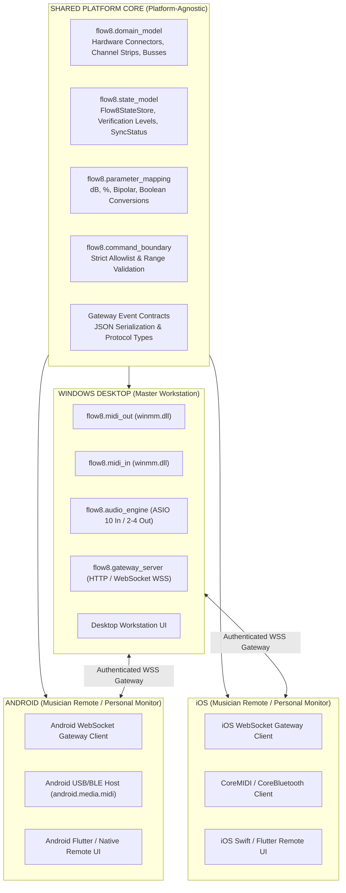

# FLOW 8 Platform Module Map
**Scope:** Shared Cross-Platform Software Architecture Foundation  
**Target Platforms:** Windows Desktop, Android, iOS  
**Target Hardware:** Behringer FLOW 8 ONLY  
**Date:** 2026-11-09  
**Status:** ARCHITECTURE FOUNDATION RATIFIED  

---

## 1. Cross-Platform Module Hierarchy

The FLOW 8 Enhanced Audio Platform is partitioned into **shared platform core modules** and **platform-specific transport/UI adapters**:

---

## 2. Shared Core Module Inventory

| Module Path | Primary Class / Component | Responsibilities | Target Platforms |
|---|---|---|---|
| `flow8/domain_model.py` | `PhysicalConnector`, `LogicalChannel`, `OutputBus`, `FLOW8_AUDIO_TOPOLOGY` | Encapsulates immutable physical connector layout (Inputs 1–8R), logical stereo channel pairings, and bus topology. | All Platforms |
| `flow8/state_model.py` | `Flow8StateStore`, `ParameterState`, `VerificationLevel`, `SyncStatus` | Central thread-safe state store tracking commanded vs observed values, timestamps, and strict verification levels. | All Platforms |
| `flow8/parameter_mapping.py` | `fader_midi_to_db`, `pan_percent_to_midi`, `mute_bool_to_midi` | Pure mathematical mapping between raw MIDI integers (0–127) and engineering units (dB, %, boolean). | All Platforms |
| `flow8/command_boundary.py` | `Flow8CommandBoundary`, `CommandLogEntry` | Parameter allowlist enforcement, range clamping, command logging, and transport delegation. | All Platforms |
| `flow8/midi_constants.py` | `WinMmError`, CC numbers, channel indexes | Protocol constants, channel masks, and status bytes. | All Platforms |

---

## 3. Platform-Specific Adapter Inventory

### 3.1 Windows Desktop Workstation
- **`Flow8MidiOut` (`flow8/midi_out.py`):** Direct class-compliant USB MIDI output driver via `winmm.dll`.
- **`Flow8MidiIn` (`flow8/midi_in.py`):** 64-bit non-blocking asynchronous MIDI input listener via `winmm.dll`.
- **`Flow8AsioEngine` (Specified):** Multi-track 10-channel 48 kHz / 24-bit capture and 2-channel playback via `flow-usb_audioasio_x64.dll`.
- **`Flow8GatewayServer` (Specified):** Authenticated local WebSocket and HTTP server dispatching mobile control events to `Flow8CommandBoundary`.

### 3.2 Mobile Remote Clients (Android & iOS)
- **Gateway Network Adapter:** Subscribes to the Windows Gateway over TLS-secured WebSockets (`wss://`) using PIN pairing tokens.
- **Role-Based Monitor UI:** Renders a lightweight, low-latency fader strip restricted to the musician's assigned auxiliary bus (e.g., `MON 1` or `MON 2`).
- **Direct BLE Mode (Standalone):** Direct connection to FLOW 8 BLE GATT server when operating away from the Windows desktop workstation.
