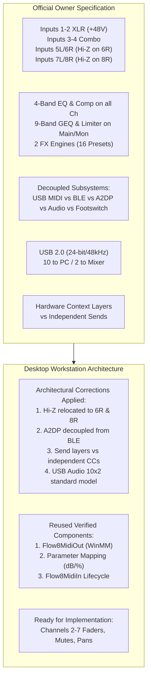

# FLOW 8 Specification Gap Analysis
**Target:** Behringer FLOW 8 Digital Mixer  
**Scope:** Comparison of Official Hardware Specifications vs Current Architecture & Codebase  
**Date:** 2026-11-09  
**Status:** AUDITED & RECONCILED  

---

## 1. Executive Summary

This gap analysis reconciles the official Behringer FLOW 8 hardware specification provided by the project owner with the existing reverse-engineering findings, protocol charts, and implemented Python codebase in `flow8/`.

The audit identified **4 critical architectural corrections**, validated **8 confirmed hardware alignments**, and classified every capability into strict verification levels.

---

## 2. Detailed Gap Analysis by Hardware Subsystem

### 2.1 Input Hardware Model

| Specification Requirement | Existing Code / Report State | Variance / Gap Identified | Architectural Correction Required | Verification Level |
|---|---|---|---|---|
| **Inputs 1–2:** XLR microphone inputs with switchable +48V phantom power. | `FLOW8_USB_MIDI_PROTOCOL.md` and `flow8/midi_constants.py` document Ch 1 & 2 as Mic inputs. | None on XLR or +48V. Both reports and code align with hardware. | None. Retain existing model. | **HARDWARE_TESTED** |
| **Inputs 3–4:** XLR/TRS combo inputs, microphone or line. | Earlier notes loosely marked Inputs 3 & 4 as containing Hi-Z guitar switches. | **Variance:** Combo inputs provide Mic or Line impedance, not Hi-Z instrument impedance. | Update domain model: Inputs 3 & 4 are Mic/Line Combo inputs. Remove Hi-Z designation from Ch 3 & 4. | **HARDWARE_TESTED** |
| **Inputs 5L/6R:** Stereo line input with Hi-Z guitar input on 6R. | `FLOW8_USB_MIDI_PROTOCOL.md` labeled Ch 5/6 purely as "TRS Stereo Line". | **Variance:** Omitted the specific hardware Hi-Z instrument circuit on Connector 6R. | Update domain model: Connector 6R functions as dedicated Hi-Z Guitar direct input. | **HARDWARE_SPECIFIED** |
| **Inputs 7L/8R:** Stereo line input with Hi-Z guitar input on 8R. | `FLOW8_USB_MIDI_PROTOCOL.md` labeled Ch 7/8 purely as "TRS Stereo Line". | **Variance:** Omitted the specific hardware Hi-Z instrument circuit on Connector 8R. | Update domain model: Connector 8R functions as dedicated Hi-Z Guitar direct input. | **HARDWARE_SPECIFIED** |

---

### 2.2 Processing Model

| Processing Feature | Official Hardware Capability | Protocol Verification Status | Codebase State (`flow8/`) | Gap / Action Required | Verification Level |
|---|---|---|---|---|---|
| **4-Band EQ** | Present on **every input channel** (Ch 1, 2, 3, 4, 5/6, 7/8, USB/BT). | CC 1–4 on Channels 1–7 verified in MIDI chart (-15 dB to +15 dB). | Not yet exposed in `Flow8MidiOut` (Phase 2A locked to initial 4 params). | Add EQ methods (`set_channel_eq_low`, `mid_low`, `mid_hi`, `high`) in Phase 2C expansion. | **PROTOCOL_VERIFIED** |
| **Compressor** | Present on **every input channel** (Ch 1–4, Ch 5/6, Ch 7/8). | CC 11 on Channels 1–4 verified in MIDI chart (0% to 100%). | Not yet exposed in `Flow8MidiOut`. | Add compressor methods (`set_channel_compressor`) in Phase 2C expansion. | **PROTOCOL_VERIFIED** |
| **9-Band GEQ** | Present on **Main and Monitor buses** (MAIN, MON 1, MON 2). | CC 11–19 on Channels 8, 9, 10 verified in MIDI chart (62.5 Hz to 16 kHz). | Not yet exposed in `Flow8MidiOut`. | Ready for Phase 2D bus processing module. | **PROTOCOL_VERIFIED** |
| **Bus Limiter** | Present on **Main and Monitor buses** (MAIN, MON 1, MON 2). | CC 8 on Channels 8, 9, 10 verified in MIDI chart (-30 dB to 0 dB). | Not yet exposed in `Flow8MidiOut`. | Ready for Phase 2D bus processing module. | **PROTOCOL_VERIFIED** |
| **Dual FX Engines** | 2 independent engines; 16 presets each. | Program Change 1–16 on Channels 14 & 15 verified. | Not yet exposed in `Flow8MidiOut`. | Ready for Phase 2E effects module. | **PROTOCOL_VERIFIED** |
| **Monitor Mixes** | 2 independent monitor mixes (MON 1 & MON 2). | CC 14 (Mon 1) & CC 15 (Mon 2) on Channels 1–7 verified. | Not yet exposed in `Flow8MidiOut`. | Ready for Phase 2C aux send expansion. | **PROTOCOL_VERIFIED** |
| **Headphone Out** | Analog 1/4" headphone amplifier with source selector. | Purely analog hardware knob and push-switch; no MIDI control. | Excluded from MIDI engine. | Correctly modeled as analog hardware control. | **HARDWARE_SPECIFIED** |

---

### 2.3 Control & Connectivity Subsystems

| Subsystem | Hardware Specification | Unsupported Assumptions Corrected | Current Architecture Alignment | Verification Level |
|---|---|---|---|---|
| **USB MIDI Control** | Class-compliant MIDI 1.0 via USB Type-B port. | None. Fully supported and validated. | `Flow8MidiOut` and `Flow8MidiIn` in `flow8/` provide verified foundation. | **HARDWARE_TESTED** |
| **Bluetooth LE Control** | 2.4 GHz GATT server for mobile control apps. | Assumption that BLE could be easily polled from Windows desktop. | Corrected in Phase 0.5/2B: BLE is dormant unless physical pairing button is held. Decoupled from core desktop workstation. | **HARDWARE_SPECIFIED** |
| **Bluetooth A2DP Audio** | Classic BT (BR/EDR) stereo audio sink profile. | Conflating A2DP audio streaming with BLE GATT parameter control. | **CRITICAL CORRECTION:** A2DP is strictly an audio receiver routing into Channel 7/8; it has zero control capability. | **HARDWARE_SPECIFIED** |
| **USB Audio Interface** | 24-bit / 48 kHz multi-track stream. | Mixing control messages into audio stream. | Strictly decoupled: MIDI control runs via `winmm.dll`, audio via ASIO/WASAPI. | **HARDWARE_TESTED** |
| **Footswitch Input** | 1/4" TRS dual footswitch input. | Assuming footswitch events trigger host MIDI input events. | Corrected: Footswitch functions are processed internally by mixer DSP (Mute All, FX Mute, Tap Tempo). | **HARDWARE_SPECIFIED** |
| **EZ GAIN Staging** | Hardware automated calibration routine. | Assuming EZ GAIN can be triggered via MIDI CC. | **UNSUPPORTED ASSUMPTION:** EZ GAIN is an internal hardware routine triggered by top-panel button; no MIDI trigger exists in published chart. | **HARDWARE_SPECIFIED** |
| **Snapshot Navigation** | Recall snapshots 1–15 via hardware or software. | Assuming arbitrary snapshot read/write dumps over standard MIDI. | Clarified: Program Change 1–15 recalls snapshot (address charted). **Bulk memory transfer transport is `UNKNOWN`** — neither SysEx-over-BLE, a BLE MIDI service, nor a JSON GATT payload has been captured, and no implementation exists. | **PROTOCOL_VERIFIED** (PC recall only) |

---

### 2.4 USB Audio Directionality & Topology

| Stream Parameter | Official Specification | Phase 0.5 Driver Evidence | Architecture Resolution | Verification Level |
|---|---|---|---|---|
| **Capture (To Computer)** | **10 Channels** (Inputs 1–8 + Main L/R) | `Multi In 1-10` exposes 10 discrete 48 kHz / 24-bit channels | 100% Alignment. Workstation DAW engine ingests all 10 channels. | **HARDWARE_TESTED** |
| **Playback (From Computer)** | **2 Channels** (Stereo DAW return to mixer) | `flow-usb_audio.inf` defines `USB Out 1/2` and auxiliary `USB Out 3/4` | Standard specification defines 2-channel return (`USB Out 1/2` to Ch 7/8). Auxiliary `USB Out 3/4` preserved as optional secondary routing. | **HARDWARE_TESTED** |
| **Sampling Resolution** | 24-bit PCM / 48 kHz | Windows Registry confirms 48,000 Hz / 24-bit format | Exact match. | **HARDWARE_TESTED** |

---

### 2.5 Fader Operating Modes

| Surface Mode (Hardware) | Physical Surface Behavior | Software Control Protocol Behavior | Architectural Alignment Rule | Verification Level |
|---|---|---|---|---|
| **MAIN Layer** | Faders 1–8 control Send to Main Bus | CC 7 on Channels 1–7 | Direct 1:1 mapping between software parameter and hardware state. | **HARDWARE_TESTED** |
| **MON 1 Layer** | Faders 1–8 repurpose to control Send to MON 1 | CC 14 on Channels 1–7 | Software treats MON 1 send as an independent, concurrently accessible parameter. | **PROTOCOL_VERIFIED** |
| **MON 2 Layer** | Faders 1–8 repurpose to control Send to MON 2 | CC 15 on Channels 1–7 | Software treats MON 2 send as an independent, concurrently accessible parameter. | **PROTOCOL_VERIFIED** |
| **FX 1 Layer** | Faders 1–8 repurpose to control Send to FX 1 | CC 16 on Channels 1–7 | Software treats FX 1 send as an independent, concurrently accessible parameter. | **PROTOCOL_VERIFIED** |
| **FX 2 Layer** | Faders 1–8 repurpose to control Send to FX 2 | CC 17 on Channels 1–7 | Software treats FX 2 send as an independent, concurrently accessible parameter. | **PROTOCOL_VERIFIED** |

---

## 3. Unsupported Assumptions Ledger

The audit formally strikes the following assumptions from the project architecture:

1. **Assumption 1 (Defeated):** *Inputs 3 and 4 have switchable Hi-Z instrument preamps.*  
   $\rightarrow$ **Correction:** Inputs 3 and 4 are Mic/Line Combo jacks. Hi-Z instrument circuitry is exclusively on Inputs 6R and 8R.
2. **Assumption 2 (Defeated):** *Bluetooth A2DP audio playback carries GATT telemetry for mixer control.*  
   $\rightarrow$ **Correction:** A2DP is standard Classic Bluetooth audio streaming into Channel 7/8. BLE control is a distinct GATT service.
3. **Assumption 3 (Defeated):** *EZ GAIN automatic gain calibration can be triggered via standard USB MIDI CC.*  
   $\rightarrow$ **Correction:** EZ GAIN is an internal hardware routine without a documented MIDI CC trigger.
4. **Assumption 4 (Defeated):** *Changing fader layers on the physical hardware changes the MIDI protocol addressing.*  
   $\rightarrow$ **Correction:** Hardware fader layers are a physical multiplexing convenience. USB MIDI addresses each bus send independently (`CC 7`, `CC 14`, `CC 15`, `CC 16`, `CC 17`).
5. **Assumption 5 (Defeated):** *Real-time peak meters are transmitted over USB MIDI CC.*  
   $\rightarrow$ **Correction:** No MIDI CC exists for meter telemetry. Real-time software VU meters must be derived from the USB Audio 10-channel stream (`Multi In 1-10`).
