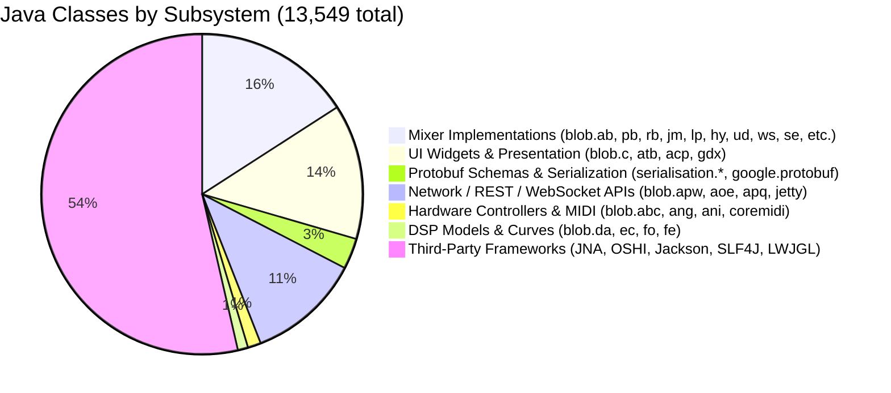

# REA Phase 3 — Java Class & Payload Inventory
**Target:** Mixing Station PC Windows 3.2.2 Build 789  
**SHA-256 (Original Binary):** `51ecb03f6b620aeea888e894e55f2046f0078e844f8a051c68a93876024d66fb`  
**Analysis Date:** 2026-11-09  
**Status:** VERIFIED  

---

## 1. Extracted Payload Inventory (49 Files in `_pe_extract`)

The initial extraction of the PE resource `RT_MANIFEST` (ID 999 `"MSI"`) yielded 49 files representing the compound MSI database streams:

| Category | Count | Files | Total Size | Architectural Function |
|---|---|---|---|---|
| **Payload Cabinet** | 1 | `Data.cab` | 88,112,954 bytes | Microsoft Cabinet file holding all 170 runtime and application files |
| **MSI Database Tables** | 38 | `!File`, `!Directory`, `!Component`, `!Property`, `!Shortcut`, `!_StringData`, `!_StringPool`, `!_Tables`, etc. | ~165,000 bytes | Relational schema defining installed directories, shortcuts, and component keys |
| **Custom Action DLLs** | 2 | `Binary.WixCA` (240 KB), `Binary.WixUIWixca` (135 KB) | 375,848 bytes | WiX installer standard custom actions (x86-64 native DLLs) |
| **Installer UI Bitmaps** | 2 | `Binary.WixUI_Bmp_Banner` (87 KB), `Binary.WixUI_Bmp_Dialog` (615 KB) | 702,540 bytes | Windows Installer wizard dialog background graphics |
| **Installer UI Icons** | 4 | `Binary.WixUI_Bmp_New`, `Binary.WixUI_Bmp_Up`, `Binary.WixUI_Ico_Exclam`, `Binary.WixUI_Ico_Info` | 2,478 bytes | Wizard navigation and status icons |
| **Application Icon** | 1 | `Icon.Icon.exe` | 199,424 bytes | Multi-resolution icon resource for application shortcuts |
| **OLE Summary Info** | 1 | `[5]SummaryInformation` | 552 bytes | MSI package title, author, and revision GUID metadata |

---

## 2. Installed Runtime & Application Payload Inventory (170 Files)

Decompressing `Data.cab` and resolving filenames against the MSI database table `File` produces 170 files installed under `mixing-station-pc\`:

### 2.1 File Category Summary

| Artifact Classification | File Count | Aggregate Size | Key Examples |
|---|---|---|---|
| **Java JAR Archives** | 2 | 54,796,740 bytes | `app\mixing-station-desktop.jar` (54.68 MB), `runtime\lib\jrt-fs.jar` (109 KB) |
| **Java JImage Modules** | 1 | 26,156,140 bytes | `runtime\lib\modules` (bundled modular runtime image) |
| **Native Executables (EXE)** | 4 | 804,856 bytes | `mixing-station-pc.exe` (679 KB), `runtime\bin\java.exe` (50 KB), `javaw.exe`, `keytool.exe` |
| **JVM Engine DLL** | 1 | 15,423,656 bytes | `runtime\bin\server\jvm.dll` (HotSpot 64-bit Server VM) |
| **JDK/JRE Native DLLs** | 19 | 4,204,112 bytes | `awt.dll` (1.4 MB), `fontmanager.dll` (963 KB), `freetype.dll` (546 KB), `jsound.dll` |
| **MSVC Runtime DLLs** | 4 | 2,105,488 bytes | `ucrtbase.dll` (1.36 MB), `msvcp140.dll` (575 KB), `vcruntime140.dll`, `vcruntime140_1.dll` |
| **Windows CRT Stubs** | 32 | ~710,000 bytes | `api-ms-win-core-*.dll`, `api-ms-win-crt-*.dll` (Win32 API set forwarders) |
| **Configuration Files** | 10 | 54,611 bytes | `app\mixing-station-pc.cfg` (289 B), `.package`, `runtime\conf\security\java.security` |
| **Runtime Data & Certs** | 8 | 1,845,417 bytes | `cacerts` (189 KB), `public_suffix_list.dat` (229 KB), `tzdb.dat` (102 KB), `jvm.lib` |
| **Legal Notices / Licenses** | 89 | ~280,000 bytes | Markdown license disclosures in `runtime\legal\*` |

---

## 3. Cryptographic Hashes of Critical Artifacts

| Artifact Name | Path | Size | SHA-256 Hash | Status |
|---|---|---|---|---|
| `mixing-station-pc-windows-3.2.2_789.exe` | Source installer | 90,396,672 | `51ecb03f6b620aeea888e894e55f2046f0078e844f8a051c68a93876024d66fb` | VERIFIED |
| `installer.msi` | Embedded MSI | 89,624,452 | `a09f6eb2722def86803e648b68509d606ec5e37b7199ab5c61065f389ef4ad2f` | VERIFIED |
| `Data.cab` | MSI cabinet | 88,112,954 | `8dec7f3c21c492a8865094e04431f9c090cde26f6453595ecdcb21cf1f3fb0ec` | VERIFIED |
| `mixing-station-desktop.jar` | Application JAR | 54,686,887 | `83094b1e41cb51af7a94b076f4b71cf45a7fb35de45a32565797c52cc277caad` | VERIFIED |
| `mixing-station-pc.exe` | Launcher | 679,424 | `4adb907d2dd54228a787c6af82328852f6a81665e454bfcbb91b9ff49c057b1a` | VERIFIED |
| `mixing-station-pc.cfg` | JPackage config | 289 | `5449bbf8c4522fb00b322193620a92a0fc3514a5b8d604d9b1ecfec9e1fb8f52` | VERIFIED |
| `jvm.dll` | JVM engine | 15,423,656 | `94fa72cd9d66ddce394e2eb1e5ebf87fa61adeabdaefd0f49cf420e7c0ab1ad1` | VERIFIED |
| `modules` | JImage | 26,156,140 | `23fef40b888e405f55541e29cd18c8a890393e2f1885157efd3b4cc11d423196` | VERIFIED |
| `WinMultitouch64.dll` | Native touch | 262,144 | `83381f840e084c6eb273f89a51d29cad6678d9cf65aaa9286f308191cfc0443e` | VERIFIED |
| `jnidispatch.dll` | JNA dispatcher | 235,008 | `cf8e552ee05cb0e872797ecffe0f9d3dc67e513748f3cd957f79e0f2f3d66ac2` | VERIFIED |
| `OpenAL.dll` | Audio engine | 1,338,368 | `0630aa42492f78126da1c4d99769632e03c55b2e63b050efe7e3005e07e3e6fc` | VERIFIED |
| `libGLESv2.dll` | ANGLE GLESv2 | 7,519,232 | `f25545f26c4ec5ad71532e3a41fabc335a39fc9813b0f5d62092c2d5f43a3485` | VERIFIED |

---

## 4. Java Class Inventory Inside `mixing-station-desktop.jar`

Total Zip entries: **15,921**  
Total compiled `.class` files: **13,549**

### 4.1 Architectural Subsystem Breakdown

### 4.2 Key Unobfuscated Classes

| Full Class Name | Superclass | Role |
|---|---|---|
| `org.devcore.mixingstation.gdx.desktop.MsDesktopLauncher` | `org.devcore.mixingstation.gdx.desktop.a` | Main entry point |
| `org.devcore.mixingstation.gdx.desktop.Selftest` | `java.lang.Object` | Command-line diagnostic test |
| `org.devcore.mixingstation.gdx.desktop.update.Updater` | `java.lang.Object` | Auto-update launcher |
| `org.devcore.mixingstation.api.dto.network.ConsoleListDto` | `java.lang.Object` | Console model discovery list |
| `org.devcore.mixingstation.api.dto.network.ConnectToMixerDto` | `java.lang.Object` | Mixer connection request |
| `org.devcore.touch.win.WinMultitouch` | `java.lang.Object` | Win32 multitouch digitizer interface |
| `org.devcore.coremidi.macos.MacOsCoreMidiClient` | `java.lang.Object` | macOS CoreMIDI port interface |
| `serialisation.EventOuterClass` | `com.google.protobuf.GeneratedMessageV3` | Protobuf root event envelope |
| `serialisation.ParameterOuterClass` | `com.google.protobuf.GeneratedMessageV3` | Protobuf mixer parameter |
| `serialisation.MeterIndexEventOuterClass` | `com.google.protobuf.GeneratedMessageV3` | Protobuf metering index definition |
