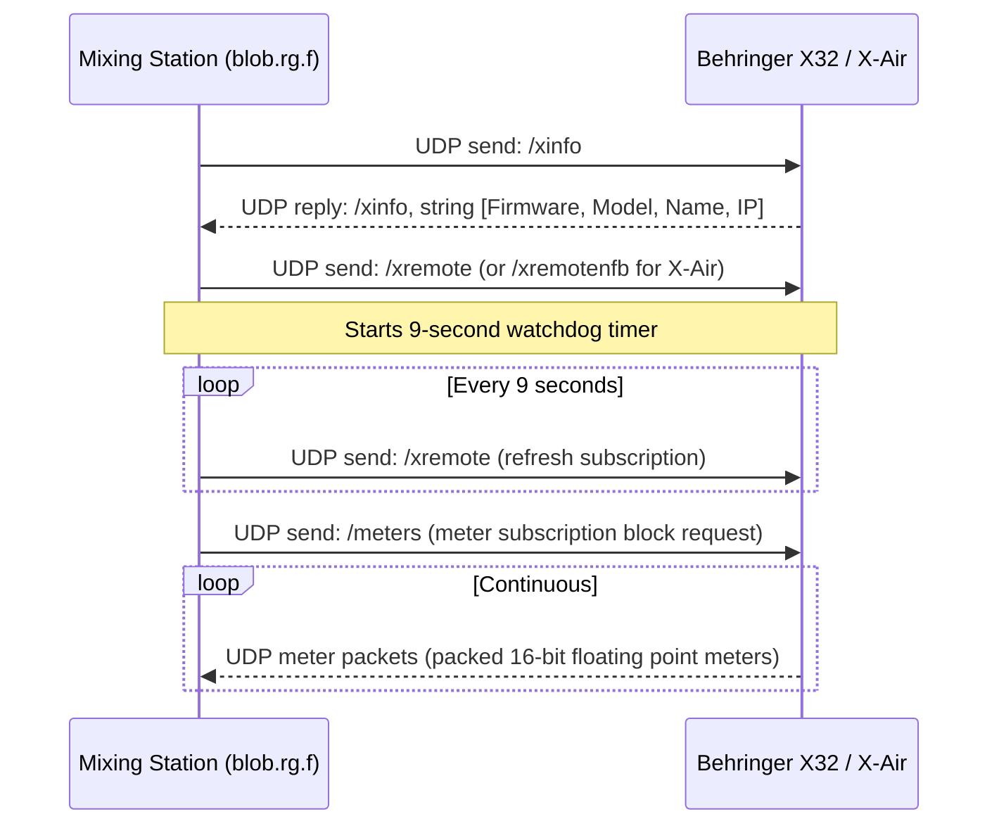

# REA Phase 3 — Mixer Communication Analysis
**Target:** Mixing Station PC Windows 3.2.2 Build 789  
**Analysis Date:** 2026-11-09  
**Status:** VERIFIED  

---

## 1. Executive Summary

Mixing Station implements a modular protocol abstraction layer centered around `blob.abi.b`. Rather than emulating a single protocol, the codebase contains distinct, purpose-built protocol drivers for 14 major digital mixing console families, plus an external REST/WebSocket API and a remote cloud tunnel client ("Anywhere").

---

## 2. Protocol Matrix by Console Family

| Manufacturer | Hardware Line | Transport Layer | Protocol Dialect | Key Driver Class | Verified Protocol Strings / Commands | Confidence |
|---|---|---|---|---|---|---|
| **Behringer / Midas** | X32, M32, X32 Compact, Rack, Producer | UDP (10023) | OSC | `blob.rg.f` | `/xinfo`, `/xremote`, `/meters`, `/-stat/osc/on` | VERIFIED |
| **Behringer** | X-Air (XR12, XR16, XR18, X18) | UDP (10024) | OSC | `blob.qb.c` | `/xremotenfb` (no-feedback subscription) | VERIFIED |
| **Behringer** | WING, WING Compact, WING Rack | UDP (2223) | WING OSC / JSON | `blob.mz.h` | `/?`, `/Meters`, `/Meters/values`, `wing_ch_0005` | VERIFIED |
| **Allen & Heath** | Qu (Qu-16, Qu-24, Qu-32, Qu-Pac) | TCP / UDP | A&H Binary MIDI | `blob.jm.d` | `quConType`, `dSnakeEn`, `#chName/`, `preamp` | VERIFIED |
| **Allen & Heath** | SQ (SQ-5, SQ-6, SQ-7) | TCP (51325) | A&H MIDI Stream | `blob.lp.b` | `#chName/`, `#chCol/`, `Heartbeat timed out` | VERIFIED |
| **Allen & Heath** | dLive & Avantis | TCP | dLive TCP/IP | `blob.hy.d` | `Channel configuration changed`, `Mixer configuration changed` | VERIFIED |
| **Soundcraft** | Ui (Ui12, Ui16, Ui24R) | HTTP (80/443) + WebSocket | JSON / Text WS | `blob.ue.h`, `blob.vq.j` | `VU`, `VU2`, `RTA`, `data` | VERIFIED |
| **Soundcraft** | Vi (Vi1 - Vi7000) | TCP | HiQnet / Harman | `blob.sv.d`, `blob.ut.a` | `Soundcraft Vi1000`, `Connection lost (closed)` | VERIFIED |
| **Yamaha** | TF (TF1, TF3, TF5, TF-RACK) | UDP (Multicast) + TCP | SCP (Simple Control Protocol) | `blob.ws.a`, `blob.yf.b` | Multicast `239.192.0.164:53450`, `_ypax-tf`, `scpmode encoding utf8` | VERIFIED |
| **Yamaha** | DM3 & DM7 (DM3, DM3S, DM7, DM7C) | UDP (Multicast) + TCP | SCP / Meter Unicast | `blob.ws.a`, `blob.wx.c` | `_ypax-dm`, `RequestMeter metertype:unicast operation:start target:all interval:50` | VERIFIED |
| **Yamaha** | CL / QL (CL1/3/5, QL1/5) | TCP | SCP Binary Command Map | `blob.wd.d`, `blob.wd.f` | `presets/yamaha/cl-map.bin`, `CHMOVE__`, `CHPASTE_`, `SCENE___` | VERIFIED |
| **PreSonus** | StudioLive Series III | UDP + TCP | UCNET | `blob.se.i` | `FD`, `JM`, `MB`, `MS`, `PC`, `PS`, `PV`, `DeletedPreset` | VERIFIED |
| **Mackie** | DL Series (DL1608, DL32R) | TCP | Master Fader TCP | `blob.mq.f` | `/monitor-aux/`, `/ready` | VERIFIED |
| **Midas** | Heritage D / HD96 | TCP | Midas HD TCP | `blob.oh.a`, `blob.oi.h` | `midas-hd`, `PopGrp`, `POP`, `Could not request meters: ` | VERIFIED |
| **Mixing Station** | Anywhere Remote Mix | TCP / TLS | OAuth2 + Secure WebSocket | `blob.aoe.a`, `blob.apq.d` | `/app/mixers/connect`, `/oauth2/token`, `wsUrl`, `code_verifier` | VERIFIED |
| **Mixing Station** | External API Server | HTTP / WS / UDP | REST / JSON / OSC | `blob.apw.g`, `blob.acq.h` | `/console/metering/`, `/console/metering2/`, `apiOscPort` | VERIFIED |

---

## 3. Deep-Dive: Behringer / Midas X32 & X-Air Protocol Engine

### 3.1 Handshake & Subscription Sequence


### 3.2 Evidence Extraction
- **Discovery Packet:** `/xinfo` extracted from `blob/rg/e$a.class`.
- **Subscription Packet:** `/xremote` extracted from `blob/rg/f.class`.
- **X-Air Variant:** `/xremotenfb` extracted from `blob/qb/c.class` (subclass of `blob/rg/f`). In X-Air consoles, `/xremotenfb` requests parameter changes without echoing back changes originating from the sending client, preventing infinite feedback loops.
- **Metering Packet:** `/meters` extracted from `blob/rg/f.class`.

---

## 4. Deep-Dive: Yamaha SCP Protocol Engine (TF, DM3, DM7)

### 4.1 Discovery & Handshake
1. **Multicast Discovery:**
   - Multicast IP: `239.192.0.164` (extracted from `blob/ws/a.class`).
   - Service identity: `_ypax-tf` for Yamaha TF, `_ypax-dm` for DM3/DM7.
2. **SCP Connection Initialization:**
   ```text
   scpmode encoding utf8
   scpmode keepalive 10000
   scpmode valuetype raw
   devinfo productname
   devinfo version
   devinfo paramsetver
   ```
3. **Meter Subscription:**
   Extracted from `blob/wx/c.class`:
   ```text
   RequestMeter metertype:unicast operation:start target:all interval:50 duration:10000
   ```
   Tells the console to stream all peak/VU meters directly to the client's unicast IP at 50 ms intervals (20 frames/sec) with a 10-second renewal duration.

---

## 5. Deep-Dive: Soundcraft Ui Series (Ui12, Ui16, Ui24R)

### 5.1 Transport Architecture
- Unlike UDP-based consoles, Soundcraft Ui mixers run an onboard Node.js/Linux web server.
- **Initialization:** HTTP GET queries mixer state; retrieves complete channel, bus, and FX settings.
- **WebSocket Streaming:** Upgrades to WebSocket for bidirectional real-time state:
  - Text frames convey fader movements, mutes, pans, and PEQ band adjustments.
  - Binary frames tagged `VU`, `VU2`, and `RTA` deliver compressed audio meter arrays.
- **Evidence:** `blob/ud/a.class` (`ui12`), `blob/ud/b.class` (`ui16`), `blob/ud/c.class` (`ui24`), `blob/ue/h.class` (`RTA`, `VU2`), `blob/vq/j.class` (`VU`, `data`).

---

## 6. Deep-Dive: Anywhere Remote Cloud Tunnel (`blob.aoe.a`)

Mixing Station provides cloud-relayed remote mixer control:
1. **Authentication:** PKCE OAuth 2.0 flow:
   - Endpoint: `/oauth2/auth` and `/oauth2/token`
   - Parameters: `client_id`, `code_challenge`, `code_challenge_method=S256`, `code_verifier`, `redirect_uri=oauth2redirect`.
2. **Tunnel Negotiation:**
   - POST to `/app/mixers/connect`
   - Receives secure WebSocket URL (`wsUrl`) and session token (`aid`).
3. **Proxy Client:**
   - Connects to relay daemon.
   - Handles tunnel heartbeats (`Heartbeat from agent lost`).
   - Demultiplexes mixer packets across the WebSocket tunnel.
