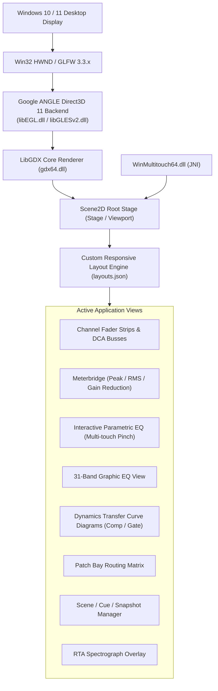

# REA Phase 3 — UI Component Map & Presentation Architecture
**Target:** Mixing Station PC Windows 3.2.2 Build 789  
**Analysis Date:** 2026-11-09  
**Status:** VERIFIED  

---

## 1. UI Architecture & Presentation Pipeline

Mixing Station uses a custom, GPU-accelerated immediate/retained hybrid rendering pipeline built on **LibGDX Scene2D** with **Google ANGLE** (OpenGL ES to Direct3D 11) and **LWJGL 3**:

---

## 2. Core UI Component Breakdown

### 2.1 Channel Fader Strips & Mixing Surface
- **Underlying Classes:** `blob.acq.d`, `blob.afy.k`, `blob.afx.c`, `blob.aga.b`
- **Component Capabilities:**
  - High-precision vertical faders with logarithmic/dB scaling curve.
  - Fine fader mode (`Fine Fader Ratio`, `chsFineRatio.help`, `chsSliderRatio.help`).
  - Integrated channel strip mini-meters (`faderMetering`, `chsFaderMeterPos.help`).
  - Channel color strips (`#chCol/`), customizable icons, scribble strip naming (`#chName/`).
  - Mute, Solo/PFL, Stereo Link, Phantom Power (+48V), Polarity ($\varnothing$), and Phase buttons.
  - Sends-on-Fader (SoF) toggle mode (`SoFConfig` in `blob/abc/g.class`).

### 2.2 Meterbridge View
- **Underlying Classes:** `blob.acq.f`, `blob.afw.d`, `blob.afz.c`, `blob.abv.b`
- **Layout:**
  - Dedicated multi-channel meter overview (`Meter Count`, `Meter style`, `Meterbridge`, `Meterbridge Faders`).
  - Dual-ballistics Peak and RMS level bars.
  - Integrated Gain Reduction meters: Gate GR (`showGRGateMeter`) and Compressor Dyn GR (`showGRDynMeter`).
  - Clip warning indicators with latching peak hold.

### 2.3 Interactive Parametric EQ (PEQ) View
- **Underlying Classes:** `blob.aau.c`, `blob.acq.e`, `blob.acq.g`, `blob.acs.a$f`
- **Interactive Gestures:**
  - 2D node drag: $X$-axis controls frequency (20 Hz – 20 kHz), $Y$-axis controls gain (-15 dB to +15 dB).
  - Multi-touch pinch-to-Q: Dynamically widens or narrows filter bandwidth (`peqPinchSens`, `peqPinchRatios`).
  - Filter type selector popup: Bell, Low Shelf, High Shelf, Low Pass, High Pass, Notch.
  - Floating numeric information overlay (`PEQ info box`, `peqInfoBox.help`, `showPeqInfoDialog`).

### 2.4 Graphic EQ (GEQ) View
- **Underlying Classes:** `blob.acs.a$a`, `blob.adg.b$a`
- **Layout:**
  - 31 precision vertical faders centered on standard ISO 1/3-octave frequencies.
  - Quick-draw fader gestures allowing continuous sweeps across multiple bands.
  - Flat/Bypass toggle.

### 2.5 Dynamics Transfer Curve View
- **Underlying Classes:** `blob.afx.c`, `blob.afz.c`, `blob.da.a`, `blob.ec.f`
- **Diagrams:**
  - **Compressor Diagram:** Visualizes 45-degree unity line, compression knee (`softKnee`, `cKnee`), compression slope ($1:R$), and real-time bouncing ball ballistics.
  - **Gate Diagram:** Visualizes gate floor, threshold, hysteresis band, and real-time open/closed gating state (`gateDiag`, `gateThr`).

### 2.6 Routing Matrix (Patch Bay) View
- **Underlying Classes:** `blob.ael.b`, `blob.ajf.a`, `blob.akj.f`, `blob.akj.g`
- **Layout:**
  - 2D grid matrix mapping logical channels to physical inputs/outputs (Local XLR, Stagebox AES50, Dante, USB, Aux).
  - Batch routing wizard: Allows bulk 8-channel or 16-channel block patching with safety confirmation prompts (`Confirm batch routing`, `Confirm routing`).

### 2.7 Scene / Cue / Snapshot Manager View
- **Underlying Classes:** `blob.ade.a`, `blob.adl.b`, `blob.ajs.b`, `blob.akf.b`
- **Layout:**
  - Cue list timeline view with recall, store, rename, copy, delete, and overwrite protections (`A scene with this name does already exists. Overwrite?`).
  - Scope/Safe filters: Visual checkboxes to isolate parameters (e.g. keep preamp gains or routing safe during scene recall).
  - Offline scene browser: Loads and edits show files directly on the PC without a connected mixer (`Offline Scenes`).

### 2.8 Real-Time Analyzer (RTA) & Spectrograph Overlay
- **Underlying Classes:** `blob.afe.d`, `blob.afe.f`, `blob.afw.d`
- **Rendering:**
  - Semi-transparent 1/3-octave bar chart or continuous FFT curve overlaid directly on the PEQ/GEQ canvas.
  - Peak hold indicators, decay speed controls, custom color customization (`peak-color`, `background-color`).

### 2.9 Custom Layout & UI Designer
- **Underlying Classes:** `blob.aga.b`, `blob.acq.l`
- **Persistence:** Saved in JSON format (`layouts.json`).
- **Features:**
  - Completely custom user layouts: allows users to build personalized fader banks, custom action buttons, floating metering windows, and DCA spill groups.
  - Cross-platform scaling: scales responsively between 7-inch tablets, laptops, and 4K desktop touchscreens via `org.devcore.mixingstation.gdx.desktop.g`.
