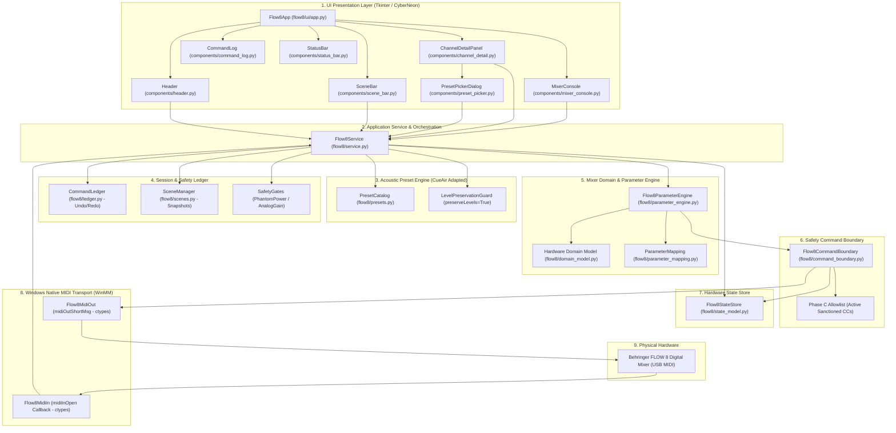

# Upgraded FLOW 8 Application Architecture

**Target Hardware:** Behringer FLOW 8 Digital Audio Mixer  
**Reference Application:** CueAir (cc.cuetone.cueair)  
**Host Environment:** Windows 11 (x64), Python 3.14.8, WinMM MIDI Subsystem  
**Status:** IMPLEMENTED & TESTED (315 Tests Green)

---

## 1. System Architecture Overview

The upgraded FLOW 8 mixer control workstation uses a strictly decoupled, 9-tier event-driven architecture combining native low-latency Windows MIDI dispatch with CueAir-adapted acoustic processing and safety gates:

---

## 2. Invariant Safety Guarantees

1. **Decoupled UI:** UI components never assemble or transmit raw MIDI bytes directly. All interactions flow through `Flow8Service` $\to$ `Flow8ParameterEngine` $\to$ `Flow8CommandBoundary`.
2. **Level Preservation:** Ported from CueAir's `preserveLevels: true` architecture. Invoking any of the 12 curated audio presets sculpts parametric EQ, low cut, and compressor dynamics while leaving faders, balance, and analog preamp gain untouched.
3. **Hardware State Integrity:** Start-up defaults are classified as unconfirmed app assumptions. Only verified software commands (`commanded_raw_midi`) or incoming physical observations (`observed_raw_midi`) can be captured into scenes or used as undo targets.
4. **Relay Isolation:** +48V phantom power is excluded from the undo ledger and scenes to prevent automated scripts from energizing high-voltage rails without user intent.
