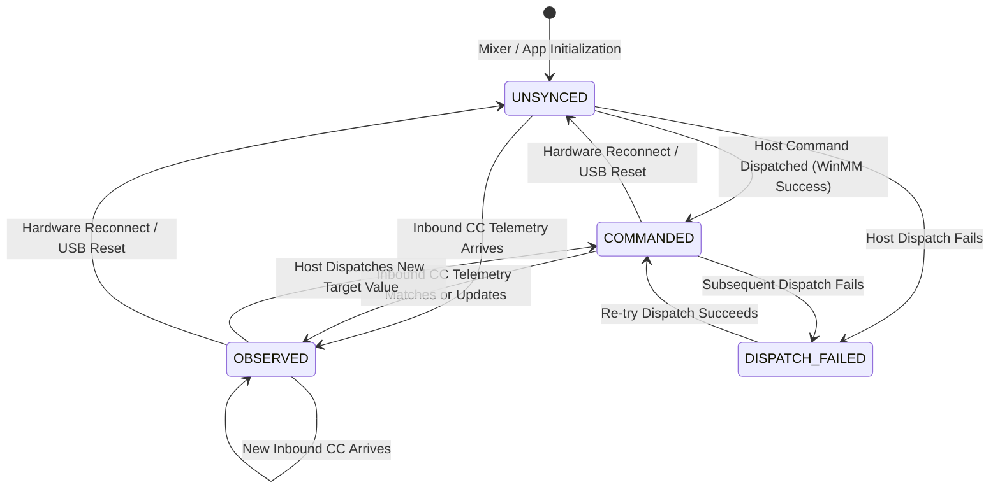

# Architecture: Bidirectional State Model & Parameter Provenance

**Document ID:** `BIDIRECTIONAL_STATE_MODEL`  
**Mixer Target:** Behringer FLOW 8 Digital Audio Mixer (Firmware 11739+)  
**Subsystem:** State Store, Command Boundary, and USB MIDI Transport  
**Date:** 2026-11-18  
**Status:** IMPLEMENTED & VERIFIED  

---

## 1. Overview & Core Philosophy

A digital mixer control workstation must never confuse an application's internal assumption with physical hardware truth. 

On the Behringer FLOW 8, communication over USB MIDI 1.0 is **asymmetric**:
- Outbound commands (Host $\rightarrow$ FLOW 8) can alter faders, mutes, pan, 4-band EQ, low cut, compressor, sends, and FX programs.
- Inbound telemetry (FLOW 8 $\rightarrow$ Host) is **strictly conditioned** on the mixer console's menu configuration (`SETUP -> MIDI -> USB TX: ON`) and is **limited to fader, mute, and pan CCs**.
- The hardware firmware **does not** emit MIDI CC messages when the user adjusts rotary encoders for EQ, Preamp Gain, Low Cut, or Compressor.
- The hardware firmware **does not** support SysEx memory query requests (no bulk dump).

To prevent deceptive UI claims and dangerous undo/redo guesses, the application implements a strict **5-Tier Parameter Provenance Model**.

---

## 2. The 5-Tier Parameter Provenance Hierarchy

Every parameter tracked in `Flow8StateStore` carries an immutable provenance grade:

```
┌─────────────────────────────────────────────────────────────────┐
│                    PARAMETER PROVENANCE                         │
├───────────────────┬─────────────────────────────────────────────┤
│ 1. UNSYNCED       │ Unconfirmed startup default baseline.        │
│                   │ Software has not commanded the value;       │
│                   │ hardware has not transmitted telemetry.     │
│                   │ STRICTLY NON-UNDOABLE.                      │
├───────────────────┼─────────────────────────────────────────────┤
│ 2. COMMANDED      │ Dispatched by software and accepted by host │
│                   │ WinMM driver queue. Maintained in software. │
│                   │ Distinct from physical hardware state.      │
├───────────────────┼─────────────────────────────────────────────┤
│ 3. OBSERVED       │ Verified hardware telemetry packet received │
│                   │ via FLOW 8 MIDI IN (0xBn cc val).           │
│                   │ Verified physical control position.         │
├───────────────────┼─────────────────────────────────────────────┤
│ 4. DISPATCH_FAILED│ Boundary validation failure or WinMM driver │
│                   │ timeout / failure during transmission.      │
├───────────────────┼─────────────────────────────────────────────┤
│ 5. UNSUPPORTED    │ Parameter address or feature not supported  │
│                   │ by FLOW 8 MIDI implementation (e.g. Ch 5-7  │
│                   │ compressor, Ch 3-8 phantom power).          │
└───────────────────┴─────────────────────────────────────────────┘
```

---

## 3. Provenance State Transition Rules



### Invariants:
1. **Never Promote Assumptions:** An `UNSYNCED` parameter cannot transition to `OBSERVED` without an inbound MIDI packet on `FLOW 8 MIDI IN`.
2. **Never Mask Telemetry Absence:** When controlling write-only parameters (e.g., EQ CC 1-4, Low Cut CC 9, Comp CC 11), the parameter's provenance is `COMMANDED`. The `observed_value` remains `None`. The UI must explicitly present this as application-maintained.
3. **Reconnection Invalidation:** When the USB cable is disconnected or reconnected, all `COMMANDED` and `OBSERVED` parameters reset to `UNSYNCED`. Stale redo records are purged from `CommandLedger`.

---

## 4. Parameter Address & Provenance Matrix

| Parameter Identity | Control Type | Hardware Inbound Telemetry | Provenance When Commanded | Provenance When Idle at Boot |
|---|---|---|---|---|
| `ch(1..7).fader` | Fader | Supported (if USB TX: ON) | `COMMANDED` / `OBSERVED` | `UNSYNCED` |
| `main.fader` | Master Fader | Supported (if USB TX: ON) | `COMMANDED` / `OBSERVED` | `UNSYNCED` |
| `ch(1..7).mute` | Mute | Supported (if USB TX: ON) | `COMMANDED` / `OBSERVED` | `UNSYNCED` |
| `ch(1..7).pan` | Pan / Balance | Supported (if USB TX: ON) | `COMMANDED` / `OBSERVED` | `UNSYNCED` |
| `ch(1..7).eq_(low/mid/hi)` | 4-Band PEQ | **None** (Write-Only) | `COMMANDED` | `UNSYNCED` |
| `ch(1..4).gain` | Analog Gain | **None** (Write-Only) | `COMMANDED` | `UNSYNCED` |
| `ch(1..4).low_cut` | HPF Filter | **None** (Write-Only) | `COMMANDED` | `UNSYNCED` |
| `ch(1..4).compressor` | Dynamics | **None** (Write-Only) | `COMMANDED` | `UNSYNCED` |
| `ch(5..7).compressor` | Dynamics | **Unsupported** | `UNSUPPORTED` | `UNSUPPORTED` |
| `ch(1..2).phantom` | Relay (+48V) | **None** (Write-Only) | `COMMANDED` | `UNSYNCED` |
| `ch(3..8).phantom` | Relay (+48V) | **Unsupported** | `UNSUPPORTED` | `UNSUPPORTED` |
| `ch(1..7).send_(mon/fx)` | Aux Sends | **None** (Write-Only) | `COMMANDED` | `UNSYNCED` |
| `fx(1..2).slot` | Prog Change | **None** (Write-Only) | `COMMANDED` | `UNSYNCED` |
