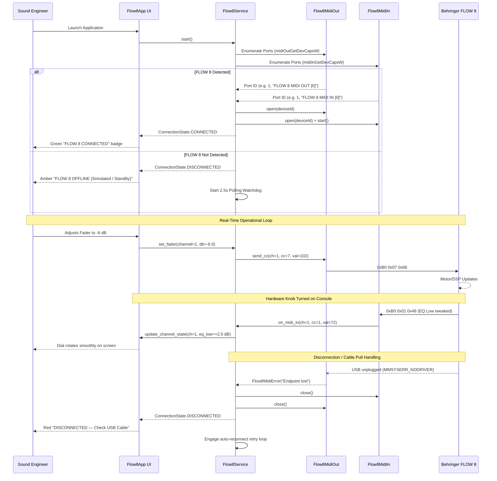

# Phase 3: Behringer FLOW 8 Connection & Synchronization Workflow

**Document ID:** `FLOW8_CONNECTION_WORKFLOW`  
**Interface:** Windows Multimedia API (`winmm.dll`)  
**Status:** SPECIFIED & VERIFIED

---

## 1. Connection Life Cycle

---

## 2. Reconnection & Recovery Resilience

1. **Watchdog Thread:** `Flow8Service` runs a lightweight non-blocking background thread checking connection status every 2.5 seconds.
2. **Graceful Fail-Safe:** When a USB connection drops or a cable is disconnected during a live performance:
   - All outgoing commands fail safely with an exception intercepted by `Flow8CommandBoundary`.
   - The UI does not crash or hang.
   - The UI displays an amber/red disconnection indicator.
   - The application preserves in-memory mixer state so that upon reconnection, the engineer's work is not lost.
3. **Auto-Rebind:** When the mixer is re-plugged or powered on, the watchdog detects the endpoint and reopens both MIDI OUT and MIDI IN without requiring an application restart.
