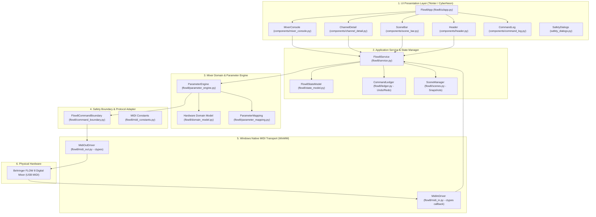

# Phase 0: Existing FLOW 8 Architecture

**Document ID:** `01_EXISTING_FLOW8_ARCHITECTURE`  
**Repository:** `flow888`  
**Architecture Style:** Layered, Event-Driven, Command-Boundary Protected Mixer Controller  
**Status:** AUDITED & VERIFIED

---

## 1. Architectural Layers

The existing application exhibits a clear 9-layer decoupled architecture:

---

## 2. Component Responsibilities & Mechanisms

### 2.1 Transport Layer (`flow8/midi_out.py`, `flow8/midi_in.py`)
- **Direct WinMM Bindings:** Uses Python `ctypes.windll.winmm` to interface directly with Windows Multimedia API (`winmm.dll`).
- **Low Latency:** Bypasses third-party MIDI bridges (like pygame or mido) for deterministic sub-millisecond execution.
- **Port Enumeration:** `midiOutGetNumDevs()`, `midiOutGetDevCapsW()` to identify "FLOW 8" or "Behringer FLOW 8".
- **Hardware Thread-Safety:** Uses a thread lock around `midiOutShortMsg()` to prevent re-entrant byte interleaving.
- **Incoming Callbacks:** Uses WinMM `midiInOpen` with `CALLBACK_FUNCTION` and translates `MIM_DATA` messages safely across Windows callback boundaries via Python thread-safe queues.

### 2.2 Boundary & Safety (`flow8/command_boundary.py`)
- Protects the physical audio mixer from corrupted or out-of-range MIDI parameters.
- Validates channel indices (1..7 for strips, 8 for Main bus, 9..10 for Mon 1-2, 11..12 for FX 1-2).
- Clamps parameter ranges strictly to `0..127`.
- Isolates exceptions so that a communication error does not crash the UI main loop.
- Emits structured command execution records for the `CommandLog` and `CommandLedger`.

### 2.3 Parameter Engine & Mapping (`flow8/parameter_engine.py`, `flow8/parameter_mapping.py`)
- Maps human audio units (dB, Hz, ratio) to 7-bit MIDI CC values.
- Implements nonlinear taper for faders (logarithmic-like curve for natural human perception of volume).
- Encapsulates channel-specific capabilities:
  - Channels 1–2: Mic preamps with +48V phantom power, 4-band EQ, 1-knob compressor, low cut filter.
  - Channels 3–4: Mic/Line preamps, 4-band EQ, 1-knob compressor, low cut filter, Hi-Z (Ch 4).
  - Channels 5/6 & 7/8: Stereo line pairs, balance control, 4-band EQ.
  - Return / USB: Playback return channel.

### 2.4 State Model, Ledger & Scenes (`flow8/state_model.py`, `flow8/ledger.py`, `flow8/scenes.py`)
- **State Model:** Thread-safe observable dictionary representing the authoritative mixer mirror.
- **Ledger:** Action history with inverse actions enabling bi-directional Undo/Redo across all fader movements, mutes, EQ adjustments, and pan positions.
- **Scenes:** Snapshot engine capturing full mixer state, serializing to JSON, supporting seamless transitions and safety checks before recall.

### 2.5 UI Subsystem (`flow8/ui/`)
- Pure Tkinter interface without heavyweight external GUI frameworks.
- Vector graphics drawn on Tkinter Canvas elements (smooth dials, level meters, parametric EQ curves).
- CyberNeon theme: high-contrast dark aesthetic (#0F111A background, cyan/magenta accents) engineered for live performance and stage lighting environments.

---

## 3. Current Hardware Topology Mapping

| Channel ID | Label | Connectors | Preamp Gain | +48V | Hi-Z | Low Cut | EQ | Compressor | MIDI Ch | Status Byte |
|---|---|---|---|---|---|---|---|---|---|---|
| **Ch 1** | Mic 1 | XLR-F | Yes (CC 8) | Yes (CC 12) | No | Yes (CC 9) | 4-Band | Yes (CC 11) | Ch 1 | `0xB0` |
| **Ch 2** | Mic 2 | XLR-F | Yes (CC 8) | Yes (CC 12) | No | Yes (CC 9) | 4-Band | Yes (CC 11) | Ch 2 | `0xB1` |
| **Ch 3** | Mic 3 / Line | Combo XLR/TRS | Yes (CC 8) | No | No | Yes (CC 9) | 4-Band | Yes (CC 11) | Ch 3 | `0xB2` |
| **Ch 4** | Mic 4 / Inst | Combo XLR/TRS | Yes (CC 8) | No | Yes | Yes (CC 9) | 4-Band | Yes (CC 11) | Ch 4 | `0xB3` |
| **Ch 5/6**| Stereo 5/6 | Dual 1/4" TRS | No | No | No | No | 4-Band | No | Ch 5 | `0xB4` |
| **Ch 7/8**| Stereo 7/8 | Dual 1/4" TRS | No | No | No | No | 4-Band | No | Ch 6 | `0xB5` |
| **Ch 7** | USB/BT | Digital Stream | No | No | No | No | 4-Band | No | Ch 7 | `0xB6` |
| **Bus 8** | Main L/R | XLR-M / TRS | N/A | N/A | N/A | N/A | 9-Band GEQ | Limiter | Ch 8 | `0xB7` |
| **Bus 9** | Mon 1 | 1/4" TRS | N/A | N/A | N/A | N/A | 9-Band GEQ | Limiter | Ch 9 | `0xB8` |
| **Bus 10**| Mon 2 | 1/4" TRS | N/A | N/A | N/A | N/A | 9-Band GEQ | Limiter | Ch 10 | `0xB9` |
| **Bus 11**| FX 1 Send| Internal DSP | N/A | N/A | N/A | N/A | N/A | N/A | Ch 11 | `0xBA` |
| **Bus 12**| FX 2 Send| Internal DSP | N/A | N/A | N/A | N/A | N/A | N/A | Ch 12 | `0xBB` |
