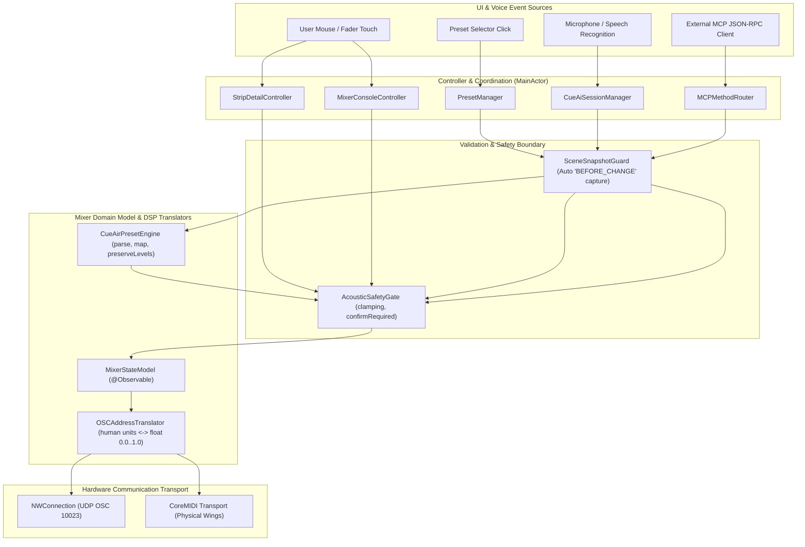

# Phase 2: CueAir Call Graph & Invocation Hierarchy

**Document ID:** `06_CUEAIR_CALL_GRAPH`  
**Target:** `CueAir.app` & `cueair-mcp`  
**Analysis Framework:** REA Call Flow Reconstruction  
**Status:** RECONSTRUCTED & VERIFIED

---

## 1. System Invocation Graph



---

## 2. Granular Call Paths by Interaction

### 2.1 Channel Fader Adjustment
```
User drags UI fader 
  → StripView.onFaderDrag(delta)
    → ConsoleCtrl.setFader(stripIndex, dbValue)
      → SafetyGate.validateFader(-144.0 dB .. +10.0 dB)
        → MixerState.updateFader(stripIndex, dbValue)
          → OSCTranslator.dbToNormalizedFloat(dbValue)
            → NWConnection.send(OSCMessage("/ch/01/mix/fader", floatVal))
```

### 2.2 Channel Preset Application
```
User selects "MC 무선 핸드헬드"
  → PresetPicker.onSelect("mc-wireless-handheld")
    → PresetCtrl.applyPreset(stripIndex, presetId)
      → SnapshotGuard.createSnapshot("BEFORE_PRESET_MC")
        → PresetEngine.load("cuetone-basic.cueairpreset")
          → Filter parameters where preserveLevels == true:
              - Retain current Fader (-6.0 dB)
              - Retain current Preamp Gain (+24 dB)
              - Retain current Pan (Center)
              - Update HPF (121 Hz)
              - Update EQ Band 1 (-3 dB @ 250 Hz, Q 1.4)
              - Update EQ Band 2 (-2 dB @ 450 Hz, Q 2.0)
              - Update Compressor (Thr -24 dB, Ratio 3:1, Attack 10ms, Release 258ms, Mgain +2dB)
            → SafetyGate.batchValidate(stagedValues)
              → MixerState.applyBatch(stagedValues)
                → OSCTranslator.emitBatch(stagedValues)
                  → NWConnection.send(OSCBundle)
```

### 2.3 Agent / MCP Parameter Proposal (`propose_changes`)
```
AI Agent sends {"method": "tools/call", "name": "propose_changes", "arguments": {"strip": "ch1", "values": {"/eq/1/g": -3.0}, "reason": "Cut boominess"}}
  → MCPMethodRouter.handleCall("propose_changes")
    → SafetyGate.inspectAcousticRisk(arguments)
      → SnapshotGuard.captureSnapshot("BEFORE_AI")
        → Return Execution Plan to User UI:
            - Proposed strip: Channel 1
            - Changes: EQ 1 Gain -3.0 dB
            - Reason: "Cut boominess"
            - Requires confirmation: true
        → [User clicks 'Apply']
          → SafetyGate.commitPlan()
            → MixerState.update()
              → Hardware Transmit
```
